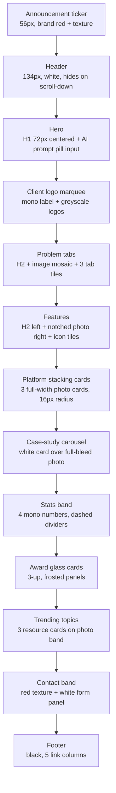
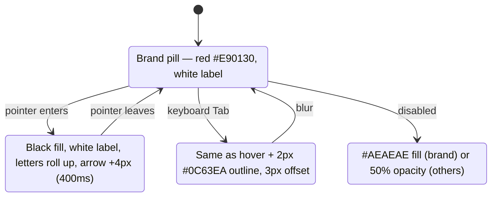

# Publicis Sapient (publicissapient.com) — Design System Reference

> **What this is.** A reference description of the live website's design system, extracted from the real site so a designer or an AI coding agent can understand and reproduce its look and feel.
>
> **Structure note.** SDSGT's own `design.md` content contract is still *deferred* (see `pipeline-plan.md` → "Deferred" and `contracts-and-seeds.md` → "`design.md` (flagged, deferred)"). This file therefore uses its own sensible structure. It is a one-off demo reference for a real third-party website, not a generated per-project `design.md`.
>
> **How values were captured.** Values come from the browser's computed styles (`getComputedStyle`) on real page elements. They are cross-checked against the site's one stylesheet (`/etc.clientlibs/ps-redesign/clientlibs/clientlib-site.css?v=20260928-2226-17bd`, a Tailwind CSS v4 build with a custom theme), its CSS custom properties, and screenshots at 1440px (desktop) and 390px (mobile) widths. Anything not measured directly is labelled **(inferred)**.

---

## 1. Overview

| | |
|---|---|
| Site | Publicis Sapient — "We Build AI Solutions for the Enterprise" |
| URL | https://www.publicissapient.com/ |
| Date captured | 2026-10-07 |
| Pages inspected | Home `/`, Blog listing `/resources/blog`, Article `/resources/blog/sovereign-ai-enterprise-control`, Industry `/industries/financial-services`, Contact `/contact`, Careers `https://careers.publicissapient.com/` (separate subdomain, same stylesheet bundle) |
| Built with | Adobe Experience Manager (AEM) pages + Tailwind CSS v4 utility classes + a custom theme (`--color-ps-*`, `display-*`, `ps-text-*`, `eyebrow-*` type classes, an `animated-btn` button system) |
| Fonts | Lexend Deca (headings), Roboto (body and UI), Roboto Mono (labels, numbers, quotes) — all from Google Fonts |

**Overall character, in plain terms**

- **Tone:** confident, calm and corporate-tech. The page is mostly white, black type does the work, and a single saturated **brand red (#E90130)** is used sparingly for the most important actions, the logo, the announcement bar and some full-width "moments".
- **Density:** airy. Sections are separated by large fixed gaps (128px on desktop), centered intros are kept to about 8 of 12 columns, and cards have generous padding (32–48px).
- **Type personality:** big, *light-weight* geometric headings (Lexend Deca 300 at 50px) paired with a neutral Roboto body. A monospaced face (Roboto Mono) gives a "technical/data" accent to eyebrows, dates, big statistics and quotes.
- **Shape:** soft and friendly. Every button and many controls are full pills. Cards, images and panels use a consistent 16px corner.
- **Imagery:** high-quality photography in two families. (1) Abstract architecture/industrial close-ups with strong red objects against teal/aqua skies or grey. (2) People collaborating in front of screens. Product UI screenshots float in rounded frames on top of photo backgrounds. Several full-width bands use red "light-streak" textured backgrounds.
- **Themes:** light mode only. There are no `prefers-color-scheme` rules. Inverted (dark) areas are limited to the **black footer**, the **red announcement bar / red form band**, and **white text over photography** (platform cards and award cards).

---

## 2. Color

### 2.1 Primitive palette (every distinct color observed)

**Brand and accent**

| Token (proposed) | Hex | RGB | Source / where used |
|---|---|---|---|
| `red.600` (brand) | `#E90130` | 233, 1, 48 | CSS var `--color-ps-red`. Brand CTA buttons, FAB, announcement bar, logo "sapient", active nav underline, active anchor-nav pill, article TOC marker, AI sparkle icon |
| `red.700` | `#BE0128` | 190, 1, 40 | Hover of *destructive* buttons only (in CSS) |
| `red.600 / 5%` | `#E901300D` | — | `bg-ps-red/5` utility (in CSS; not seen on inspected pages) |
| `red.600 / 10%` | `#E901301A` | — | `bg-ps-error/10` error-tint background (in CSS) |
| `purple.brand` | `#53389E` | 83, 56, 158 | Start color of a `gradient-brand` (purple → red, "to top right") utility. In CSS only; not seen on inspected pages |
| `blue.focus` | `#0C63EA` | 12, 99, 234 | CSS var `--color-ps-focus`. All keyboard focus rings and input focus outlines |

**Neutrals** (the site's own `--color-gray-neutral-*` scale, pure grays)

| Token | Hex | Where used |
|---|---|---|
| `neutral.0` | `#FFFFFF` | Page background, cards, inputs, text on dark/red |
| `neutral.25` | `#FDFDFD` | Defined, not observed |
| `neutral.50` | `#FAFAFA` | Defined, not observed |
| `neutral.100` | `#F5F5F5` | Anchor-nav track, accordion items, light section background (resources band base) |
| *(off-scale)* | `#F6F6F6` | Feature cards on industry pages (hard-coded `bg-[#F6F6F6]`) |
| `neutral.200` | `#EEEEEE` | Feature icon tiles, hero "send" button, subtle 1px borders |
| *(off-scale)* | `#EDEDED` | 1px border of device-frame cards (hard-coded) |
| `neutral.300` | `#DDDDDD` | 4px top rail of the "problem" tabs |
| `neutral.350` | `#AEAEAE` | Disabled brand button background |
| `neutral.400` | `#949494` | Default input outline/border, case-study dividers, dashed stat dividers |
| `neutral.600` | `#666666` | Tertiary text: eyebrows, legal copy, "required" note, inactive tabs, dates |
| `neutral.700` | `#444444` | Secondary text: almost all body paragraphs, form labels |
| `neutral.900` | `#000000` | Primary text, headings, footer background, secondary-button outline |

**Tailwind "cool gray" values used in a few spots** (Tailwind v4 defaults; converted from OKLCH)

| Hex | Tailwind name | Where used |
|---|---|---|
| `#101828` | gray-900 | Main navigation item text, search icon, select/textarea text |
| `#030712` | gray-950 | Navigation item hover/active text |
| `#99A1AF` | gray-400 | Divider inside resource cards |
| `#6A7282` | gray-500 | Placeholder text in contact-form inputs |
| `#4A5565` / `#364153` | gray-600 / gray-700 | Tertiary button text, default / hover (in CSS) |
| `#F3F4F6` | gray-100 | Tertiary button hover background (in CSS) |

The theme also defines Tailwind's default `blue`, `green`, `orange`, `purple`, `sky`, `yellow` and `red` ramps (50–800). They were **not observed** on inspected pages. They are probably used for status badges or the AI chat UI.

**Translucent overlays**

| Value | Where used |
|---|---|
| `rgba(255,255,255,0.30)` (white/30) | Glass panels on award cards: fill and 1px border |
| `rgba(255,255,255,0.85)` (white/85) | Page overlay behind the open mega menu |
| `rgba(0,0,0,0.40)` (black/40) | One dark overlay on the homepage (image scrim) |
| White-to-transparent gradients (`270deg` / `90deg`, 0 → 25/60/75/85% → 100% white) | Fade masks at the ends of the logo marquee |

### 2.2 Semantic roles (mapped to SDSGT's semantic token names)

| SDSGT semantic token | Value | Where it's used on the site |
|---|---|---|
| `background.primary` | `#FFFFFF` | Page background (the site uses pure white, not an off-white) |
| `background.secondary` | `#F5F5F5` | Anchor-nav track, accordion items, light bands |
| `background.surface` | `#FFFFFF` | Cards, mega menu, form panel, inputs |
| `background.inverse` | `#000000` | Footer |
| `background.brand` *(site-specific extra)* | `#E90130` | Announcement bar, contact band (with photo texture), FAB |
| `text.primary` | `#000000` | Headings, card titles, link CTAs, nav (`#101828` in the header) |
| `text.secondary` | `#444444` | Body copy, intros, labels, stat labels |
| `text.tertiary` *(site-specific extra)* | `#666666` | Eyebrows, dates, legal text, inactive tabs |
| `text.disabled` | not observed. Proposed: `#AEAEAE` (the disabled-button fill) | — |
| `text.on-primary` | `#FFFFFF` | Text on red buttons and the red bar |
| `text.inverse` | `#FFFFFF` | Footer, text over photos |
| `action.primary` | `#E90130` | Brand CTA ("Let's Connect", "Submit", "Connect with us") |
| `action.primary-hover` | `#000000` | **Red buttons turn black on hover/focus.** They do not get darker red. |
| `action.primary-disabled` | `#AEAEAE` | Disabled brand button background |
| `action.secondary` | `#FFFFFF` + 1px `#000000` inset ring | Outline pill ("Explore all three", "Learn more") |
| `action.secondary-hover` | `#000000` fill, white text | Secondary hover/focus |
| `action.neutral` *(site's "primary" variant)* | `#000000` | Black pill. Hover becomes white with a black ring |
| `border.default` | `#949494` | Inputs, selects, textarea, dividers |
| `border.subtle` | `#DDDDDD` (rails), `#EEEEEE` (hairlines) | Tab rail, light separators |
| `border.focus` | `#0C63EA` | Focus outline (2px). **Not the brand color.** |
| `border.on-primary` | `#FFFFFF` | Dividers on photo/red cards (1px white), white focus ring on dark |
| `status.error` | `#E90130` | `--color-ps-error`. **Same value as the brand red** (see Caveats) |
| `overlay.scrim` | `rgba(255,255,255,0.85)` | Light scrim behind the mega menu (the site uses a *white* scrim, not a dark one) |
| `link.text` | inherits (usually `#000`/`#444`/`#666`/white) | Links take the surrounding text color. The underline is the cue, not color |

### 2.3 Dark and inverted areas

| Area | Background | Text | Notes |
|---|---|---|---|
| Footer | `#000000` | `#FFFFFF` | Logo switches to white "publicis" + red "sapient" |
| Announcement ticker (top) | `#E90130` + red textured photo | `#FFFFFF` | 56px tall, rotating messages, prev/next/pause controls |
| Contact band (home, contact page) | Red textured photo (diagonal light streaks) | — | Holds a white 16px-radius form panel |
| Platform "stacking" cards | Full-bleed photo/gradient | `#FFFFFF` | Light 300-weight 42px titles in white |
| Award ("glass") cards | Photo with red floor | `#FFFFFF` | Text sits on a frosted white/30 panel with 12px blur |

### 2.4 Contrast ratios (WCAG 2.x, computed from measured hex values)

| Text / element | On | Ratio | Passes |
|---|---|---|---|
| `#000000` primary text | `#FFFFFF` | 21.0 : 1 | AAA |
| `#444444` body copy | `#FFFFFF` | 9.74 : 1 | AAA |
| `#666666` tertiary text | `#FFFFFF` | 5.74 : 1 | AA (normal text) |
| `#666666` tertiary text | `#F5F5F5` | 5.27 : 1 | AA |
| `#101828` nav text | `#FFFFFF` | 17.75 : 1 | AAA |
| `#6A7282` placeholder | `#FFFFFF` | 4.84 : 1 | AA |
| `#FFFFFF` on brand red button | `#E90130` | 4.65 : 1 | AA normal text (just above 4.5) |
| `#E90130` red text/icon | `#FFFFFF` | 4.65 : 1 | AA |
| `#E90130` red | `#F5F5F5` | 4.27 : 1 | AA large text / UI only |
| `#FFFFFF` footer text | `#000000` | 21.0 : 1 | AAA |
| `#949494` input outline | `#FFFFFF` | 3.03 : 1 | Meets 3:1 for UI components (barely) |
| `#0C63EA` focus ring | `#FFFFFF` | 5.27 : 1 | Meets 3:1 |
| `#FFFFFF` on disabled `#AEAEAE` | — | 2.22 : 1 | Below AA (acceptable for disabled) |
| White text on white/30 glass over photo | varies | not measurable | Depends on the photo underneath |

---

## 3. Typography

### 3.1 Families

| Role | Family | Loaded from | Fallback stack (as declared) | Weights loaded |
|---|---|---|---|---|
| Display / headings | **Lexend Deca** | Google Fonts (`fonts.googleapis.com/css2?family=Lexend+Deca:wght@100..900`, variable) | `"Lexend Deca", sans-serif` | 100–900 (uses 300, 400, 500, 600) |
| Body / UI | **Roboto** | Google Fonts (variable, normal + italic) | `"Roboto", sans-serif` | 100–900 (uses 400, 500, 600, 700) |
| Labels / numbers / quotes | **Roboto Mono** | Google Fonts (variable, normal + italic) | `"Roboto Mono", monospace` | 100–700 (uses 400, 500) |
| Unstyled default | system UI | — | `ui-sans-serif, system-ui, sans-serif, "Apple Color Emoji", …` | Anything without a type class falls back to this (see Caveats) |

Root font size: **16px**. Letter-spacing is `normal` everywhere except footer column headings (+0.3px). **No uppercase text-transform** is used anywhere that was inspected. Lexend Deca headings use `line-height: normal`. For this font that renders at about **1.25×** (measured: 50px → 63px line box, 36px → 45px, 72px → 90px).

### 3.2 Named type styles (the site's own classes, measured in the browser at 1440px)

**Display (Lexend Deca)** — line-height `normal` (≈1.25×) unless noted

| Class | Size | Weight(s) available | Typical use |
|---|---|---|---|
| `display-2xl-regular` (md+) | 72px | 400 | Home/industry/contact H1 |
| `display-xl-regular` / `-light` (md+) | 60px | 400 / 300 | Article H1 |
| `display-lg-light` / `-regular` / `-medium` / `-semibold` | 50px | 300 / 400 / 500 / 600 | **Section H2s (300 light)**; mobile H1 (400) |
| `display-md-light` / `-regular` / `-medium` | 42px | 300 / 400 / 500 | Platform card titles (300) |
| `display-sm-light` / `-regular` / `-semibold` | 36px | 300 / 400 / 600 | Mobile section H2s (300) |
| `display-sm-card-regular` (md+) | 28px | 400 | Resource card titles |
| `display-sm--mobile-regular` | 28px | 400 | Mobile variant |
| `display-xs-light` / `-regular` / `-medium` / `-semibold` | 24px | 300–600 | Tab titles (400, 30px line), award titles (500), article body H2 (500), "Ready to learn more?" |
| `display-xxs-regular` / `-medium` | 22px | 400 / 500 | Mobile tab/award titles (27.5px line) |
| `display-xxs-mobile-medium` | 20px | 500 | Mobile |
| `display-micro-medium` (md+) | 18px / 28px | 500 | Small display labels |
| `display-nano-medium` | 16px / 24px | 500 | Smallest display label |

**Text (Roboto)**

| Class | Size / line-height | Weights | Typical use |
|---|---|---|---|
| `ps-text-xl-*` | 20 / 30px | 400, 500, 600 | Hero and section intro paragraphs, form subtitle, FAQ questions |
| `ps-text-lg-*` | 18 / 28px | 400, 500, 600, 700 | **Default desktop body copy**, card text, feature titles (500), link CTAs (600) |
| `ps-text-md-*` | 16 / 24px | 400, 500, 600 | Nav items (500), button labels (500/600), mobile body copy |
| `ps-text-sm-*` | 14 / 22px | 400, 500, 600 | Labels (500), legal/required notes (400), footer links (400), ticker text (500) |
| `ticker-sm-medium` | 13 / 20px | 500 | Mobile announcement ticker |
| `ps-text-legal-regular` | 11 / 17px | 400 | Fine print |
| *(utility)* `text-xs font-bold tracking-wide` | 12 / 18px, +0.3px | 700 | Footer column headings |

**Mono (Roboto Mono)**

| Class | Size / line-height | Weight | Typical use |
|---|---|---|---|
| `testimonial-lg-regular` | 42 / 64px | 400 | Big quotes; case-study stat numbers ("700+", "60%") |
| `testimonial-md-regular` | 36 / 48px | 400 | Mobile quotes / stats |
| `testimonial-xs-medium` | 24px / normal | 500 | Small quote |
| *(stats band numbers)* | 60px / normal (mobile 50px) | 400 | "30+", "20,000", "26+", "3" |
| `eyebrow-sm-medium` | 16px / normal | 500 | Section eyebrows, quote eyebrow |
| `eyebrow-xs-medium` | 14px / normal | 500 | Card type label ("Article"), dates, "Trusted by…" label, case-study eyebrow |
| `eyebrow-xxs-medium` | 11px / normal | 500 | Tiny labels |

### 3.3 Type scale by element (desktop 1440 → mobile 390)

| Element / role | Family | Desktop size / line-height | Mobile size / line-height | Weight | Color |
|---|---|---|---|---|---|
| H1 (home, industry, contact hero) | Lexend Deca | 72 / ≈90px | 50 / ≈63px | 400 | `#000000` |
| H1 (article) | Lexend Deca | 60 / ≈75px | 42 / ≈53px (inferred from `display-md-regular`) | 400 | `#000000` |
| H2 (section titles) | Lexend Deca | 50 / ≈63px | 36 / 45px | **300** | `#000000` |
| H3 platform card title (on photo) | Lexend Deca | 42 / ≈53px | 36px | 300 | `#FFFFFF` |
| H3 resource card title | Lexend Deca | 28 / ≈35px | 24px | 400 | `#000000` |
| H3 tab / problem title | Lexend Deca | 24 / 30px | 22 / 27.5px | 400 | `#000000` |
| H3 award (glass) card title | Lexend Deca | 24px | 22 / 27.5px | 500 | `#FFFFFF` |
| H2 in article body | Lexend Deca | 24px | 22px (inferred) | 500 | `#000000` |
| Small block heading ("Ready to learn more?") | Lexend Deca | 24px | 22px | 400 | `#000000` |
| Hero / section intro paragraph | Roboto | 20 / 30px | 18 / 28px | 400 | `#444444` |
| Body paragraph | Roboto | 18 / 28px | 16 / 24px | 400 | `#444444` |
| Article body | Roboto | 18 / 28px, 24px paragraph gap | 16 / 24px | 400 (bold = 600) | `#444444` |
| Feature item title | Roboto | 18 / 28px | 16 / 24px | 500 | `#000000` |
| Link CTA ("Explore more →") | Roboto | 18 / 28px | 16 / 24px (inferred) | 600 | `#000000` or `#FFFFFF` on photos |
| Button label (xl / md) | Roboto | 16 / 24px | 14 / 22px (sm buttons on mobile) | 600 (header CTA 500) | per variant |
| Nav item | Roboto | 16 / 24px | (hidden in burger menu) | 500 | `#101828` |
| Form label | Roboto | 14 / 22px | 14 / 22px | 500 | `#444444` |
| Legal / required note | Roboto | 14 / 22px | 14 / 22px | 400 | `#666666` |
| Footer link | Roboto | 14 / 22px | 14 / 22px | 400 | `#FFFFFF` |
| Footer column heading | Roboto | 12 / 18px, +0.3px | same | 700 | `#FFFFFF` |
| Eyebrow / date / card type | Roboto Mono | 14px / normal | 14px | 500 | `#666666` (eyebrow), `#444444` (date), `#000` (type) |
| Big statistic | Roboto Mono | 60px | 50px | 400 | `#000000` |
| Case-study statistic | Roboto Mono | 42 / 64px | 36 / 48px | 400 | `#000000` |
| Testimonial quote | Roboto Mono | 42 / 64px (hanging indent −1ch) | 36 / 48px | 400 | `#000000` |

---

## 4. Spacing and layout

### 4.1 Spacing scale

- **Base unit: 4px.** The theme sets `--spacing: 0.25rem`, and every Tailwind spacing class is a multiple of it.
- **Values actually used** on the homepage (padding/margin/gap, desktop), by frequency: `4, 6, 8, 12, 16, 20, 24, 32, 40, 48, 64` (heavy use) plus `2, 3, 10, 14, 80, 96, 128` (occasional). The most common are **24, 32, 16, 12, 64, 8**.
- **Section rhythm:** sections are separated by dedicated spacer blocks (`.verticalpadding`) rather than section padding.

| Spacer size | Desktop | Mobile |
|---|---|---|
| Small | 64px | 40px |
| Medium | 96px | 64px |
| Large (the default between sections) | **128px** | **80px** |

- **Common inner spacing:** heading → intro paragraph 24px (`mb-6`). Intro → button about 32px. Card padding 32px (resource cards), 48px vertical (case-study card), 24/20px (glass panels), 32px (mega menu). Feature icon tile padding 12px. Form field rows 24–32px apart.

### 4.2 Containers and grid

| Item | Value |
|---|---|
| Max content container (`.boxed`) | **1536px** (`--container-2xl`), centered |
| Side gutter (container padding) | **16px** below 1024px, **64px** at 1024px and up |
| Grid (`.ps-grid` / `.rail-grid`) | **4 columns, 16px gap** below 1024px; **12 columns, 32px gap** at 1024px+ |
| Column width at 1440 viewport | ≈78.75px (12 cols across 1297px content width) |
| Centered intro text block | Spans **8 of 12 columns** (854px at 1440) |
| Article layout | Left rail = columns 2–3 (author, table of contents). Body = columns 5–11 (743px measure). Title spans columns 2–10 |
| Card grids | 3-up cards span 4 columns each (411px at 1440). Stats band is 4-up (300px each) |
| Other named containers (in CSS) | xs 320, sm 640, md 768, lg 1024, xl 1280, 3xl 768, 4xl 896, 5xl 1024, 6xl 1152, 7xl 1280 px |

### 4.3 Breakpoints (from the stylesheet's media queries)

| Name | Min-width | What changes |
|---|---|---|
| (base) | 0 | Mobile layout, 4-col grid, 16px gutter |
| `xs` (container) | 360px | Container step |
| `sm` | 640px | Minor |
| `md` | **768px** | Most type steps up (H2 36 → 50px, H1 50 → 72px, body 16 → 18px) |
| `lg` | **1024px** | 12-column grid, 64px gutters, 32px grid gap |
| `navigation-sm` | **1153px** | Full desktop navigation replaces the burger menu |
| `xl` | 1280px | Container step |
| `navigation-lg` | 1281px | Wider nav gaps |
| `2xl` | 1536px | Max container |
| one-offs | 639, 672, 1356 px; `max-width: 500px` | Component-specific |

### 4.4 Page anatomy (homepage, desktop)



---

## 5. Shape and surface

### 5.1 Corner radius

| Token (site name) | Value | Where used |
|---|---|---|
| `radius-none` | 0 | Full-bleed bands, footer |
| `radius-xxs` | 2px | Defined (rare) |
| `radius-xs` | 4px | Nav-item focus shape, small links |
| `radius-sm` | 6px | Defined |
| `radius-md` | **8px** | **Inputs, selects, textarea**, mobile menu items |
| `radius-lg` | **10px** | Feature icon tiles (48px), search button, accordion trigger |
| `radius-xl` | 12px | Accordion item container |
| `radius-2xl` | **16px** | **The signature radius**: all cards, image tiles, mega-menu panel, form panel, glass panels, case-study image |
| `radius-3xl` | 20px | Defined |
| `radius-4xl` | 24px | Inner screen of device-frame cards |
| *(arbitrary)* | 36px | Device-frame card outer (desktop) |
| `radius-full` | **9999px** | **All buttons**, hero prompt input, FAB, carousel arrows, anchor-nav track and pills, button focus rings |

Note: the site's `radius-lg` is **10px** (`0.625rem`). Tailwind's default is 8px, so the site customized it.

### 5.2 Borders

| Use | Value |
|---|---|
| Input / select outline | 1px solid `#949494` (drawn as `outline`, not `border`, on text inputs) |
| Textarea, select trigger | 1px solid `#949494` border |
| Content dividers (case study) | 1px solid `#949494` top border, 24px padding above content |
| Dividers on photo cards | 1px solid `#FFFFFF` |
| Resource card divider | 1px solid `#99A1AF` |
| Stats columns | 1px **dashed** `#949494` left border, 32px left padding |
| Tab rail | 4px solid `#DDDDDD` top border |
| Glass panel | 1px solid white/30 |
| Secondary / outline buttons | 1px "ring" drawn as `box-shadow: inset 0 0 0 1px #000` (not a border) |
| Carousel arrow buttons | 1px solid `#444444` |
| Footer "Chat with us" button | 2px solid (white on black, visually) |
| Device-frame card | 1px solid `#EDEDED` |

### 5.3 Shadows (elevation)

| Name (proposed) | Exact value | Where used |
|---|---|---|
| `shadow.sm` | `0 1px 3px 0 rgba(0,0,0,.10), 0 1px 2px -1px rgba(0,0,0,.10)` (Tailwind `shadow`) | Small elements on blog listing |
| `shadow.card-stack` | `0 -4px 14px 0 rgba(0,0,0,.10), 0 1px 1px -1px rgba(0,0,0,.10)` | Platform stacking cards (shadow points *upward* so stacked cards separate) |
| `shadow.lg` | `0 10px 15px -3px rgba(0,0,0,.10), 0 4px 6px -4px rgba(0,0,0,.10)` (Tailwind `shadow-lg`) | Contact form panel |
| `shadow.float` | `0 0 24px 0 rgba(0,0,0,.10), 0 8px 8px -4px rgba(0,0,0,.03), 0 3px 3px -1.5px rgba(0,0,0,.04)` | FAB (chat button), device-frame cards |
| `shadow.menu` | `0 0 16px 0 rgba(0,0,0,.18), 0 8px 8px -4px rgba(0,0,0,.03), 0 3px 3px -1.5px rgba(0,0,0,.04)` | Mega-menu panel |
| `shadow.input-hero` | `0 0 8px 2px rgba(0,0,0,.18), 0 4px 6px -2px rgba(0,0,0,.04), 0 2px 2px -1px rgba(0,0,0,.04)` | Hero AI prompt pill |
| `shadow.header` | `0 24px 48px -12px rgba(0,0,0,.18), 0 4px 4px -2px rgba(0,0,0,.04)` | Sticky header after scrolling back up |
| `shadow.inner` | `inset 0 2px 4px 0 rgba(0,0,0,.05)` | Inner screen of device-frame cards |

Elevation is used **sparingly**. Most cards sit flat on photos or white, and depth comes from photography rather than shadow.

### 5.4 Opacity, overlays, gradients, effects

| Effect | Value |
|---|---|
| Disabled controls | `opacity: 0.5` (brand buttons instead switch to a `#AEAEAE` fill at full opacity) |
| Carousel "previous" at start | `opacity: 0.5` |
| Glass panel | `background: rgba(255,255,255,.30)`, `backdrop-filter: blur(12px)`, 1px white/30 border, 16px radius |
| Mega-menu page overlay | `rgba(255,255,255,.85)` full-screen |
| Logo marquee edge fades | Linear gradients from transparent to white at both ends |
| Device-frame glare | White → transparent top gradient at 30% opacity |
| Brand gradient (CSS only) | `linear-gradient(to top right, #53389E, #E90130)` |
| Notched image | The features image uses an SVG `clip-path: url(#roundedPolygon)`, giving rounded corners with "cut-out" stepped notches (top-right and bottom-left) |

---

## 6. Motion

| What animates | Duration | Easing | Behavior |
|---|---|---|---|
| Default Tailwind transitions | 150ms | `cubic-bezier(.4, 0, .2, 1)` | Base default |
| Link / nav color changes | 200ms | `cubic-bezier(.4, 0, .2, 1)` | Color, background, border, outline |
| **Button background** | **400ms** | `cubic-bezier(.25, .46, .45, .94)` | Fill swaps (red → black, white → black, and so on) |
| **Button label "letter roll"** | 400ms per letter, **+10ms stagger per letter** | `cubic-bezier(.25, .46, .45, .94)` | On hover/focus each character slides up 1.5em and a copy rolls in from below (text-shadow trick) |
| Button arrow nudge | 300ms | `cubic-bezier(.25, .46, .45, .94)` | Arrow icon moves 4px right on hover |
| Nav tab underline | 300ms | ease-in-out | 2px red bar grows left → right (`scaleX 0 → 1`) on hover/focus. It stays solid while the menu is open |
| Text-link underline | 300ms | ease | Underline is a 1.5px background line at 100% width that **shrinks to 0** on hover (it disappears on hover rather than appearing) |
| Header show/hide | 300ms | `cubic-bezier(.4, 0, .2, 1)` | Slides away on scroll-down. Slides back (fixed, with `shadow.header`) on scroll-up |
| Tab tiles | 300ms | `cubic-bezier(.4, 0, .2, 1)` | All properties |
| Resource card | 300ms | `cubic-bezier(0, 0, .2, 1)` (ease-out) | Hover effect itself not verified |
| **Scroll-reveal entrance** | **≈1.2–1.3s** (sampled) | slow-in / slow-out | Content fades 0 → 1 while moving up from `translateY(40px)` (some items slide in from `translateX(40px)`). Driven by JavaScript |
| Article hero heading | — | — | `animate-fade-up` (starts at opacity 0, `translate-y-5`) |
| FAB | 150ms | `cubic-bezier(.4, 0, .2, 1)` | Shadow change on hover |
| Pulse ring (AI/loading) | 1.5s infinite | ease-out | Ring scales 1 → 1.5 while fading .4 → 0 |
| Skeleton / spinner | 1.5s / 1s infinite | linear | Loading states |
| Logo marquee and ticker | continuous | linear | Auto-scrolling, with a **pause button** |

**Reduced motion:** with `prefers-reduced-motion: reduce`, the letter roll, the arrow nudge and the underline animation are switched off. Button color changes drop to **150ms ease-out**.



---

## 7. Components

### 7.1 Buttons (`animated-btn` system)

Every button is a **full pill** (`9999px`), Roboto, with an optional trailing arrow icon (20px). The fill is a separate absolutely-positioned layer, so it can animate independently of the label.

**Sizes**

| Size | Height | Horizontal padding | Label | Icon gap |
|---|---|---|---|---|
| `sm` | 38px | 16px | 14 / 22px, 600 | 4px (header mobile: 6px) |
| `md` | 44px | 16px | 16 / 24px, **500** | 6px |
| `lg` | 44px | 16px | 16 / 24px, 600 | 6px |
| `xl` | **48px** | **24px** | 16 / 24px, 600 | 6px |
| `xl-career` | 44px | 24px | 16 / 24px, 600 | 6px |
| `2xl` | 56px | 28px | 18 / 28px, 600 | 6px |
| `link` | auto | 0 | 18 / 28px, 600 (`link-md-lg`) or 16 / 24 | 4–6px |

**Variants** (rest → hover/focus)

| Variant | Rest | Hover / focus | Seen as |
|---|---|---|---|
| `brand` | `#E90130` fill, white text | **`#000000` fill**, white text | "Let's Connect", "Submit", "Connect with us" |
| `secondary` | white fill + 1px black inset ring, black text | black fill, ring hidden, white text | "Explore all three", "Learn more", "Explore insights" |
| `outline` | transparent + 1px black ring, black text | black fill, white text | (in CSS) |
| `primary` | black fill, white text | white fill + 1px black ring, black text | (in CSS) |
| `light` | white fill, black text | black fill, white text | On dark/photo backgrounds |
| `secondary-black` / `-ghost` | black ↔ white swaps | inverse | On dark backgrounds |
| `tertiary` | transparent, `#4A5565` text | `#F3F4F6` fill, `#364153` text | Low-emphasis |
| `destructive` | `#E90130` fill + red ring | `#BE0128` | (in CSS) |
| `secondary-destructive` | white + red ring, red text | red fill, white text | (in CSS) |
| `link` | no fill, black (or white) text, arrow | arrow nudges 4px | "Explore more →", "Learn more about Slingshot →" |

**States:** focus-visible = `outline: 2px solid #0C63EA; outline-offset: 3px`, keeping the pill shape. On dark areas it is `2px solid #FFFFFF`. Disabled = `opacity .5`, `cursor: not-allowed`. Brand disabled = `#AEAEAE` fill.

**Other button styles found outside the system:** the article "Generate AI Summary" button (red pill, 16/24 600, padding 8/16, sparkle icon + chevron). The "Share" text button (14/22 600). Carousel arrows (44px circle, white, 1px `#444` border, 14px padding). The FAB (see 7.10).

### 7.2 Links

| Type | Style |
|---|---|
| Rich-text / legal links | Same color as surrounding text. **1.5px underline drawn as a background line** at the bottom. On hover the underline shrinks to 0 (300ms). External links (`target=_blank`) get a small external-link icon, and the underline stops 1rem short of it |
| Footer links | White 14/22. Same 1.5px underline-on-rest / retract-on-hover behavior |
| CTA links ("Explore more") | 18 / 28 600, black, trailing 16px arrow, 4px gap, `underline-offset: 4px` |
| Announcement link | 14/22 500 white, underlined, with arrow |
| Focus | `ring-2 ring-#0C63EA ring-offset-2`, 4px radius |

### 7.3 Header and navigation

| Part | Measured style |
|---|---|
| Announcement ticker | 56px tall, `#E90130` + textured image, centered 14/22 500 white message with a 20px line icon and an underlined link. Prev/next chevrons and a pause button at the edges |
| Header bar | 134px tall (desktop), 83px (mobile), white. Becomes `position: fixed` on scroll-up with `shadow.header` |
| Logo | Two-line lowercase wordmark: "publicis" in black, "sapient" in `#E90130`. 100 × 54px on desktop |
| Primary nav items | Roboto 16/24 500, `#101828`, about 40px apart. Hover/open: text `#030712` + **2px `#E90130` underline** 4px below the text |
| Utility | Search icon (24px). "Let's Connect" brand pill, `md` size (44px, 16px label at weight 500) |
| Mobile | Burger icon left, logo, search, "Let's Connect" `sm` pill (38px) |
| Mega menu | White panel, **16px radius, 32px padding**, `shadow.menu`, opening about 20px below the active nav underline, left-aligned with the first nav item. A full-page white/85 overlay dims the page. Two columns: a column head (16/24 500) and links (16/24 500, black) each with a **16px line icon** on the left (12px gap) and a trailing "→". Rows are 48px apart. The "Partners →" header is itself a link |
| Careers item | Shows an external-link icon (opens `careers.publicissapient.com`) |

### 7.4 Hero

| Variant | Style |
|---|---|
| Home hero (centered) | H1 72px Lexend 400, max 8 columns (854px), centered. Intro 20/30 `#444`. **AI prompt input**: 633 × 72px pill, white, `shadow.input-hero`, padding 16/24, red sparkle icon, 20/30 text with typewriter placeholder ("What can we solve for you?"), 40px circular send button (`#EEEEEE`, arrow icon) |
| Industry hero | Same centered H1 + intro, then a brand `xl` CTA ("Connect with us →"), then a sticky **anchor nav** (see 7.9) |
| Article hero | Left-aligned H1 60px (columns 2–10), 20/30 subtitle, mono date (14px `#666`), "Share" button at the right |
| Listing hero (blog) | Two columns: H1 72px + intro + email field + brand "Submit" on the left; a 16px-radius tinted photo on the right |
| Contact hero | Left-aligned H1 72px + 20/30 intro, then the red contact band |

### 7.5 Cards

| Card | Size / layout | Surface | Content styles |
|---|---|---|---|
| **Platform stacking card** | Full content width (1297px), min-height 660px, 12-col internal grid | Full-bleed photo, **16px radius**, `shadow.card-stack`. Cards stick and overlap as you scroll; earlier cards appear narrower behind (scaled back) | Title Lexend 42 light white. 1px white divider + 24px top padding. Body 18/28 white. White link CTA. Right side: floating product-UI screenshot |
| **Case-study card** (carousel) | White card, 16px radius, 48px vertical padding, 12-col grid, sitting on a full-bleed photo band (128px top / 96px bottom padding) | `#FFFFFF` | Mono eyebrow 14 500 `#666`. Title 50 light. Body 20/30 `#444`. 1px `#949494` divider. Two mono stats (42/64) with 18/28 labels. `secondary xl` "Learn more" button. 16px-radius photo on the right. Round arrow buttons below |
| **Award (glass) card** | 3-up, 411 × 548 (3:4 ratio) | Photo, 16px radius | Frosted panel inset 16px from the edges: white/30 + 12px blur, 1px white/30 border, 16px radius, padding 24/20. Title Lexend 24 500 white + arrow. Text 18/28 white |
| **Resource card** ("Trending topics", "Related reading") | 3-up, 411 × 321 (mobile 265px tall) | White, 16px radius, padding 32 (mobile 24/20), no shadow, on a photo band | Doc icon (16px) + mono "Article" 14 500. Title Lexend 28 400 (clamped to 4 lines). Pushed to the bottom: 1px `#99A1AF` divider, then mono date 14 500 `#444` |
| **Feature card** (industry page) | 3-up, 411 × 497, staggered vertically | `#F6F6F6`, 16px radius, 32px padding | Text + small media with a play/pause control |
| **Device-frame card** | — | Transparent, **36px radius**, 1px `#EDEDED` border, `shadow.float`, 24px padding; inner screen 24px radius + `shadow.inner` | Product UI showcase |

### 7.6 Tabs / "problem" tiles (homepage)

- A 3-column row under an image mosaic (mosaic tiles have a 16px radius, about 14px gaps).
- Each tile: 4px `#DDDDDD` top rail, padding 24/16, 16px internal gap, centered text. Title Lexend 24/30 400. Text 18/28 `#444`. "Explore more →" link (18 600).
- The active/selected tile's rail is presumably highlighted. **(inferred, not verified)**

### 7.7 Feature list (icon + text)

- Icon tile: **48 × 48px, `#EEEEEE`, 10px radius, 12px padding**, holding a 24px black line icon.
- Title Roboto 18/28 500 black (mobile 16/24). Description 18/28 `#444`.
- Laid out 2-up beside a large notched photo.

### 7.8 Statistics band

- 4 columns, each with a 1px **dashed** `#949494` left border and 32px left padding, 12px gap.
- Number: Roboto Mono 60px 400 black (mobile 50px). Label: Roboto 18/28 `#444`.

### 7.9 Anchor navigation (industry pages)

- Track: `#F5F5F5`, full pill, 4px padding, 48px tall, full content width.
- Items: Roboto 16/24 500, pill, padding 8/16 (40px tall). Inactive text `#666`. **Active: `#E90130` pill with white text.** A trailing "Connect with us →" link sits at the right.
- Focus: `box-shadow: 0 0 0 2px white, 0 0 0 4px #0C63EA`.
- On mobile it collapses into a white pill dropdown (1px `#949494` border, padding 12/24, 16/24 500).

### 7.10 Floating action button (AI assistant)

- 64 × 64px circle, `#E90130`, white sparkle icon, `shadow.float`, fixed at the bottom-right (about 24px from the bottom, aligned with the content edge). Appears on every page.

### 7.11 Forms and inputs (contact form)

| Part | Style |
|---|---|
| Panel | White, 16px radius, `shadow.lg`, about 80px inner padding on desktop. Sits on the red textured band. Two columns: a checklist pitch on the left, the form on the right |
| Form heading | Lexend 50 light ("Get in touch"), subtitle 20/30 `#444` |
| Required note | "*Required field" 14/22 `#666` |
| Label | Roboto 14/22 500 `#444`, asterisk in `#444` with 2px left margin, about 6px above the field |
| Text input | **44px tall, 8px radius, white, 1px `#949494` outline**, padding 10/16, text 16/24 black, placeholder `#6A7282` |
| Focus | Outline turns **2px `#0C63EA`** |
| Select | Custom button: 44px, 8px radius, 1px `#949494` border, padding 10/16, chevron-down icon, text `#101828` |
| Textarea | 120px tall, 8px radius, 1px `#949494` border, padding 12/14, 16/24 |
| Checkbox | Square box with a thin border (visual only; not measured) + 14/22 label |
| Legal text | 14/22 `#666` with underlined links |
| Submit | `brand xl` pill (48px) with arrow, aligned right of the checkbox |
| Field gaps | About 24px between columns, about 32px between rows |
| Disabled | `bg-gray-50` (`#F9FAFB`) per class names (not observed) |
| Error | `--color-ps-error` `#E90130` border/ring/text and `bg-ps-error/10` tint (from CSS; not triggered, because no form was submitted) |
| Checklist (left) | 20px circle-check line icons + 18/28 `#444` text, 12px gap, 40px row pitch |

### 7.12 Accordion (FAQ on articles)

- Item container: `#F5F5F5`, 12px radius. Trigger: full width, padding 24, 10px radius, question Roboto 20/30 400 black, chevron at the right.

### 7.13 Testimonial

- Mono eyebrow (16px 500 `#666`).
- Quote in **Roboto Mono 42/64 400 black** with a hanging opening quote mark (`indent: -1ch`).
- Name Roboto 18/28 500, role 16/24 `#444`. The section is on white with no card.

### 7.14 Article page parts

- **Author block:** "Meet the author" 16/24 500. 44px square photo. Name 14/22 500, role 14/22 `#444`. Mail and LinkedIn icons.
- **Table of contents:** "In this article" 16/24 500. Entries 14/22 500. The active entry is black with a red vertical bar on the left track; inactive entries are `#666`.
- **Body:** H2 Lexend 24 500, paragraphs 18/28 `#444` with a 24px gap, bold at 600, bulleted lists indented about 24px, underlined inline links.

### 7.15 Footer

- Black background, white text. Height about 780px at desktop.
- Left: white/red logo, tagline Roboto 18/28 white ("Where People and Products Shape the Future of Enterprise"), and a "Chat with us" outline pill (2px white border, white text, chat icon).
- Right: 5 link columns. Headings 12/18 700 +0.3px white. Links 14/22 400 white with the 1.5px underline, about 31px row pitch, about 177px column pitch.
- Bottom row: legal paragraph 14/22, policy links 14/22 underlined, social icons 20px (black glyph in a white circle that inverts on hover).

### 7.16 Icons

- **Style:** thin outline/line icons (about 1.5px stroke look), rounded joins, monochrome. They are rendered as CSS masks (`.ps-icon`, `background-color: currentColor`), so **icons always take the text color**.
- **Sizes used:** 12, 16, 18, 20, 24px. Feature icons are 24px, button/link arrows 16–20px, mega-menu item icons 16px, footer social icons 20px.
- **Signature icons:** the right arrow "→" after almost every CTA, the external-link arrow for off-site links, and a **four-point "sparkle" star in red** as the AI motif (hero input, FAB, AI summary).

### 7.17 Imagery treatment

- All in-content images are **clipped to 16px corners** (`rounded-2xl overflow-hidden`), `object-fit: cover`.
- Full-bleed photographic bands (no radius) sit behind white cards (case studies, resources) and behind the contact form (red texture).
- Some image tiles mix a tall portrait tile with landscape tiles in a masonry-style mosaic with about 14px gaps.
- Client logos are greyscale SVGs at 120px width in an auto-scrolling marquee.
- Product UI appears as floating white "app cards" (small radius, light shadow) over photography.

### 7.18 Third-party: cookie banner (OneTrust)

- Black rounded panel (about 16px radius) at the bottom-left, white 14px bold text, two white-outline pill buttons ("Cookies Settings", "Accept All Cookies"). It uses its own stylesheet (706 rules), not the site theme.

---

## 8. Design rules and patterns

Each rule is labelled **[measured]** (directly observed in styles/CSS) or **[inferred]** (a pattern judged from many observations).

**Color**
1. **[measured]** One accent color. `#E90130` red is the only saturated UI color. Everything else is black, white or gray.
2. **[inferred]** Red marks *the* primary action on a view (header "Let's Connect", form "Submit", hero "Connect with us") plus brand moments (ticker, FAB, active nav/tab). Secondary actions are black/white outline pills.
3. **[measured]** Hover never "darkens the red". **Every button hovers to black** (or to white on black). This makes black the universal "engaged" color.
4. **[measured]** Text color hierarchy is black (headings) → `#444` (body) → `#666` (meta/eyebrows). Links do not change color; an underline (or an arrow) is the only link cue.
5. **[measured]** Focus is always **blue `#0C63EA`**, deliberately separate from the brand red.

**Typography**
6. **[measured]** Headings are Lexend Deca. Large section headings use the **light (300)** weight. The hero H1 uses 400. Small headings (24px and below) use 400–500. Headings never go bold.
7. **[measured]** Body is Roboto at **18/28 on desktop, 16/24 on mobile**, `#444`. Intros are one step up (20/30).
8. **[measured]** Roboto Mono is reserved for "data voice": eyebrows, content-type labels, dates, statistics and quotes.
9. **[inferred]** Section openers follow one fixed recipe: centered H2 (50px light) + centered 20/30 intro (8 columns wide) + optional `secondary xl` button, then the component.

**Layout and rhythm**
10. **[measured]** Everything sits on a 4px grid. Sections are separated by a fixed 128px (desktop) / 80px (mobile) spacer.
11. **[measured]** Content is 12 columns with 32px gaps and 64px side margins on desktop, and 4 columns with 16px gaps and margins on mobile. Card rows are 3-up (4 columns each).
12. **[inferred]** Section heads are centered; detailed content (feature lists, case studies, article body, form) is left-aligned.

**Shape and depth**
13. **[measured]** Pills for anything you press (buttons, prompt input, nav pills, FAB). **16px** corners for anything you look at (cards, images, panels). 8px corners for form fields.
14. **[inferred]** Depth comes from photography and layering (white cards on photo bands, glass panels on images) rather than heavy shadows.

**Motion**
15. **[measured]** Motion is gentle and "premium": a 400ms soft ease-out on button fills, letter-by-letter label roll, a 4px arrow nudge, and roughly 1.2s fade-up reveals. All of it is reduced under `prefers-reduced-motion`.

**Imagery**
16. **[inferred]** Photography is clean, minimal and architectural, often with a red object as the focal point. This echoes the brand color without adding UI color.

**Tone of voice**
17. **[inferred]** Headlines are short, confident, outcome-focused statements: "We Build AI Solutions for the Enterprise", "Where enterprise expertise meets AI", "We're purpose-built for enterprise AI". Hero and article H1s use Title Case. Section H2s use sentence case.
18. **[inferred]** CTAs are 1–3 word verb phrases followed by an arrow: "Explore more", "Learn more", "Let's Connect", "Explore insights", "Submit", "Chat with us".

---

## 9. Proposed token set (W3C DTCG format)

A condensed, measured token set in SDSGT's naming grammar (`<group>.<tier>.<role>`). Values in `color.primitive` are measured. `red.700` is the site's own destructive-hover value. No other ramp steps were invented; SDSGT's color formula would generate the rest of a brand ramp at promotion time.

```json
{
  "color": {
    "primitive": {
      "red": {
        "600": { "$type": "color", "$value": "#E90130", "$description": "Brand red (--color-ps-red / --color-ps-error)" },
        "700": { "$type": "color", "$value": "#BE0128", "$description": "Destructive hover" }
      },
      "blue": {
        "focus": { "$type": "color", "$value": "#0C63EA", "$description": "--color-ps-focus" }
      },
      "neutral": {
        "0":   { "$type": "color", "$value": "#FFFFFF" },
        "100": { "$type": "color", "$value": "#F5F5F5" },
        "200": { "$type": "color", "$value": "#EEEEEE" },
        "300": { "$type": "color", "$value": "#DDDDDD" },
        "350": { "$type": "color", "$value": "#AEAEAE" },
        "400": { "$type": "color", "$value": "#949494" },
        "600": { "$type": "color", "$value": "#666666" },
        "700": { "$type": "color", "$value": "#444444" },
        "900": { "$type": "color", "$value": "#000000" }
      },
      "cool-gray": {
        "400": { "$type": "color", "$value": "#99A1AF" },
        "500": { "$type": "color", "$value": "#6A7282" },
        "900": { "$type": "color", "$value": "#101828" }
      }
    },
    "semantic": {
      "background": {
        "primary":   { "$type": "color", "$value": "{color.primitive.neutral.0}" },
        "secondary": { "$type": "color", "$value": "{color.primitive.neutral.100}" },
        "surface":   { "$type": "color", "$value": "{color.primitive.neutral.0}" },
        "inverse":   { "$type": "color", "$value": "{color.primitive.neutral.900}" },
        "brand":     { "$type": "color", "$value": "{color.primitive.red.600}" }
      },
      "text": {
        "primary":    { "$type": "color", "$value": "{color.primitive.neutral.900}" },
        "secondary":  { "$type": "color", "$value": "{color.primitive.neutral.700}" },
        "tertiary":   { "$type": "color", "$value": "{color.primitive.neutral.600}" },
        "disabled":   { "$type": "color", "$value": "{color.primitive.neutral.350}", "$description": "Not observed on text; proposed" },
        "on-primary": { "$type": "color", "$value": "{color.primitive.neutral.0}" },
        "inverse":    { "$type": "color", "$value": "{color.primitive.neutral.0}" },
        "nav":        { "$type": "color", "$value": "{color.primitive.cool-gray.900}" },
        "placeholder":{ "$type": "color", "$value": "{color.primitive.cool-gray.500}" }
      },
      "action": {
        "primary":          { "$type": "color", "$value": "{color.primitive.red.600}" },
        "primary-hover":    { "$type": "color", "$value": "{color.primitive.neutral.900}", "$description": "Site hovers red buttons to black" },
        "primary-disabled": { "$type": "color", "$value": "{color.primitive.neutral.350}" },
        "secondary":        { "$type": "color", "$value": "{color.primitive.neutral.0}", "$description": "Paired with a 1px inset ring of neutral.900" },
        "secondary-hover":  { "$type": "color", "$value": "{color.primitive.neutral.900}" },
        "destructive-hover":{ "$type": "color", "$value": "{color.primitive.red.700}" }
      },
      "border": {
        "default":    { "$type": "color", "$value": "{color.primitive.neutral.400}" },
        "subtle":     { "$type": "color", "$value": "{color.primitive.neutral.300}" },
        "focus":      { "$type": "color", "$value": "{color.primitive.blue.focus}" },
        "on-primary": { "$type": "color", "$value": "{color.primitive.neutral.0}" },
        "card-divider": { "$type": "color", "$value": "{color.primitive.cool-gray.400}" }
      },
      "status": {
        "error": { "$type": "color", "$value": "{color.primitive.red.600}", "$description": "Identical to brand red on the live site" }
      },
      "overlay": {
        "scrim-light": { "$type": "color", "$value": "rgba(255, 255, 255, 0.85)" },
        "glass":       { "$type": "color", "$value": "rgba(255, 255, 255, 0.30)" }
      }
    }
  },
  "typography": {
    "primitive": {
      "fontFamily": {
        "display": { "$type": "fontFamily", "$value": ["Lexend Deca", "sans-serif"] },
        "body":    { "$type": "fontFamily", "$value": ["Roboto", "sans-serif"] },
        "mono":    { "$type": "fontFamily", "$value": ["Roboto Mono", "monospace"] }
      },
      "fontWeight": {
        "light":    { "$type": "fontWeight", "$value": 300 },
        "regular":  { "$type": "fontWeight", "$value": 400 },
        "medium":   { "$type": "fontWeight", "$value": 500 },
        "semibold": { "$type": "fontWeight", "$value": 600 },
        "bold":     { "$type": "fontWeight", "$value": 700 }
      }
    },
    "semantic": {
      "display":      { "$type": "typography", "$value": { "fontFamily": "{typography.primitive.fontFamily.display}", "fontSize": "72px", "fontWeight": 400, "lineHeight": 1.25, "letterSpacing": "0px" } },
      "heading-xl":   { "$type": "typography", "$value": { "fontFamily": "{typography.primitive.fontFamily.display}", "fontSize": "60px", "fontWeight": 400, "lineHeight": 1.25, "letterSpacing": "0px" } },
      "heading-lg":   { "$type": "typography", "$value": { "fontFamily": "{typography.primitive.fontFamily.display}", "fontSize": "50px", "fontWeight": 300, "lineHeight": 1.25, "letterSpacing": "0px" } },
      "heading-md":   { "$type": "typography", "$value": { "fontFamily": "{typography.primitive.fontFamily.display}", "fontSize": "42px", "fontWeight": 300, "lineHeight": 1.25, "letterSpacing": "0px" } },
      "heading-card": { "$type": "typography", "$value": { "fontFamily": "{typography.primitive.fontFamily.display}", "fontSize": "28px", "fontWeight": 400, "lineHeight": 1.25, "letterSpacing": "0px" } },
      "heading-sm":   { "$type": "typography", "$value": { "fontFamily": "{typography.primitive.fontFamily.display}", "fontSize": "24px", "fontWeight": 400, "lineHeight": "30px", "letterSpacing": "0px" } },
      "body-xl":      { "$type": "typography", "$value": { "fontFamily": "{typography.primitive.fontFamily.body}", "fontSize": "20px", "fontWeight": 400, "lineHeight": "30px", "letterSpacing": "0px" } },
      "body-lg":      { "$type": "typography", "$value": { "fontFamily": "{typography.primitive.fontFamily.body}", "fontSize": "18px", "fontWeight": 400, "lineHeight": "28px", "letterSpacing": "0px" } },
      "body":         { "$type": "typography", "$value": { "fontFamily": "{typography.primitive.fontFamily.body}", "fontSize": "16px", "fontWeight": 400, "lineHeight": "24px", "letterSpacing": "0px" } },
      "body-sm":      { "$type": "typography", "$value": { "fontFamily": "{typography.primitive.fontFamily.body}", "fontSize": "14px", "fontWeight": 400, "lineHeight": "22px", "letterSpacing": "0px" } },
      "caption":      { "$type": "typography", "$value": { "fontFamily": "{typography.primitive.fontFamily.body}", "fontSize": "12px", "fontWeight": 700, "lineHeight": "18px", "letterSpacing": "0.3px" } },
      "label":        { "$type": "typography", "$value": { "fontFamily": "{typography.primitive.fontFamily.body}", "fontSize": "14px", "fontWeight": 500, "lineHeight": "22px", "letterSpacing": "0px" } },
      "button":       { "$type": "typography", "$value": { "fontFamily": "{typography.primitive.fontFamily.body}", "fontSize": "16px", "fontWeight": 600, "lineHeight": "24px", "letterSpacing": "0px" } },
      "eyebrow":      { "$type": "typography", "$value": { "fontFamily": "{typography.primitive.fontFamily.mono}", "fontSize": "14px", "fontWeight": 500, "lineHeight": 1.3, "letterSpacing": "0px" } },
      "stat":         { "$type": "typography", "$value": { "fontFamily": "{typography.primitive.fontFamily.mono}", "fontSize": "60px", "fontWeight": 400, "lineHeight": 1.3, "letterSpacing": "0px" } },
      "quote":        { "$type": "typography", "$value": { "fontFamily": "{typography.primitive.fontFamily.mono}", "fontSize": "42px", "fontWeight": 400, "lineHeight": "64px", "letterSpacing": "0px" } }
    }
  },
  "spacing": {
    "1":  { "$type": "dimension", "$value": "4px" },
    "2":  { "$type": "dimension", "$value": "8px" },
    "3":  { "$type": "dimension", "$value": "12px" },
    "4":  { "$type": "dimension", "$value": "16px" },
    "5":  { "$type": "dimension", "$value": "20px" },
    "6":  { "$type": "dimension", "$value": "24px" },
    "8":  { "$type": "dimension", "$value": "32px" },
    "10": { "$type": "dimension", "$value": "40px" },
    "12": { "$type": "dimension", "$value": "48px" },
    "16": { "$type": "dimension", "$value": "64px" },
    "20": { "$type": "dimension", "$value": "80px" },
    "24": { "$type": "dimension", "$value": "96px" },
    "32": { "$type": "dimension", "$value": "128px" }
  },
  "radius": {
    "none": { "$type": "dimension", "$value": "0px" },
    "sm":   { "$type": "dimension", "$value": "4px" },
    "md":   { "$type": "dimension", "$value": "8px" },
    "lg":   { "$type": "dimension", "$value": "10px" },
    "xl":   { "$type": "dimension", "$value": "16px" },
    "full": { "$type": "dimension", "$value": "9999px" }
  },
  "border-width": {
    "1": { "$type": "dimension", "$value": "1px" },
    "2": { "$type": "dimension", "$value": "2px" },
    "4": { "$type": "dimension", "$value": "4px" }
  },
  "shadow": {
    "sm": { "$type": "shadow", "$value": [
      { "color": "rgba(0,0,0,0.10)", "offsetX": "0px", "offsetY": "1px", "blur": "3px", "spread": "0px" },
      { "color": "rgba(0,0,0,0.10)", "offsetX": "0px", "offsetY": "1px", "blur": "2px", "spread": "-1px" } ] },
    "md": { "$type": "shadow", "$value": [
      { "color": "rgba(0,0,0,0.10)", "offsetX": "0px", "offsetY": "-4px", "blur": "14px", "spread": "0px" },
      { "color": "rgba(0,0,0,0.10)", "offsetX": "0px", "offsetY": "1px", "blur": "1px", "spread": "-1px" } ] },
    "lg": { "$type": "shadow", "$value": [
      { "color": "rgba(0,0,0,0.10)", "offsetX": "0px", "offsetY": "10px", "blur": "15px", "spread": "-3px" },
      { "color": "rgba(0,0,0,0.10)", "offsetX": "0px", "offsetY": "4px", "blur": "6px", "spread": "-4px" } ] },
    "xl": { "$type": "shadow", "$value": [
      { "color": "rgba(0,0,0,0.18)", "offsetX": "0px", "offsetY": "0px", "blur": "16px", "spread": "0px" },
      { "color": "rgba(0,0,0,0.03)", "offsetX": "0px", "offsetY": "8px", "blur": "8px", "spread": "-4px" },
      { "color": "rgba(0,0,0,0.04)", "offsetX": "0px", "offsetY": "3px", "blur": "3px", "spread": "-1.5px" } ] },
    "2xl": { "$type": "shadow", "$value": [
      { "color": "rgba(0,0,0,0.18)", "offsetX": "0px", "offsetY": "24px", "blur": "48px", "spread": "-12px" },
      { "color": "rgba(0,0,0,0.04)", "offsetX": "0px", "offsetY": "4px", "blur": "4px", "spread": "-2px" } ] }
  },
  "opacity": {
    "30": { "$type": "number", "$value": 0.3 },
    "50": { "$type": "number", "$value": 0.5 },
    "85": { "$type": "number", "$value": 0.85 }
  },
  "duration": {
    "fast":   { "$type": "duration", "$value": "150ms" },
    "base":   { "$type": "duration", "$value": "200ms" },
    "medium": { "$type": "duration", "$value": "300ms" },
    "slow":   { "$type": "duration", "$value": "400ms" },
    "reveal": { "$type": "duration", "$value": "1200ms" }
  },
  "easing": {
    "standard": { "$type": "cubicBezier", "$value": [0.4, 0, 0.2, 1] },
    "out":      { "$type": "cubicBezier", "$value": [0, 0, 0.2, 1] },
    "soft":     { "$type": "cubicBezier", "$value": [0.25, 0.46, 0.45, 0.94] }
  },
  "breakpoint": {
    "sm":  { "$type": "dimension", "$value": "640px" },
    "md":  { "$type": "dimension", "$value": "768px" },
    "lg":  { "$type": "dimension", "$value": "1024px" },
    "nav": { "$type": "dimension", "$value": "1153px" },
    "xl":  { "$type": "dimension", "$value": "1280px" },
    "2xl": { "$type": "dimension", "$value": "1536px" }
  }
}
```

Notes on the token block:
- The `shadow.sm`–`2xl` keys follow SDSGT's fixed shadow keys. Mapping: `sm` = Tailwind `shadow`, `md` = card-stack, `lg` = form panel, `xl` = mega menu, `2xl` = sticky header.
- `lineHeight` values of `1.25` / `1.3` approximate the browser's `normal` for Lexend Deca and Roboto Mono, which the site actually uses. They are ratios measured from rendered line boxes, not values declared in the site's CSS.
- `spacing.32` (128px) is outside SDSGT's Tailwind spacing preset (which stops at `24` = 96px). The site uses it for section spacers.

### 9.1 Mapping onto SDSGT's preset menus

| SDSGT seed / menu | Closest preset | Why |
|---|---|---|
| **Target design language** | **Tailwind** | The site is literally built with Tailwind CSS v4 (custom theme on top of Tailwind defaults) |
| **Type scale** (`caption, body-sm, body, body-lg, heading-sm, heading-md, heading-lg, display`) | **Tailwind** (12 / 14 / 16 / 18 / 20 / 24 / 30 / 48) | Exact match for the six body/UI sizes (12, 14, 16, 18, 20, 24). **Mismatch on headings:** the site uses 36 / 42 / 50 / 60 / 72px, so `heading-lg` (30) and `display` (48) would need overriding to roughly 50 and 72 to look like the site |
| **Spacing rhythm** | **Tailwind** (4px linear; MD3/MD2 are identical) | The site's `--spacing` is 4px and every observed value is a multiple of 4. Note that 128px is beyond the preset's top key |
| **Corner roundness** (design-language menu: Tailwind / Bootstrap / MD3 / MD2) | **Bootstrap** (0 / 4 / 6 / 8 / **16** / pill) | The site's three workhorse radii (4px focus/small, 8px inputs, **16px cards**) all exist in Bootstrap's set. Tailwind's preset tops out at 12px, which would make cards visibly less round. MD3 has 16px but no 8px |
| **Corner roundness** (the square / lowly-round / highly-round menu described in `CLAUDE.md`) | **highly-round** | Every button and control is a full pill, and cards use 16px |
| **Shadow** | **Tailwind** | The form panel uses Tailwind's `shadow-lg` verbatim and small elements use Tailwind's `shadow`. The other shadows are bespoke multi-layer soft shadows |
| **Opacity** | **Tailwind** (5% steps) | Uses /5, /10, /30, /85, which are 5%-step values. Bootstrap's 25% steps can't express them |
| **Fonts** | Primary = Lexend Deca, Secondary = Roboto | **Gap:** SDSGT supports two families, but the site uses a third (Roboto Mono) for eyebrows, stats and quotes |
| **Breakpoints** (SDSGT fixed Tailwind set) | Matches 640 / 768 / 1024 / 1280 / 1536 | The site adds 360, 1153 (desktop nav) and 1281 |
| **Grid** (SDSGT fixed MD3 recipe: 4/16/16 → 8/24/24 → 12/24/24) | Partial | The site has **no 8-column tier**. Desktop gutter is 32px (not 24) and the desktop side margin is 64px (not 24) |

> **Note on a doc inconsistency:** the project's `CLAUDE.md` describes corner-roundness as a square / lowly-round / highly-round menu. `contracts-and-seeds.md` (the radius preset table and `cli/src/presets/radius.*.json`) implements it as a Tailwind / Bootstrap / MD3 / MD2 menu. Both mappings are given above.

**Fidelity gaps if this site were rebuilt with SDSGT's current generator** (per the project's disclosure policy):
1. **Brand-button hover turns black, not a darker red.** SDSGT's `action.primary-hover` = `brand.700` convention would produce a darker red instead.
2. **Focus color is blue `#0C63EA`, not the brand color.** SDSGT's `border.focus` aliases `brand.600`, which would give a red focus ring.
3. **A third font (Roboto Mono) is used.** SDSGT only carries primary + secondary fonts.
4. **Heading weights are light (300) / regular (400).** SDSGT generates `heading-*` as semibold/bold and `display` as bold, so headings would look much heavier.
5. **Heading sizes (36–72px) are larger than the Tailwind preset's 30/48px** top steps.
6. **Line-height is `normal` (≈1.25) on headings.** SDSGT uses 1.2× for headings and 1.5× for body. The site's body uses 1.5–1.56 (18/28) and its heading ratio is ≈1.25.
7. **Section spacers of 128px, a 64px desktop gutter, and a 32px grid gap** are outside SDSGT's fixed grid/spacing defaults.
8. **No dark mode** on the site, so there are no measured `color.semantic.dark` values.
9. **Error and brand are the same red.** SDSGT's separate `status.error` ramp would introduce a different error red.

---

## 10. Caveats

**What could not be determined, or was only partly verified**
- **Cookie banner:** the OneTrust consent banner was **hidden in the browser's DOM for measurement, not accepted or dismissed through its buttons.** No consent was given. Its own look (black panel, white pills) is noted in 7.18 but is third-party.
- **No form was submitted**, so validation/error states (red outline, error text, `bg-ps-error/10`) come only from the stylesheet, not from observed rendering. The focus outline on contact inputs comes from the class names (`focus:outline-2 focus:outline-ps-focus`) and CSS; the live focus measurement hit a hidden duplicate form field instead.
- **Hover effects** were verified live for the `secondary` and `brand` buttons and the nav tab. Hover on resource cards, award cards, platform cards and tab tiles was **not verified**. Their transitions (duration/easing) were measured, but not what changes.
- **Rotating and animated content:** the announcement ticker rotates messages (three different messages were seen across page loads). Scroll-reveal animations mean some screenshots caught elements mid-fade. Measurements were taken after scrolling the whole page to trigger lazy-loading and reveals. The reveal duration (≈1.2–1.3s) was **sampled**, because it is set by JavaScript rather than CSS.
- **The AI assistant** (FAB and hero prompt) was not opened, so its chat UI is undocumented. The theme's unused Tailwind color ramps (blue, green, orange, purple, sky, yellow) may belong to it.
- **The mega menu** was inspected for "Solutions" only. Other menus are assumed to share the same panel style **(inferred)**.
- **The active state of the homepage "problem" tabs** (the rail highlight) was not verified.
- **The footer "Chat with us" button:** the measured element was a hidden duplicate (38px, black 2px border). The visible footer instance looks like a ~48px pill with a 2px white border on black **(visual estimate)**.
- **Careers** (`careers.publicissapient.com`) loads the same stylesheet version and was only checked at the first screen. It has its own simplified header (logo + "Careers", 3 nav links, red "Search" pill), a photo hero with white 72px Lexend text, and white rounded inputs.
- Only **one article** and **one industry page** were inspected. Other templates (newsroom, locations, demos, customer stories) may introduce more patterns.
- Desktop measurements were taken at a 1440px window (1425px usable width after a 15px scrollbar). Mobile measurements were taken at 390px. Intermediate widths (768–1152px) were reasoned from media queries and not screenshotted.
- Font loading: all three families load from Google Fonts as variable fonts. Subsets and `font-display` come from Google's own CSS (`display=swap` is requested in the import URL).

**Inconsistencies observed on the site**
1. **Brand red = error red** (`--color-ps-red` and `--color-ps-error` are both `#E90130`), so error states can't be told apart from brand emphasis by color alone.
2. **Two nearly identical light grays:** `#F5F5F5` (theme token) and `#F6F6F6` (hard-coded on feature cards). The same goes for `#EEEEEE` vs `#EDEDED` for borders.
3. **Mixed gray families:** most text uses pure neutral grays (`#444`, `#666`), but nav text, select text and placeholders use Tailwind's blue-tinted cool grays (`#101828`, `#6A7282`).
4. **Missing font on some links:** the homepage "Explore more →" tab links render in the **system UI font** (`ui-sans-serif`, 18/27px), because no font class is applied. Every other CTA link uses Roboto 18/28.
5. **Placeholder colors differ:** `#444444` in the hero prompt vs `#6A7282` in the contact form.
6. **Input borders are built two ways:** text inputs use a 1px `outline`, while the textarea and select use a 1px `border`. They look alike at rest.
7. **Focus blue varies:** the site uses `#0C63EA`, but the third-party phone-number widget (`intl-tel-input`) uses `#2563EB`.
8. **Button weight varies:** the header "Let's Connect" button is weight 500 (`md` size), while all other buttons are 600.
9. **Near-duplicate breakpoints:** `xl` = 1280px and `navigation-lg` = 1281px.
10. **The site's `radius-lg` = 10px** is not on a 4px step, unlike everything else.
