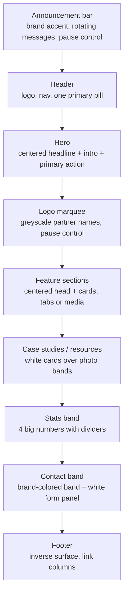

# design.md

This project's design-system usage guide. It has two parts:

1. **The generated design system is the source of truth** (section 1). Every color, font, size, space, corner, shadow and breakpoint in this project comes from the generated tokens. If anything in sections 2–7 ever seems to disagree with a token, **the token wins**.
2. **Design direction** (sections 2–7): patterns, structure, tone and behavior distilled from a reference website's design analysis. These are *how things are arranged and how they should feel*, never *which values to use*. Values are deliberately left out so nothing here can compete with the generated tokens.

Read alongside:
- `AGENTS.md` — token-usage rules for writing code (semantic tokens, not primitives; no hardcoded hex/px).
- `foundations-rules.md` — universal accessibility/UX rules.

> **If `generate` is re-run, this file is reset to the tool's placeholder.** Keep a copy of any edits before regenerating.

---

## 1. This project's design system (generated — authoritative)

Generated from the seed: Next.js, Tailwind design language, shadcn/ui, light mode only.

| Area | How it resolved | Where to find the values |
|---|---|---|
| Brand color | `#E90130` (red), full ramp `brand` 50–950 | `tailwind/theme.css`, `css/tokens.css` |
| Neutrals | Pure gray (no brand tint), ramp 50–950 | same |
| Status colors | Fixed palette: error, success, warning, info, promo (each with `-bg`, `-text`, `-border`) | same |
| Modes | Light only (`css/light.css`, `tailwind/theme-light.css`) | — |
| Fonts | Headings/display: **Lexend Deca**. Body/UI: **Roboto** | `typography.primitive.fontFamily.*` |
| Type scale | Tailwind preset: 12 / 14 / 16 / 18 / 20 / 24 / 30 / 48 | `typography.semantic.*` |
| Spacing | Tailwind preset: 4px base. Keys `0 1 2 3 4 5 6 8 10 12 16 20 24` | `--spacing-*` |
| Corner roundness | Bootstrap preset: `none 0`, `sm 4`, `md 6`, `lg 8`, `xl 16`, `full` (pill) | `--radius-*` |
| Shadows | Tailwind preset: `sm md lg xl 2xl` | `--shadow-*` |
| Opacity | Tailwind preset, 5% steps | `--opacity-*` |
| Border width | 0 / 1 / 2 / 4 / 8px | `--border-width-*` |
| Breakpoints | `sm 640`, `md 768`, `lg 1024`, `xl 1280`, `2xl 1536` | `--breakpoint-*` |
| Grid | 4 / 8 / 12 columns (compact / medium / expanded) | `--grid-*` |
| Components | shadcn/ui, themed through `shadcn/theme.css` | `components/ui/` (if scaffolded) |

**Semantic color names to use** (never the primitive ramps directly):
`background.{primary,secondary,surface,inverse}` · `text.{primary,secondary,disabled,on-primary,on-surface,inverse}` · `action.{primary,primary-hover,primary-active,primary-pressed,primary-disabled}` · `border.{default,subtle,focus,on-primary}` · `status.{error,success,warning,info,promo}` (+ `-bg`, `-text`, `-border`) · `overlay.scrim`.

**Semantic type styles to use:**
`display-bold` · `heading-{lg,md,sm}-{semibold,bold}` · `body-{lg,regular,sm}` (regular + semibold) · `caption` (regular + semibold).

---

## 2. Overall character

- **Tone:** confident, calm, corporate-tech. Mostly neutral surfaces, with **one** saturated brand accent used sparingly for the most important actions and a few brand moments.
- **Density:** airy. Generous whitespace between sections, comfortable padding inside cards, short line lengths for intro text.
- **Shape language:** soft and friendly. Things you *press* are pills; things you *look at* (cards, images, panels) share one consistent rounded corner; form fields use a smaller one. Use the `radius.*` tokens, never raw values.
- **Depth:** comes mainly from photography and layering (white cards on photo bands, translucent panels over images), not heavy shadows. Use shadow tokens sparingly, only to separate a floating layer from what's behind it.
- **Themes:** light only. The only inverted areas are the footer and full-bleed brand or photo bands, where text switches to the `on-primary`/`inverse` tokens.

## 3. Using color (principles, not values)

1. **One accent.** The brand color (`action.primary`) marks *the* primary action in a view, plus a few brand moments (announcement bar, floating action button, active nav/tab marker). Everything else is neutral.
2. **One primary action per view.** Secondary actions are outlined or neutral pills, never a second brand-filled button competing with the first.
3. **Text hierarchy.** Headings use `text.primary`; body copy and intros use `text.secondary`; use `text.disabled` only for genuinely disabled content.
4. **Links are recognized by an underline or a trailing arrow, not by color alone** (this also satisfies the "Use of color" rule in `foundations-rules.md`).
5. **Status colors carry meaning** (error, success, warning, info, promo) and are always paired with an icon or text, never shown as a bare color.
6. **Focus** is always clearly visible, using `border.focus`. Follow the generated token, not any other color.
7. **Hover, active and disabled** states use the generated `action.*` tokens. Do not invent other hover colors.

## 4. Using type (principles, not values)

1. Headings and display text use the heading font; body, UI and labels use the body font. Never swap them.
2. Pick the **semantic type style** that matches the role (display, heading, body, caption). Don't set sizes or weights by hand.
3. **Section openers follow one recipe:** a centered heading, a centered short intro paragraph kept narrow (about two-thirds of the content width), then an optional secondary button, then the content.
4. **Section heads are centered; detailed content is left-aligned** (feature lists, long copy, forms, article bodies).
5. Eyebrows, dates, card type labels and statistics are small supporting text. Use the caption or small-body styles with the neutral `text.secondary` color. (The reference site sets these in a third, monospace face; this project has no third font, so do not add one.)
6. Titles use Title Case for the page's main headline and sentence case for section headings.

## 5. Layout and rhythm (structure, not measurements)

- Build on the generated **spacing tokens** and **grid tokens**. Keep every gap on the spacing scale.
- **Section spacing is consistent.** Use one chosen large spacing token between sections on desktop and a smaller one on mobile, and reuse it everywhere. If a design truly needs a gap larger than the biggest spacing token, add a token. Don't hardcode a number.
- **Card rows are 3-up on desktop** (each card spans a third of the grid), collapsing to a single column on mobile. Stat bands are 4-up, wrapping to 2-up on small screens.
- **Article pages** use a narrow left rail (author, table of contents) beside a body column with a comfortable reading width.
- **Responsive behavior:** the main navigation collapses into a burger menu below the desktop-nav breakpoint; type steps down and spacing tightens at the mobile breakpoint.

## 6. Components and patterns (behavior and anatomy)

**Buttons**
- Every button is a full pill (`radius.full`), with an optional trailing arrow icon.
- Variants in use: **brand** (filled `action.primary`), **secondary** (white or neutral with an outline), **link** (text with a trailing arrow). Use shadcn/ui's themed `Button` variants; don't restyle them locally.
- A button's label may animate letter-by-letter on hover and the arrow may nudge right a few pixels. This is optional polish. It must be switched off under `prefers-reduced-motion`.

**Announcement bar and carousels**
- Auto-rotating or auto-scrolling content (announcement messages, logo marquee) **must have a visible pause control** and must stop under `prefers-reduced-motion`.

**Header and navigation**
- Logo at left, nav items, then one primary pill action at right. The header hides on scroll-down and returns on scroll-up. When it returns it sits above the page with a shadow token.
- The active nav item gets a thin brand-colored underline. A mega menu is a white, rounded panel under the nav, with a light page overlay behind it (`overlay.scrim`). Menu rows pair a small line icon with a label and a trailing arrow.

**Hero**
- A centered large headline, a short intro and one primary action. Optional extras: a prompt-style input pill, or a sticky pill-shaped anchor navigation (active item filled with the brand color).

**Cards**
- Share one rounded corner (`radius.xl`) and generous padding from the spacing scale. Cards usually sit flat. They rely on the surrounding photo or surface for depth.
- Kinds: **resource cards** (type label, title, divider, date), **feature cards** (muted background, text plus small media), **case-study cards** (white card on a photo band with two key stats and a secondary button), **glass cards** (translucent panel over an image, using white text), **stacking platform cards** (full-width photo cards that overlap as you scroll).
- Keep text on photos legible, with a translucent panel or enough contrast (see Accessibility).

**Tabs, accordion, stats, testimonial**
- **Tabs / problem tiles:** a row of three tiles, each with a thin top rail; the selected tile's rail uses the brand color.
- **Accordion (FAQ):** muted-surface items with rounded corners; the question is a full-width button with a chevron.
- **Stats band:** four large numbers with short labels, separated by thin dashed dividers.
- **Testimonial:** a large quote on a plain surface, with the person's name and role below.

**Forms**
- A white, rounded panel on a brand-colored or photo band, usually two columns (a benefits checklist at left, the form at right).
- Labels sit above fields. Fields use the `radius.md` corner and the default border token. Focus uses the focus border token. Required fields are marked. Errors use the `status.error*` tokens **plus** text or an icon.
- Submit is the single primary (brand) action. Never submit anywhere from a prototype. Show an inline confirmation message instead.

**Footer**
- Inverse surface, with light text. Five link columns, a legal row, and round social icons.

**Floating action button**
- One round brand-colored button, fixed at the bottom-right, for an assistant/chat entry point. It uses a floating shadow token.

**Icons**
- Thin line icons, one stroke style throughout, drawn in `currentColor` so they always take the surrounding text color. Common sizes are the small steps of the type scale (16–24px). The right arrow after almost every call to action is the signature icon.

**Imagery**
- Clean, minimal, often architectural photography, frequently with a red object as the focal point that echoes the brand color without adding UI color. In prototypes, stand in with abstract gradients and shapes.
- All in-content images are clipped to the card corner (`radius.xl`) and cropped to fill.
- Product UI is shown as floating white app cards over photography.

## 7. Motion (not tokenized — guidance only)

The generated tokens contain no motion values, so this section is a feel guide. Anything here can be tuned freely.

- Gentle and "premium": color/fill changes of about a third of a second with a soft ease-out; a slower fade-up reveal (content rising slightly while fading in) as sections scroll into view.
- Hover changes should be quick and quiet. Never bouncy.
- **Always honor `prefers-reduced-motion`:** show content immediately, stop auto-moving content, and drop label/arrow animations, leaving only instant color changes.

## 8. Voice and copy

- Headlines are short, confident, outcome-focused statements.
- Calls to action are 1–3 word verb phrases, ending with an arrow when they lead somewhere: "Explore more", "Learn more", "Get Tickets", "Submit".
- Intros are one or two plain sentences. Avoid jargon-heavy filler.

## 9. Accessibility notes specific to this direction

These add to, and never replace, `foundations-rules.md`.

- Check body text on every surface against the contrast rule, including text over photos and translucent panels. If a photo can't guarantee contrast, put the text on a solid or translucent panel.
- The brand color on the white surface sits close to the minimum contrast for normal-size text. Use it for large text, icons and buttons with `on-primary` text, and verify any new pairing before shipping.
- Every interactive element needs a visible focus ring, a pointer-and-keyboard-reachable target, and all required states (default, hover, focus, active, disabled).
- Auto-moving content needs a pause control (see section 6).

---

## What was intentionally left out of this file

So that the generated tokens are the only implemented values, the following reference-site details were **not** carried over:

- **All raw values:** hex colors, font sizes, line heights, pixel spacing, radii, shadows, opacities, border widths, breakpoints, container widths and the reference site's grid measurements.
- **Typography:** the reference site's third (monospace) font, its light/regular heading weights and its specific type scale. This project uses the generated heading and body styles instead.
- **Interaction colors that differ from the tokens:** the reference site's red-to-black button hover, its blue focus ring, and its identical brand/error red. This project follows the generated `action.*`, `border.focus` and `status.*` tokens.
- **Page-specific measurements:** header heights, section spacers (including spacing larger than this project's spacing scale), container maximum and gutter sizes.
- **Third-party widgets:** the reference site's cookie banner and phone-number input styling.
