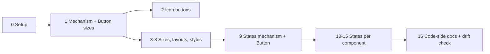

# Plan: Add the missing shadcn/ui component variations to the Figma push

## Context

The user noticed generated shadcn components "only come in one size." Investigation found:

- **Code is already complete.** `scaffold` runs `shadcn add --all` (`Tool/cli/src/scaffold/nextjs.ts:161`), which vendors the official, unmodified files. E.g. `Demo/sdsgt-demo-app/src/components/ui/button.tsx` already has 6 variants × 8 sizes. Nothing trims them.
- **Figma is the gap.** `Tool/cli/src/scaffold/figma-components-plan.ts` (3,447 lines) deliberately builds "one size each ('default'), rest states only" for its 29 components, and `Tool/.claude/skills/SDSGT-figma-push/SKILL.md` step 7 replays that plan with a single `Variant=` property.

Missing in Figma (verified against the vendored official source, 2026-10-08):

| Component | Missing |
|---|---|
| Button | sizes xs/sm/lg + icon-only sizes icon/icon-xs/icon-sm/icon-lg |
| Toggle | sizes sm/lg |
| Item | sizes sm/xs |
| Attachment | sizes sm/xs + orientation vertical |
| Avatar | sizes sm/lg (`data-[size=…]`, not cva) |
| Card, NativeSelect, Switch | size sm (`data-[size=…]`) |
| Tabs | style "line" (`tabsListVariants`) |
| Marker | variants separator/border |
| Separator | orientation vertical |
| Field | orientation horizontal (`responsive` = breakpoint behavior → skip + disclose) |
| 13+ interactive components | states Hover / Focus / Disabled / Invalid / Pressed |

**User decisions (2026-10-08):** build *all* of the above; off-scale sizes **snap to the nearest token** (not exact px); **small batches, 1–2 components each**, so a Claude Pro session never runs out mid-batch.

Intended outcome: every variation the official code has also exists as a real Figma variant property (`Variant=…, Size=…, State=…`), token-bound, with every fidelity gap disclosed.

## Rules for whoever executes this (Sonnet or Haiku)

1. **One batch per session.** Start each session by reading only: this plan's status table, the batch's section, and the specific functions named (use `grep -n` to find them — don't read all of `figma-components-plan.ts` or `SKILL.md`, they're 3.4k / 1.8k lines).
2. **This file (`figma-component-variations-plan.md`, project root) is the source of truth.** Tick its status table at the end of every batch, so the next session knows where to resume.
3. **Strictly additive.** Every new field is optional. A component that doesn't use the new fields must produce **byte-identical** plan JSON to the baseline (see Verification).
4. **Disclosure policy (project rule): every gap is disclosed twice**: (a) a line in the plan's `notes` (surfaced by SKILL.md step 6's report) and (b) the Figma component set's own `description`. Gaps include: sizes snapped to a token, sizes that end up visually identical after snapping, states that can't be represented, and dropped opacity.
5. **Never invent class values.** Read sizes and states from the real vendored source (reuse `parseCvaAxis(source, "size")`). If the source has an option the builder doesn't handle, record it in a `skipped…` list with a reason. Don't throw (it would break scaffold), and don't drop it silently.
6. Ask the user before deleting or replacing any existing component set in their Figma file.
7. At the end of each batch: update docs (see "Docs to keep in sync") and stop. Don't start the next batch in the same session.

## Mechanism (built once in Batch 1, reused by every later batch)

### A. Plan schema (`figma-components-plan.ts`), all optional

```ts
// Overrides applied on top of the component's own fields for one axis option.
export interface FigmaComponentLayoutOverrides {
  heightVariable?: string;          // NEW: fixed frame height bound to a spacing token (h-N / size-N)
  paddingHorizontalVariable?: string;
  paddingVerticalVariable?: string; // ignored when heightVariable is set (content is centered)
  fontSizeVariable?: string;
  radiusVariable?: string;
  fixedSizePx?: number;
  iconOnly?: FigmaComponentIconPlanItem; // NEW: replace the text label with an icon (Button icon sizes)
  line?: FigmaComponentLinePlanItem;     // Separator orientation
  sections?: FigmaComponentSectionPlanItem[]; sectionGapVariable?: string; // Field/Attachment orientation
  variantOverrides?: Record<string, Partial<FigmaComponentVariantPlanItem>>; // per-variant tweaks (Switch thumb dims, Tabs line style)
}
export interface FigmaComponentAxisPlanItem {
  propertyName: string;             // "Size" | "Orientation" | "Style"
  options: Array<{ name: string; overrides: FigmaComponentLayoutOverrides }>;
  skippedOptions: Array<{ name: string; reason: string }>;
}
// on FigmaComponentPlanItem:
extraAxes?: FigmaComponentAxisPlanItem[];
statePropertyName?: "State";        // added in Batch 9
// on FigmaComponentVariantPlanItem (Batch 9):
states?: FigmaComponentStatePlanItem[]; // Default is implicit = the variant's rest values
skippedStates?: Array<{ name: string; reason: string }>;
```

The **Default option of every new axis must reproduce the component's current values exactly** (regression guard). One intended exception: components that gain a Size axis also get `heightVariable` on every size, including Default. Button Default then becomes a fixed 32px (`h-8`), where today it hugs its content. That's a fix, so disclose it in the batch's docs entry.

### B. Shared helpers (`figma-components-plan.ts`)

- `tailwindClassPx(cls)`: `h-N | size-N | px-N | py-N | p-N | gap-N` → N×4 (N may be fractional, e.g. 2.5); `text-xs/sm/base/lg` → 12/14/16/18; `text-[0.8rem]` → 12.8. Returns `null` for anything else.
- Radius: `rounded-lg` → existing `exactRadiusMd()`. `rounded-[min(var(--radius-md),Npx)]` → min(radius.md, N) → `nearestToken`.
- **Snapping = existing `nearestToken()` unchanged** (ties resolve to the smaller token, deterministic). Known consequences, which must be disclosed: Button `sm` (28px) snaps to 24px and `lg` (36px) snaps to 32px, so Sm looks identical to Xs and Lg looks identical to Default in Figma. All of them are still created, so Figma property names match code `size=` values. Write a small helper that detects options with identical resolved overrides and adds the "renders identical to X" note.
- `parseDataSizeClasses(classString)` → `Record<sizeName, string[]>` from `data-[size=X]:` / `group-data-[size=X]/…:` prefixes (Avatar, Card, NativeSelect, Switch).
- Naming: `Size` option values use the existing `capitalize()` ("Xs", "Icon-sm"), same convention as variants.

### C. Replay (`SKILL.md` step 7)

- **Combinations:** for each variant × each combination of `extraAxes` options (× each state, from Batch 9 on), merge: `item = {...component, ...axisOverrides}` and `variantItem = {...variant, ...overrides.variantOverrides?.[variant.name], ...stateOverrides}`. Then run the **existing, unchanged** frame-building code on the merged objects. Name each component `Variant=Default, Size=Sm, State=Hover` (order: variant property, then `extraAxes` in order, then State).
- **Height:** when `heightVariable` is set: horizontal auto-layout, width hugs, `counterAxisSizingMode = "FIXED"`, then `frame.setBoundVariable("height", getVar(...))`. **Smoke-test this binding live first**, as earlier batches did for `rescale()`.
- **iconOnly:** square frame (height token used for both sides), centered icon via the existing `buildLucideIcon` helper, no text node. The `Label` property still exists on the set but those variants don't reference it.
- **Timeout chunking:** `figma_execute` / `use_figma` cap at ~30s. Build at most ~20 variant frames per call (measure on the first call and adjust), return the created node IDs, and do `combineAsVariants` + `componentSet.description` in a final call. On any error, follow step 7's existing orphan-cleanup rule.
- Set `componentSet.description` to the disclosure lines for that component (rule 4b).

## Batches

Model guide: **S** = use Sonnet (new mechanism or highest risk). **S/H** = Haiku is OK, because the pattern already exists by then.

| # | Scope | Model | Status |
|---|---|---|---|
| 0 | Capture baseline plan JSON, add `scripts/regen-components-plan.ts` (plan already saved to repo 2026-10-08) | S/H | ☐ |
| 1 | Mechanism A+B+C, plus **Button text sizes** (default/xs/sm/lg) | S | ☐ |
| 2 | **Button icon-only sizes** (icon/icon-xs/icon-sm/icon-lg) | S | ☐ |
| 3 | **Toggle** sizes + **Item** sizes | S/H | ☐ |
| 4 | **Avatar** + **Switch** sizes (first `data-[size]` consumers) | S | ☐ |
| 5 | **Card** + **NativeSelect** size sm | S/H | ☐ |
| 6 | **Attachment** sizes + orientation (first component with 2 extra axes) | S | ☐ |
| 7 | **Separator** + **Field** orientation | S/H | ☐ |
| 8 | **Tabs** "Line" style + **Marker** separator/border variants | S | ☐ |
| 9 | States mechanism, plus **Button** states | S | ☐ |
| 10 | **Toggle** + **Badge** states | S/H | ☐ |
| 11 | **Input** + **Textarea** states | S/H | ☐ |
| 12 | **NativeSelect** + **Item** states | S/H | ☐ |
| 13 | **Checkbox** + **RadioGroup** states | S/H | ☐ |
| 14 | **Switch** + **Tabs** states | S/H | ☐ |
| 15 | **Accordion** + **Label** states; triage the minor ones | S/H | ☐ |
| 16 | Code side: Figma↔code naming rule in agent docs, plus a drift check | S/H | ☐ |



### Batch 0: Setup (no Figma)
- Add `Tool/cli/scripts/regen-components-plan.ts`. It calls `buildFigmaComponentsPushPlan(codeDir, uiDir)` and writes the JSON, so later batches can regenerate a plan without re-scaffolding. Default args: `codeDir = Demo/out/Code tokens (consumables)/sdsgt-demo`, `uiDir = Demo/sdsgt-demo-app/src/components/ui`, output path as a flag. Run with `node` (Node already runs `.ts` here, see `package.json` scripts).
- Save the baseline: `cp Demo/sdsgt-demo-app/figma-components-push-plan.json <scratchpad>/baseline-plan.json`. Commit it under `Tool/cli/qa-results/` so later sessions have it too.

### Batch 1: Mechanism + Button text sizes
- Add schema A, helpers B, replay C.
- `buildButtonPlan` (`figma-components-plan.ts:817`): read `parseCvaAxis(buttonSource, "size")`. Build options for `default/xs/sm/lg` from each class string (h-N → `heightVariable`, px-N → padding, text-* → font size, rounded-* → radius). Put the `icon*` keys in `skippedOptions` with reason "added in Batch 2".
- Disclose: the 28→24 and 36→32 snaps, and Sm≡Xs / Lg≡Default in Figma.
- Live: push Button only (5 variants × 4 sizes = 20), screenshot, then `setProperties({Variant, Size, Label})` on a test instance, screenshot, delete the test instance.

### Batch 2: Button icon-only sizes
- Add a `plus` entry to `LUCIDE_ICONS` (`figma-components-plan.ts:537`). Extract the real path data from the project's installed `lucide-react` bundle, the same provenance method as the existing two entries. Don't type it from memory.
- Move `icon/icon-xs/icon-sm/icon-lg` out of `skippedOptions`. Each one: `iconOnly` + `heightVariable` (size-8 = 32, size-6 = 24, size-7 = 28→24, size-9 = 36→32; disclose). Icon px from the source's `[&_svg…]:size-N` (default 16, xs 12, sm 14). Icon color = the variant's text color.
- Size axis now has 8 options: 40 Button variants. This is the first real test of chunking.

### Batch 3: Toggle + Item sizes
- `buildTogglePlan` (:927) and `buildItemPlan` (:2315) via `parseCvaAxis(…, "size")`. Item uses `sections`, so per-size overrides touch padding/gap/font. Validate each size's sections render, not only Default.

### Batch 4: Avatar + Switch sizes
- Build `parseDataSizeClasses`. Avatar (:1536): `data-[size=sm]:size-6`, default size-8, `data-[size=lg]:size-10`. Fallback text uses `group-data-[size=sm]/avatar:text-xs`.
- Switch (:3141): track `h-[18.4px] w-[32px]` (default) vs `h-[14px] w-[24px]` (sm), thumb `size-4` vs `size-3`. These are literal px values already used by the `thumb` fields, not tokens, so use `variantOverrides` to give the Checked/Unchecked thumbs per-size dimensions and recompute `thumbOffsetXPx` with the existing formula.

### Batch 5: Card + NativeSelect size sm
- Card (:1248): `data-[size=sm]:[--card-spacing:--spacing(3)]` → sm `sectionGapVariable` / section padding = 12px (`spacing/3`, exact). Title `group-data-[size=sm]/card:text-sm`.
- NativeSelect (:1429): `data-[size=sm]:h-7` (snaps to 24, disclose), `py-0.5`, smaller radius.

### Batch 6: Attachment sizes + orientation
- `attachmentVariants` has `size=[default, sm, xs]` and `orientation=[horizontal, vertical]`, so this is two `extraAxes` (3 × 2 = 6 combos). Orientation changes the `sections` direction. First component with two extra axes, so check the naming (`Variant=…, Size=…, Orientation=…`) live.

### Batch 7: Separator + Field orientation
- Separator (:2137): `Orientation` axis. Vertical overrides `line` (swap thickness/length; source `data-vertical:w-px self-stretch`, so use the existing `representativeLengthPx` as the height).
- Field (:2047): `fieldVariants` orientation vertical/horizontal → `sections` direction. `responsive` → `skippedOptions`, reason "breakpoint-driven layout; Figma components have no viewport".

### Batch 8: Tabs "Line" style + Marker variants
- Tabs (:2714): `Style` axis Default/Line. Read `tabsListVariants` and the trigger's `group-data-[variant=line]/tabs-list:` classes; use `variantOverrides` for the Active/Inactive look under Line.
- Marker (:2427): today it ignores its cva axis on purpose. Now build `Variant` = default/separator/border from the real classes (border adds a stroke; separator adds a line). **Read the real source first.** The 2026-09 survey found these options don't differ in color, so the difference is structural.

### Batch 9: States mechanism + Button states
- Extend `classToFigmaVariable` (:586) to also return `opacity` from a `/NN` modifier. This is a strict superset: existing callers ignore the new field.
- Add `extractStateClasses(classString, prefix)` for `hover:`, `focus-visible:`, `disabled:`, `aria-invalid:`, and `aria-pressed:`/`data-pressed:`/`aria-expanded:`. Ignore any `dark:`-combined class (dark mode = Figma variable modes).
- State mapping: Hover/Pressed → overridden fill/text/stroke (+ `fillOpacity` on the paint). Disabled → `nodeOpacity` from `disabled:opacity-50`. Focus → `strokeVariable = border.focus` plus `focusRing {colorVariable, widthPx from ring-N, opacity from ring-ring/NN}`, drawn as a DROP_SHADOW (spread = width, blur 0) with its color bound via `setBoundVariableForEffect`. **Smoke-test that binding live first**, including whether the effect keeps its own alpha. Invalid → stroke `status.error` plus a ring.
- **Consistency rule:** if a variant's rest fill already had its opacity dropped (existing simplification, e.g. `bg-destructive/10`), drop it in that variant's states too, and disclose. Don't change any existing rest state.
- Every variant gets the same set of State values. If one can't be represented, build it identical to Default and disclose.
- Button: 5 variants × 8 sizes × 5 states (Default/Hover/Focus/Disabled/Invalid) = 200 frames, so chunking is mandatory. If one session can't finish the live push, stop after the plan + typecheck are done and finish the live push next session. Record that in the status table.

### Batches 10–15: States per component
Same mechanism as Batch 9, no new code expected. Only build the states each component's real source has (scan from 2026-10-08):

| Component | Hover | Focus | Disabled | Invalid | Pressed |
|---|---|---|---|---|---|
| Toggle | ✓ | ✓ | ✓ | ✓ | ✓ |
| Badge | ✓ (`[a&]:hover:`, link-only) | ✓ | – | ✓ | – |
| Input, Textarea | – | ✓ | ✓ | ✓ | – |
| NativeSelect | ✓ | ✓ | ✓ | ✓ | – |
| Item | ✓ | ✓ | – | – | – |
| Checkbox, RadioGroup, Switch | – | ✓ | ✓ | ✓ | – |
| Tabs, Accordion | ✓ | ✓ | ✓ | – | – |
| Label | – | – | ✓ (via peer/group) | – | – |

Batch 15 also triages Alert, Breadcrumb, Field, Marker, Attachment and Bubble. They have 1–3 hover/focus classes, which are probably on child links. For each, either build the state or add a disclosed skip reason to the plan `notes`.

### Batch 16: Code side
- Code already ships every variation, so no component code changes. Add one agent rule in `Tool/cli/src/generate/project-docs.ts` (the shadcn/Tailwind section): Figma property values map to code props by lowercasing (`Variant=Outline, Size=Icon-sm` → `variant="outline" size="icon-sm"`). Note that a few Figma sizes are visually snapped, so agents should trust the code's classes, not measure the Figma file.
- Drift check: in `Tool/cli/scripts/qa-matrix/checks.ts` (cli group), assert that every cva `size`/`variant` key in the vendored source is either built or listed in a `skipped…` list in the generated plan. This catches a future shadcn release adding a size.

## Critical files
- `Tool/cli/src/scaffold/figma-components-plan.ts`: all plan logic (builders listed by line above; `COMPONENT_BUILDERS` at :3388)
- `Tool/.claude/skills/SDSGT-figma-push/SKILL.md`: step 7 replay (component-set naming at ~:1391, frame build at ~:1152)
- `Tool/cli/src/generate/project-docs.ts`, `Tool/cli/scripts/qa-matrix/checks.ts`: Batch 16
- Reuse: `parseCvaAxis`, `nearestToken`, `exactRadiusMd`, `readCssScale`, `capitalize`, `buildVariantsFromCva`, `LUCIDE_ICONS`/`buildLucideSvg`, SKILL's `buildLucideIcon`
- Edit real files under `Tool/` (root `cli` and `.claude/skills` are symlinks into it)

## Docs to keep in sync (every batch)
`figma-component-variations-plan.md` status table; the "proven live" ledger in the `figma-components-plan.ts` file header; the SKILL.md step 7 ledger; a dated entry in `docs/layer2-layer3-plan.md`; the scope wording in `contracts-and-seeds.md` and `Tool/.claude/skills/SDSGT-start/SKILL.md` (stop saying "one size each"); `pipeline-plan.md` if it mentions the one-size limitation.

## Verification (every batch)
1. `cd Tool/cli && npm run typecheck`
2. Regenerate the plan with `scripts/regen-components-plan.ts` and diff against the baseline. **Only the batch's own components may change.** Read the new JSON for those components by hand: check option names, bound variable names, skipped reasons and notes.
3. `npm run qa:matrix -- --group=cli` (add `--group=core` if anything outside `figma-components-plan.ts` changed).
4. Live Figma (Demo seed's "SDSGT test file", `figmaMcp: southleft`): push only the batch's components → `figma_capture_screenshot` → create one test instance and `setProperties()` every property (Variant, Size/Orientation/Style, State, Label) → screenshot → delete the instance → final page screenshot (no orphans). Check that the component description shows the disclosures.
5. Optional, for size batches: `next build` in `Demo/sdsgt-demo-app` plus a Playwright `getComputedStyle` on a real `<Button size="sm">` to confirm the source px values the plan used.
