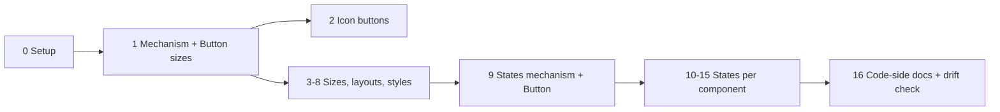

# Plan: Add the missing shadcn/ui component variations to the Figma push

## Context

The user noticed generated shadcn components "only come in one size." Investigation found:

- **Code is already complete.** `scaffold` runs `shadcn add --all` (`Tool/cli/src/scaffold/nextjs.ts:161`), which vendors the official, unmodified files. E.g. `Demo/sdsgt-demo-app/src/components/ui/button.tsx` already has 6 variants × 8 sizes. Nothing trims them.
- **Figma is the gap.** `Tool/cli/src/scaffold/figma-components-plan.ts` (3,447 lines) deliberately builds "one size each ('default'), rest states only" for its 29 components, and `Tool/.claude/skills/SDSGT-figma-push/SKILL.md` step 7 replays that plan with a single `Variant=` property.

Missing in Figma (verified against the vendored official source, 2026-10-08):

| Component | Missing |
|---|---|
| Button | sizes xs/sm/lg + icon-only sizes icon/icon-xs/icon-sm/icon-lg |
| Toggle | sizes sm/lg |
| Item | sizes sm/xs |
| Attachment | sizes sm/xs + orientation vertical |
| Avatar | sizes sm/lg (`data-[size=…]`, not cva) |
| Card, NativeSelect, Switch | size sm (`data-[size=…]`) |
| Tabs | style "line" (`tabsListVariants`) |
| Marker | variants separator/border |
| Separator | orientation vertical |
| Field | orientation horizontal (`responsive` = breakpoint behavior → skip + disclose) |
| 13+ interactive components | states Hover / Focus / Disabled / Invalid / Pressed |

**User decisions (2026-10-08):** build *all* of the above; off-scale sizes **snap to the nearest token** (not exact px); **small batches, 1–2 components each**, so a Claude Pro session never runs out mid-batch.

Intended outcome: every variation the official code has also exists as a real Figma variant property (`Variant=…, Size=…, State=…`), token-bound, with every fidelity gap disclosed.

## Rules for whoever executes this (Sonnet or Haiku)

1. **One batch per session.** Start each session by reading only: this plan's status table, the batch's section, and the specific functions named (use `grep -n` to find them — don't read all of `figma-components-plan.ts` or `SKILL.md`, they're 3.4k / 1.8k lines).
2. **This file (`figma-component-variations-plan.md`, project root) is the source of truth.** Tick its status table at the end of every batch, so the next session knows where to resume.
3. **Strictly additive.** Every new field is optional. A component that doesn't use the new fields must produce **byte-identical** plan JSON to the baseline (see Verification).
4. **Disclosure policy (project rule): every gap is disclosed twice**: (a) a line in the plan's `notes` (surfaced by SKILL.md step 6's report) and (b) the Figma component set's own `description`. Gaps include: sizes snapped to a token, sizes that end up visually identical after snapping, states that can't be represented, and dropped opacity.
5. **Never invent class values.** Read sizes and states from the real vendored source (reuse `parseCvaAxis(source, "size")`). If the source has an option the builder doesn't handle, record it in a `skipped…` list with a reason. Don't throw (it would break scaffold), and don't drop it silently.
6. Ask the user before deleting or replacing any existing component set in their Figma file.
7. At the end of each batch: update docs (see "Docs to keep in sync") and stop. Don't start the next batch in the same session.

## Mechanism (built once in Batch 1, reused by every later batch)

### A. Plan schema (`figma-components-plan.ts`), all optional

```ts
// Overrides applied on top of the component's own fields for one axis option.
export interface FigmaComponentLayoutOverrides {
  heightVariable?: string;          // NEW: fixed frame height bound to a spacing token (h-N / size-N)
  paddingHorizontalVariable?: string;
  paddingVerticalVariable?: string; // ignored when heightVariable is set (content is centered)
  fontSizeVariable?: string;
  radiusVariable?: string;
  fixedSizePx?: number;
  iconOnly?: FigmaComponentIconPlanItem; // NEW: replace the text label with an icon (Button icon sizes)
  line?: FigmaComponentLinePlanItem;     // Separator orientation
  sections?: FigmaComponentSectionPlanItem[]; sectionGapVariable?: string; // Field/Attachment orientation
  variantOverrides?: Record<string, Partial<FigmaComponentVariantPlanItem>>; // per-variant tweaks (Switch thumb dims, Tabs line style)
}
export interface FigmaComponentAxisPlanItem {
  propertyName: string;             // "Size" | "Orientation" | "Style"
  options: Array<{ name: string; overrides: FigmaComponentLayoutOverrides }>;
  skippedOptions: Array<{ name: string; reason: string }>;
}
// on FigmaComponentPlanItem:
extraAxes?: FigmaComponentAxisPlanItem[];
statePropertyName?: "State";        // added in Batch 9
// on FigmaComponentVariantPlanItem (Batch 9):
states?: FigmaComponentStatePlanItem[]; // Default is implicit = the variant's rest values
skippedStates?: Array<{ name: string; reason: string }>;
```

The **Default option of every new axis must reproduce the component's current values exactly** (regression guard). One intended exception: components that gain a Size axis also get `heightVariable` on every size, including Default. Button Default then becomes a fixed 32px (`h-8`), where today it hugs its content. That's a fix, so disclose it in the batch's docs entry.

### B. Shared helpers (`figma-components-plan.ts`)

- `tailwindClassPx(cls)`: `h-N | size-N | px-N | py-N | p-N | gap-N` → N×4 (N may be fractional, e.g. 2.5); `text-xs/sm/base/lg` → 12/14/16/18; `text-[0.8rem]` → 12.8. Returns `null` for anything else.
- Radius: `rounded-lg` → existing `exactRadiusMd()`. `rounded-[min(var(--radius-md),Npx)]` → min(radius.md, N) → `nearestToken`.
- **Snapping = existing `nearestToken()` unchanged** (ties resolve to the smaller token, deterministic). Known consequences, which must be disclosed: Button `sm` (28px) snaps to 24px and `lg` (36px) snaps to 32px, so Sm looks identical to Xs and Lg looks identical to Default in Figma. All of them are still created, so Figma property names match code `size=` values. Write a small helper that detects options with identical resolved overrides and adds the "renders identical to X" note.
- `parseDataSizeClasses(classString)` → `Record<sizeName, string[]>` from `data-[size=X]:` / `group-data-[size=X]/…:` prefixes (Avatar, Card, NativeSelect, Switch).
- Naming: `Size` option values use the existing `capitalize()` ("Xs", "Icon-sm"), same convention as variants.

### C. Replay (`SKILL.md` step 7)

- **Combinations:** for each variant × each combination of `extraAxes` options (× each state, from Batch 9 on), merge: `item = {...component, ...axisOverrides}` and `variantItem = {...variant, ...overrides.variantOverrides?.[variant.name], ...stateOverrides}`. Then run the **existing, unchanged** frame-building code on the merged objects. Name each component `Variant=Default, Size=Sm, State=Hover` (order: variant property, then `extraAxes` in order, then State).
- **Height:** when `heightVariable` is set: horizontal auto-layout, width hugs, `counterAxisSizingMode = "FIXED"`, then `frame.setBoundVariable("height", getVar(...))`. **Smoke-test this binding live first**, as earlier batches did for `rescale()`.
- **iconOnly:** square frame (height token used for both sides), centered icon via the existing `buildLucideIcon` helper, no text node. The `Label` property still exists on the set but those variants don't reference it.
- **Timeout chunking:** `figma_execute` / `use_figma` cap at ~30s. Build at most ~20 variant frames per call (measure on the first call and adjust), return the created node IDs, and do `combineAsVariants` + `componentSet.description` in a final call. On any error, follow step 7's existing orphan-cleanup rule.
- Set `componentSet.description` to the disclosure lines for that component (rule 4b).

## Batches

Model guide: **S** = use Sonnet (new mechanism or highest risk). **S/H** = Haiku is OK, because the pattern already exists by then.

| # | Scope | Model | Status |
|---|---|---|---|
| 0 | Capture baseline plan JSON, add `scripts/regen-components-plan.ts` (plan already saved to repo 2026-10-08) | S/H | ☑ |
| 1 | Mechanism A+B+C, plus **Button text sizes** (default/xs/sm/lg) | S | ☑ done (live-verified 2026-10-08) |
| 2 | **Button icon-only sizes** (icon/icon-xs/icon-sm/icon-lg) | S | ☑ done (live-verified 2026-10-08) |
| 3 | **Toggle** sizes + **Item** sizes | S/H | ☑ done (live-verified 2026-10-08) |
| 4 | **Avatar** + **Switch** sizes (first `data-[size]` consumers) | S | ☑ done (live-verified 2026-10-08) |
| 5 | **Card** + **NativeSelect** size sm | S/H | ☑ done (live-verified 2026-10-08) |
| 6 | **Attachment** sizes + orientation (first component with 2 extra axes) | S | ☑ done (live-verified 2026-10-08) |
| 7 | **Separator** + **Field** orientation | S/H | ☑ done (live-verified 2026-10-08) |
| 8 | **Tabs** "Line" style + **Marker** separator/border variants | S | ☑ done (live-verified 2026-10-08) |
| 9 | States mechanism, plus **Button** states | S | ☐ |
| 10 | **Toggle** + **Badge** states | S/H | ☐ |
| 11 | **Input** + **Textarea** states | S/H | ☐ |
| 12 | **NativeSelect** + **Item** states | S/H | ☐ |
| 13 | **Checkbox** + **RadioGroup** states | S/H | ☐ |
| 14 | **Switch** + **Tabs** states | S/H | ☐ |
| 15 | **Accordion** + **Label** states; triage the minor ones | S/H | ☐ |
| 16 | Code side: Figma↔code naming rule in agent docs, plus a drift check | S/H | ☐ |



### Batch 0: Setup (no Figma)
- Add `Tool/cli/scripts/regen-components-plan.ts`. It calls `buildFigmaComponentsPushPlan(codeDir, uiDir)` and writes the JSON, so later batches can regenerate a plan without re-scaffolding. Default args: `codeDir = Demo/out/Code tokens (consumables)/sdsgt-demo`, `uiDir = Demo/sdsgt-demo-app/src/components/ui`, output path as a flag. Run with `node` (Node already runs `.ts` here, see `package.json` scripts).
- Save the baseline: `cp Demo/sdsgt-demo-app/figma-components-push-plan.json <scratchpad>/baseline-plan.json`. Commit it under `Tool/cli/qa-results/` so later sessions have it too.
- **Done.** Regenerate a plan: `cd Tool/cli && npm run regen:components-plan -- --out /tmp/new-plan.json` (or `node scripts/regen-components-plan.ts --out <path>`; optional `--code-dir` / `--ui-dir`; no `--out` prints to stdout). Baseline to diff against: `Tool/cli/qa-results/baseline-components-plan.json` (byte-identical to `Demo/sdsgt-demo-app/figma-components-push-plan.json` at capture time), e.g. `diff Tool/cli/qa-results/baseline-components-plan.json /tmp/new-plan.json`.

### Batch 1: Mechanism + Button text sizes
- Add schema A, helpers B, replay C.
- `buildButtonPlan` (`figma-components-plan.ts:817`): read `parseCvaAxis(buttonSource, "size")`. Build options for `default/xs/sm/lg` from each class string (h-N → `heightVariable`, px-N → padding, text-* → font size, rounded-* → radius). Put the `icon*` keys in `skippedOptions` with reason "added in Batch 2".
- Disclose: the 28→24 and 36→32 snaps, and Sm≡Xs / Lg≡Default in Figma.
- Live: push Button only (5 variants × 4 sizes = 20), screenshot, then `setProperties({Variant, Size, Label})` on a test instance, screenshot, delete the test instance.

- **Done 2026-10-08 (code, plan JSON, docs, and live Figma push).** Built: schema A (plus a `disclosures?: string[]` field on each axis, which SKILL.md writes into `componentSet.description`, and `heightVariable?` on the plan item), helpers B, `buildButtonSizeAxis` (called from `buildButtonPlan`), and SKILL.md step 2c. Verified: `npm run typecheck`; regenerated plan vs `qa-results/baseline-components-plan.json` differs only in Button's new `extraAxes` and the new `Button Size ...` `notes` lines; `npm run qa:matrix -- --group=cli` 5/5 pass. Button plan: Default `spacing/8`, Xs `spacing/6`, Sm `spacing/6` (28px snaps to 24), Lg `spacing/8` (36px snaps to 32); padding `spacing/2`; fonts 14/12/12/14; radius `radius/md` for all four. **Live push, same day ("SDSGT test file", Southleft Desktop Bridge):** all passed. (1) Height binding: `counterAxisSizingMode = "FIXED"` then `setBoundVariable("height", spacing/8)` binds and reads back exactly 32, so no fallback was needed; every built frame read back 32 (Default/Lg) or 24 (Xs/Sm). (2) Frames per call: 10 frames built and converted in ~450ms, then the other 10 plus `combineAsVariants` and layout in ~315ms, so all 20 fit in one call with huge headroom (~20-45ms per frame); no chunking needed at 20 variants, and the ~30s cap should allow hundreds of frames (untested; Batch 2's 40 and Batch 15's 200 should re-measure). (3) Built as a new set "Button (sizes test)" in a new sibling Section "Button sizes test" below "Components" (the existing Button set and Section were not touched or resized). Layout: wrapped grid, 5 columns x 4 rows, 716x184. Size property options came out Default/Xs/Sm/Lg; description with the 9 disclosure lines verified by read-back. (4) Visuals: fills, strokes, text colors, font sizes and radii all still variable-bound on all 20 (no invisible-text regression on Ghost/Destructive/Link). Sm renders identical to Xs (24px tall, 12px text) and Lg identical to Default (32px, 14px text), as disclosed; Size Default is now a fixed 32px rather than hugging. (5) Test instance with `{Variant: Destructive, Size: Lg, Label: "Delete account"}` worked (the tool maps `Label` to `Label#<id>` itself), screenshot correct, instance deleted; no orphans left. Surprises: none blocking. Outline variants are 2px wider than the others (1px stroke); the old Button set's own look is unchanged. **Next for the user:** swap "Button (sizes test)" in for the old Button set (move it into "Components" at the old Button's slot, delete the old set) when happy.
- Note: the user renamed `figma-remaining-components-plan.md` to `[Legacy] figma-remaining-components-plan.md`; several docs and code comments still use the old name.

### Batch 2: Button icon-only sizes
- Add a `plus` entry to `LUCIDE_ICONS` (`figma-components-plan.ts:537`). Extract the real path data from the project's installed `lucide-react` bundle, the same provenance method as the existing two entries. Don't type it from memory.
- Move `icon/icon-xs/icon-sm/icon-lg` out of `skippedOptions`. Each one: `iconOnly` + `heightVariable` (size-8 = 32, size-6 = 24, size-7 = 28→24, size-9 = 36→32; disclose). Icon px from the source's `[&_svg…]:size-N` (default 16, xs 12, sm 14). Icon color = the variant's text color.
- Size axis now has 8 options: 40 Button variants. This is the first real test of chunking.

- **Done 2026-10-08 (code, plan JSON, docs, and live Figma push).** Built: a `plus` entry in `LUCIDE_ICONS` (from the installed lucide-react v1.53.0's `plus.mjs`: two paths, `M5 12h14` and `M12 5v14`, joined into one path string with two sub-paths), the four `icon*` sizes in `buildButtonSizeAxis` (`iconOnly` + `heightVariable` + radius; icon colored per variant at replay time from the variant's own `textVariable`, the plan's `iconOnly.colorVariable` is only a fallback), SKILL.md step 2c's `iconOnly` branch and mixed-width manual grid, and a null guard in step 5. Verified: `npm run typecheck`; regenerated plan vs baseline differs only in Button (28 other components byte-identical); `qa:matrix --group=cli` 5/5. Button Size options: Default, Xs, Sm, Lg, Icon, Icon-xs, Icon-sm, Icon-lg, `skippedOptions` empty. Icon-only plan values: Icon `spacing/8` (32px exact, 16px icon), Icon-xs `spacing/6` (24px exact, 12px icon), Icon-sm `spacing/6` (size-7 = 28px snaps to 24; the source sets no icon size for it, so 16px), Icon-lg `spacing/8` (size-9 = 36px snaps to 32; 16px icon); radius `radius/md` for all (`min(var(--radius-md),Npx)` = 6px here). Disclosures: the two snaps, Icon-lg renders identical to Icon, and the plus icon is a placeholder. **Live push, same day ("SDSGT test file", Southleft Desktop Bridge): all passed.** (1) Built a NEW set "Button (icon sizes test)" (40 variants) in a NEW Section "Button icon sizes test" at y=1350; the existing "Components" and "Button sizes test" Sections were not touched. (2) Chunking: all 40 frames (20 with `createNodeFromSvg` icons) built and converted in ~760ms, whole call ~820ms, so one call is plenty (~19ms/frame); no chunking needed at 40. (3) `setBoundVariable("width", ...)` plus `"height"` on a FIXED/FIXED frame binds and reads back exactly (32/24/24/32). Every variant's fill, stroke, radius and icon stroke are variable-bound; icon strokes are each variant's text color (visible against every fill; no invisible-icon regression) and icons are centered (a 16px icon at 8,8 in 32px). (4) Label property: the set keeps one `Label` TEXT property bound on the 20 text variants; after adding the null guard, the 20 icon-only variants are skipped without error. `setProperties({Label: ...})` on an icon-only instance does not error and renders nothing; the value survives swapping Size icon->text and back. (5) Instances `{Variant: Outline, Size: Icon-sm}` and `{Variant: Destructive, Size: Lg, Label: "Delete account"}` rendered correctly, then were deleted; no orphans. (6) Surprise: with auto-layout wrap, narrow icon variants pack extra per row and break the 5-column grid, so the set uses a manual grid instead (SKILL.md step 2c), 716x392. Description with the 12 disclosure lines verified by read-back. **Next for the user:** when happy, swap "Button (icon sizes test)" in for the old Button set (it supersedes "Button (sizes test)", which has only the 4 text sizes).

### Batch 3: Toggle + Item sizes
- `buildTogglePlan` (:927) and `buildItemPlan` (:2315) via `parseCvaAxis(…, "size")`. Item uses `sections`, so per-size overrides touch padding/gap/font. Validate each size's sections render, not only Default.

- **Done 2026-10-08 (code, plan JSON, docs, and live Figma push).** Built: Button's size builder was extracted into the shared `buildCvaSizeAxis(componentName, ...)` (optional `describeUnmodeled` hook for per-size "not modeled" lines; Button output byte-identical to Batch 2), Toggle uses it, and a new `buildItemSizeAxis` handles Item (reads `size` cva `py-N`/`px-N`, ItemDescription's `group-data-[size=X]/item:text-*` via `parseDataSizeClasses`, which got its first consumer). SKILL.md: step 3's `sections` branch now reads `item.sections` / `item.sectionGapVariable`; step 2c got a "Sections + extraAxes" note. Verified: `npm run typecheck`; regenerated plan vs baseline differs only in Button (unchanged vs Batch 2 output), Toggle, Item (27 others byte-identical); `qa:matrix --group=cli` 5/5. Plan values: Toggle Default `spacing/8` h, pad `spacing/2`, font 14; Sm `spacing/6` (h-7 28px snaps to 24), font 12 (12.8 snaps); Lg `spacing/8` (36 snaps to 32, identical to Default); radius `radius/md` for all (`min(radius-md,12px)` = md). Not modeled, disclosed: `min-w-N`, icon-related padding/size classes. Item Default py `spacing/2` (py-2.5 snaps), px `spacing/3`, descriptions 14; Sm identical to Default; Xs py `spacing/2` (exact), px `spacing/2` (px-2.5 snaps), Description 12. Disclosed: flex `gap-N`, `in-data-[slot=dropdown-menu-content]:p-0`, `size-8`/`size-6`/`gap-0` on inner parts. **Live push, same day ("SDSGT test file"): all passed.** NEW sets "Toggle (sizes test)" (6 variants, 154x136) and "Item (sizes test)" (9 variants, 687x207) in a NEW Section "Toggle and Item sizes test" at y=1900 (nothing existing touched); 15 frames built in ~390ms in one call. Read-back: Toggle heights 32/24/32 bound to spacing tokens, padding 8, fonts 14/12/14; Item padding-top 8 bound, section padding 12 (Default/Sm) vs 8 (Xs), Description 14 vs 12, Title/Description non-empty and variable-bound in every size and variant. Test instances took `setProperties` for Variant, Size, Label/Title/Description (Toggle Sm 49x24; Item Xs 304x49 with a long description), then were deleted; no orphans. Descriptions: 13 lines (Toggle), 9 (Item), verified. Surprise: none blocking. **Next for the user:** swap the test sets in for the old Toggle/Item sets when happy.

### Batch 4: Avatar + Switch sizes
- Build `parseDataSizeClasses`. Avatar (:1536): `data-[size=sm]:size-6`, default size-8, `data-[size=lg]:size-10`. Fallback text uses `group-data-[size=sm]/avatar:text-xs`.
- Switch (:3141): track `h-[18.4px] w-[32px]` (default) vs `h-[14px] w-[24px]` (sm), thumb `size-4` vs `size-3`. These are literal px values already used by the `thumb` fields, not tokens, so use `variantOverrides` to give the Checked/Unchecked thumbs per-size dimensions and recompute `thumbOffsetXPx` with the existing formula.

- **Done 2026-10-08 (code, plan JSON, docs, and live Figma push).** Built: `buildAvatarSizeAxis` (Avatar) and a size axis inside `buildSwitchPlan`, both reading the real `data-[size=X]:` / `group-data-[size=X]/name:` classes through `parseDataSizeClasses` (its first uses outside Item); one new optional override, `square?: boolean` (with `heightVariable`: width AND height bound to the token, zero padding, label kept and centered); SKILL.md step 2c's thumb branch now reads the merged `variantItem.thumb`, plus a `square` bullet and a `square` branch in step 3's frame code. Verified: `npm run typecheck`; regenerated plan vs the Batch 3 output differs only in Avatar and Switch, vs baseline only in Button, Toggle, Item, Avatar, Switch (both Avatar and Switch are byte-identical to baseline once `extraAxes` is removed, so all pre-existing fields, including Switch's `thumb` content, are unchanged); `qa:matrix --group=cli` 5/5. Plan values: Avatar Default `spacing/8` (32px), Sm `spacing/6` (24px), Lg `spacing/10` (40px), all exact so nothing snapped; fallback text 14 / 12 (`group-data-[size=sm]/avatar:text-xs`) / 14 (no lg-specific text class, disclosed); radius stays `radius/full`. Intended exception, disclosed: Avatar Default is now a true fixed 32px circle instead of the hug-content box approximating it. Switch Default 32x18.4 track, 16px thumb, offsets 1 / 15; Sm 24x14 track, 12px thumb, offsets 1 / 11 (checked = trackWidth - thumbSize - 1, one shared formula); literal px, not tokens, so nothing is snapped (disclosed). `variantOverrides` carries a COMPLETE `thumb` object per size because the replay's merge is a shallow `Object.assign`. Not modeled, disclosed: AvatarImage, AvatarBadge and AvatarGroupCount per-size dimensions, `[&>svg]` rules. **Live push, same day ("SDSGT test file", Southleft Desktop Bridge): all passed.** NEW sets "Avatar (sizes test)" (3 variants, 144x40) and "Switch (sizes test)" (4 variants, 88x60.8) in a NEW Section "Avatar and Switch sizes test" at y=2270 (below "Toggle and Item sizes test", which ends at y=2187); all 7 frames built in one call in ~240ms; nothing existing touched. Read-back: Avatar frames 32/24/40, width, height, radius, fill, stroke, font size and text fill all variable-bound; Label property bound on all three; Switch thumbs at x=1 / 15 (Default) and 1 / 11 (Sm), thumb sizes 16 / 12, tracks 32x18.4 / 24x14, track and thumb fills bound. Screenshots: Avatar sizes visibly 24/32/40 with legible initials; Switch thumbs flush left (Unchecked, gray track) and flush right (Checked, red track) at both sizes. Test instances `{Variant, Size: Lg, Label: "AB"}` (Avatar, 40x40) and `{Variant: Checked, Size: Sm}` (Switch, 24x14, thumb at x=11) rendered correctly, then were deleted; no orphans. Descriptions verified by read-back (3 lines Avatar, 1 line Switch). Surprise: none blocking. **Next for the user:** swap the test sets in for the old Avatar and Switch sets when happy.

### Batch 5: Card + NativeSelect size sm
- Card (:1248): `data-[size=sm]:[--card-spacing:--spacing(3)]` → sm `sectionGapVariable` / section padding = 12px (`spacing/3`, exact). Title `group-data-[size=sm]/card:text-sm`.
- NativeSelect (:1429): `data-[size=sm]:h-7` (snaps to 24, disclose), `py-0.5`, smaller radius.

- **Done 2026-10-08 (code, plan JSON, docs, and live Figma push).** Built: `buildCardSizeAxis` (called from `buildCardPlan`; reads the real root `[--card-spacing:--spacing(N)]` per `data-[size=X]` plus the Title/Description size-specific text classes) and `buildNativeSelectSizeAxis` (called from `buildNativeSelectPlan`; reads the base `h-8` and the `data-[size=X]` classes). No SKILL.md replay code change was needed (the `sections` and `heightVariable` branches already covered both); only a note. Verified: `npm run typecheck`; regenerated plan vs the Batch 4 output differs only in Card and NativeSelect (vs baseline: Button, Toggle, Item, Avatar, Switch, Card, NativeSelect); with `extraAxes` stripped, Card and NativeSelect are byte-identical to the baseline; `qa:matrix --group=cli` 5/5. Plan values: Card Default `spacing/4` gap and section padding, Title 16 / Description 14 / Content 14 (same as before); Sm `spacing/3` (12px, exact, nothing snapped) for gap and section padding, Title 14 (`group-data-[size=sm]/card:text-sm`), Description and Content 14. NativeSelect Default `heightVariable` `spacing/8` (h-8, exact), Sm `spacing/6` (h-7 = 28px snaps to 24, disclosed), radius `radius/md` for both (`min(var(--radius-md),10px)` = 6px here, same as Default; disclosed). Intended exception, disclosed: NativeSelect Default is now a fixed 32px (the old set hugged to 28px). Not modeled, disclosed: Card's `has-data-[slot=card-footer]:pb-0` (no CardFooter in the Figma Card), NativeSelect's `py-0.5` as a separate value (fixed height, text centered) and its chevron icon. **Live push, same day ("SDSGT test file", Southleft Desktop Bridge): all passed.** NEW sets "Card (sizes test)" (2 variants, 502x106) and "NativeSelect (sizes test)" (2 variants, 286x32) in a NEW Section "Card and NativeSelect sizes test" at y=2500 (582x258); all 4 frames built in one call. Read-back: Card Default 243x106 (same as the existing Card set), Sm 235x92 with 12px padding, gap and section padding, all variable-bound; Title/Description/Content visible in both and bound to the three text properties; NativeSelect 32 / 24px high, bound. Screenshot: Card Sm visibly tighter, all three lines legible. Test instances took `setProperties` on Variant, Size and every text property, then were deleted; no orphans. Descriptions verified (2 and 5 lines). Surprise: none blocking. **Next for the user:** swap the test sets in for the old Card and NativeSelect sets when happy.

### Batch 6: Attachment sizes + orientation
- `attachmentVariants` has `size=[default, sm, xs]` and `orientation=[horizontal, vertical]`, so this is two `extraAxes` (3 × 2 = 6 combos). Orientation changes the `sections` direction. First component with two extra axes, so check the naming (`Variant=…, Size=…, Orientation=…`) live.

- **Done 2026-10-08 (code, plan JSON, docs, and live Figma push).** Built: `buildAttachmentAxes` (called from `buildAttachmentPlan`, which now builds its one Title + Description section through a shared `buildSections`), producing two `extraAxes`, plus two small additive schema pieces: `widthVariable` (a fixed token-bound frame width; sections stretch, text fills and truncates with an ellipsis like the real `truncate`) and `combinationOverrides` on an axis option (overrides applied only alongside one named option of another axis, key `"Size=Sm"`), because Vertical's extra content padding depends on BOTH axes. SKILL.md step 2c: the combination code now applies `combinationOverrides` after every axis's own overrides (the loop was already the full cartesian product), plus notes on two axes, `widthVariable`, and the grid for a one-variant, two-axis set (columns = Size, rows = Orientation); step 3's `sections` branch got the `widthVariable` code. Real classes read: size default/sm/xs = `has-data-[slot=attachment-content]:px-2.5 py-2` / `px-2 py-1.5` / `px-1.5 py-1`, bare `text-sm`/`text-xs`/`text-xs` (Title inherits it; Description keeps its own `text-xs`), xs `rounded-lg`; orientation horizontal = `min-w-40 items-center`, vertical = `w-24 flex-col has-data-[slot=attachment-content]:w-30`, plus AttachmentContent's `group-data-[orientation=vertical]/attachment:px-1`. Plan values: Default `spacing/2` padding both ways (px-2.5 snaps), Title 14, radius `radius/lg` (rounded-xl, as before); Sm padding top/bottom `spacing/1` (py-1.5 snaps), sides `spacing/2`, Title 12; Xs padding `spacing/1` all round (px-1.5 snaps), Title 12, radius `radius/md`. Vertical: width `spacing/24` (real 120px snaps to 96px, 24px off, disclosed), horizontal padding = size's px + 4px: Default `spacing/3` (14px snaps to 12), Sm `spacing/3` (12 exact), Xs `spacing/2` (10 snaps to 8). Default + Horizontal reproduces the old Attachment exactly (frame 93x51). Not modeled, disclosed: gap between parts, media-only padding, `min-w-40` (the horizontal Figma Attachment hugs its text as before), `flex-col` stacking (no Media), Media and Actions sizing/placement, the real `w-24` no-content width. No cross-axis combination renders identical (checked by a small helper). Verified: `npm run typecheck`; regenerated plan vs the Batch 5 output differs only in Attachment (vs baseline: Button, Toggle, Item, Avatar, Switch, Card, NativeSelect, Attachment; Attachment byte-identical to baseline once `extraAxes` is removed, apart from the plan-level `notes` line, which now says sizes and orientation are modeled); `qa:matrix --group=cli` 5/5. **Live push, same day ("SDSGT test file", Southleft Desktop Bridge): all passed.** NEW set "Attachment (sizes test)" (6 variants) in a NEW Section "Attachment sizes test" at y=2850 (below "Card and NativeSelect sizes test", which ends at y=2758); nothing existing touched. All 6 frames built and combined in one call (~475ms). Names read `Variant=Default, Size=Sm, Orientation=Vertical`; Figma reports three VARIANT properties (Variant, Size, Orientation) plus the Title and Description TEXT properties. Read-back: Default/Horizontal 93x51 (same as the old set), Sm/Horizontal 83x40, Xs/Horizontal 75x40, every Vertical 96 wide (51/40/40 high); padding, gap, radius, widths and font sizes all variable-bound and matching the plan; Vertical text nodes are FILL with ending truncation. Screenshot: all six visibly distinct and legible; Default/Vertical truncates "receipt.p..." at the 96px width (the snapped width, disclosed). Test instance took `setProperties` on all five properties (Size/Orientation round trips gave 139x40 for Xs/Horizontal and 169x51 for Default/Horizontal with a long title), then was deleted; no orphans. Description has 17 disclosure lines, verified by read-back. Surprises: `combineAsVariants` keeps creation order (Size outer, Orientation inner), so the grid must position children by parsing their names, not by index. **Next for the user:** swap "Attachment (sizes test)" in for the old Attachment set when happy.

### Batch 7: Separator + Field orientation
- Separator (:2137): `Orientation` axis. Vertical overrides `line` (swap thickness/length; source `data-vertical:w-px self-stretch`, so use the existing `representativeLengthPx` as the height).
- Field (:2047): `fieldVariants` orientation vertical/horizontal → `sections` direction. `responsive` → `skippedOptions`, reason "breakpoint-driven layout; Figma components have no viewport".

- **Done 2026-10-08 (code, plan JSON, docs, and live Figma push).** Built: `buildSeparatorAxes` (reads the real `data-horizontal:` / `data-vertical:` classes) and `buildFieldOrientationAxis` (reads the `fieldVariants` `orientation` cva axis), plus one small additive schema field, `line.orientation?: "vertical"`. SKILL.md: the `component.line` branch now reads the merged `item.line` (the only change needed for per-option `line` overrides) and builds a vertical rect as `resize(thickness, length)`; step 2c got a line + extraAxes bullet and a horizontal-sections bullet (Field Horizontal reuses step 3's existing Breadcrumb `textLineDirection: "horizontal"` branch unchanged). Plan values: Separator Horizontal = empty overrides (today's 1px x 200px line), Vertical = `line` with `orientation: "vertical"`, same `border.default` color; both lengths are the representative 200px stand-in (disclosed; the real classes are `w-full` / `self-stretch`). Field Vertical = empty overrides (today's plan), Horizontal = the same three sections with `textLineDirection: "horizontal"`; `responsive` is in `skippedOptions` ("breakpoint-driven layout (container query); Figma components have no viewport"); classes not modeled are listed verbatim in the disclosures. `FieldSeparator` was left alone (no orientation axis in the real source). Verified: `npm run typecheck`; regenerated plan vs the Batch 6 output differs only in Separator and Field (vs baseline: Button, Toggle, Item, Avatar, Switch, Card, NativeSelect, Attachment, Separator, Field; each of Separator/Field is byte-identical to baseline with `extraAxes` removed); `qa:matrix --group=cli` 5/5. Intended difference, disclosed: Field Horizontal has no top/bottom padding (the real root has none) while Vertical keeps the old 8px padding trade-off so it renders exactly as before. **Live push, same day ("SDSGT test file", Southleft Desktop Bridge): all passed.** NEW sets "Separator (orientation test)" (2 variants) and "Field (orientation test)" (2 variants) in a NEW Section "Separator and Field orientation test" at y=3150 (Attachment's section ends at y=3056); built in one call; nothing existing touched. Read-back: Separator 200x1 and 1x200, fills bound to `color/semantic/border/default`; Field Vertical 195x86 (identical to the old set), Horizontal 449x18 (gap `spacing/2`, no padding); all text sizes and fills variable-bound; Label/Description/Error properties bound in both orientations. Screenshot: both orientations visibly distinct and legible. Test instances took `setProperties` on Orientation and all three text properties (Separator Vertical 1x200; Field Horizontal 247x18 with short text, back to Vertical 97x86), then were deleted; no orphans. Descriptions: 4 lines (Separator), 5 (Field). Surprises: none; the Separator component wraps its rectangle, as the old set does. **Next for the user:** swap the test sets in for the old Separator and Field sets when happy.

### Batch 8: Tabs "Line" style + Marker variants
- Tabs (:2714): `Style` axis Default/Line. Read `tabsListVariants` and the trigger's `group-data-[variant=line]/tabs-list:` classes; use `variantOverrides` for the Active/Inactive look under Line.
- Marker (:2427): today it ignores its cva axis on purpose. Now build `Variant` = default/separator/border from the real classes (border adds a stroke; separator adds a line). **Read the real source first.** The 2026-09 survey found these options don't differ in color, so the difference is structural.

- **Done 2026-10-08 (code, plan JSON, docs, and live Figma push).** Built: `buildTabsStyleAxis` (Tabs `Style` axis Default/Line from the real `tabsListVariants` cva and the trigger's `group-data-[variant=line]/tabs-list:` classes) and `buildMarkerStyleVariants` (Marker's Separator and Border added to the existing `Variant` list, not a new axis, so `Variant=Default/Separator/Border` and Default stays byte-identical). New optional schema fields, all additive: variant-level `strokeSides: "bottom"`, `strokeWeightPx`, `paddingBottomVariable`, `flankLines`, and component-level `disclosures` (written into the set description, needed because Marker has no axis). In `variantOverrides`, an empty-string `fillVariable` means "remove the base fill". Decision on the Line underline: the real indicator is an `after:` bar (`bg-foreground`, `h-0.5`, `bottom-[-5px]`); adding per-side stroke weights was a small additive change, so Line's Active tab is a 2px bottom-edge stroke bound to text.primary (nearest look, not exact: real bar sits 3-5px below the tab, Figma stroke is flush, follows the rounded corners, adds 2px height; all disclosed). Marker: Separator = two 1px border.default lines (80px stand-ins, the real `flex-1` has no fixed width) with a 12px gap (`gap-2` + `mr-1`) bound to `spacing/3`; Border = bottom-only 1px border.default stroke + `pb-2` as bottom padding `spacing/2`; every Marker hugs its text (real one is `w-full`). Nothing was skipped. Verified: `npm run typecheck`; plan vs Batch 7 output differs only in Tabs and Marker (vs baseline: Button, Toggle, Item, Avatar, Switch, Card, NativeSelect, Attachment, Separator, Field, Tabs, Marker; Tabs byte-identical to baseline minus `extraAxes`; three Tabs/Marker `notes` lines reworded); `qa:matrix --group=cli` 5/5. **Live push, same day ("SDSGT test file"): all passed.** NEW sets "Tabs (style test)" (4 variants, 90x62) and "Marker (variants test)" (3 variants, 382x27) in a NEW Section "Tabs and Marker test" at y=3730; built in two calls (~90ms each). Read-back: Active/Line has no fill, stroke text.primary, weights [0,0,2,0], 33x20; other Tabs 33x18; Marker Default 50x18, Separator 234x18 with itemSpacing 12 bound, Border 50x27 with bottom padding 8 and weights [0,0,1,0]; every text node font size and fill variable-bound, Label bound. Screenshots: Default vs Line visibly distinct, Active distinguishable in both, Marker variants visibly distinct, all text legible. Test instances took `setProperties` on every property then were deleted; no orphans; descriptions verified (6 and 4 lines). **Next for the user:** swap the test sets in for the old Tabs and Marker sets when happy.

### Batch 9: States mechanism + Button states
- Extend `classToFigmaVariable` (:586) to also return `opacity` from a `/NN` modifier. This is a strict superset: existing callers ignore the new field.
- Add `extractStateClasses(classString, prefix)` for `hover:`, `focus-visible:`, `disabled:`, `aria-invalid:`, and `aria-pressed:`/`data-pressed:`/`aria-expanded:`. Ignore any `dark:`-combined class (dark mode = Figma variable modes).
- State mapping: Hover/Pressed → overridden fill/text/stroke (+ `fillOpacity` on the paint). Disabled → `nodeOpacity` from `disabled:opacity-50`. Focus → `strokeVariable = border.focus` plus `focusRing {colorVariable, widthPx from ring-N, opacity from ring-ring/NN}`, drawn as a DROP_SHADOW (spread = width, blur 0) with its color bound via `setBoundVariableForEffect`. **Smoke-test that binding live first**, including whether the effect keeps its own alpha. Invalid → stroke `status.error` plus a ring.
- **Consistency rule:** if a variant's rest fill already had its opacity dropped (existing simplification, e.g. `bg-destructive/10`), drop it in that variant's states too, and disclose. Don't change any existing rest state.
- Every variant gets the same set of State values. If one can't be represented, build it identical to Default and disclose.
- Button: 5 variants × 8 sizes × 5 states (Default/Hover/Focus/Disabled/Invalid) = 200 frames, so chunking is mandatory. If one session can't finish the live push, stop after the plan + typecheck are done and finish the live push next session. Record that in the status table.

### Batches 10–15: States per component
Same mechanism as Batch 9, no new code expected. Only build the states each component's real source has (scan from 2026-10-08):

| Component | Hover | Focus | Disabled | Invalid | Pressed |
|---|---|---|---|---|---|
| Toggle | ✓ | ✓ | ✓ | ✓ | ✓ |
| Badge | ✓ (`[a&]:hover:`, link-only) | ✓ | – | ✓ | – |
| Input, Textarea | – | ✓ | ✓ | ✓ | – |
| NativeSelect | ✓ | ✓ | ✓ | ✓ | – |
| Item | ✓ | ✓ | – | – | – |
| Checkbox, RadioGroup, Switch | – | ✓ | ✓ | ✓ | – |
| Tabs, Accordion | ✓ | ✓ | ✓ | – | – |
| Label | – | – | ✓ (via peer/group) | – | – |

Batch 15 also triages Alert, Breadcrumb, Field, Marker, Attachment and Bubble. They have 1–3 hover/focus classes, which are probably on child links. For each, either build the state or add a disclosed skip reason to the plan `notes`.

### Batch 16: Code side
- Code already ships every variation, so no component code changes. Add one agent rule in `Tool/cli/src/generate/project-docs.ts` (the shadcn/Tailwind section): Figma property values map to code props by lowercasing (`Variant=Outline, Size=Icon-sm` → `variant="outline" size="icon-sm"`). Note that a few Figma sizes are visually snapped, so agents should trust the code's classes, not measure the Figma file.
- Drift check: in `Tool/cli/scripts/qa-matrix/checks.ts` (cli group), assert that every cva `size`/`variant` key in the vendored source is either built or listed in a `skipped…` list in the generated plan. This catches a future shadcn release adding a size.

## Critical files
- `Tool/cli/src/scaffold/figma-components-plan.ts`: all plan logic (builders listed by line above; `COMPONENT_BUILDERS` at :3388)
- `Tool/.claude/skills/SDSGT-figma-push/SKILL.md`: step 7 replay (component-set naming at ~:1391, frame build at ~:1152)
- `Tool/cli/src/generate/project-docs.ts`, `Tool/cli/scripts/qa-matrix/checks.ts`: Batch 16
- Reuse: `parseCvaAxis`, `nearestToken`, `exactRadiusMd`, `readCssScale`, `capitalize`, `buildVariantsFromCva`, `LUCIDE_ICONS`/`buildLucideSvg`, SKILL's `buildLucideIcon`
- Edit real files under `Tool/` (root `cli` and `.claude/skills` are symlinks into it)

## Docs to keep in sync (every batch)
`figma-component-variations-plan.md` status table; the "proven live" ledger in the `figma-components-plan.ts` file header; the SKILL.md step 7 ledger; a dated entry in `docs/layer2-layer3-plan.md`; the scope wording in `contracts-and-seeds.md` and `Tool/.claude/skills/SDSGT-start/SKILL.md` (stop saying "one size each"); `pipeline-plan.md` if it mentions the one-size limitation.

## Verification (every batch)
1. `cd Tool/cli && npm run typecheck`
2. Regenerate the plan with `scripts/regen-components-plan.ts` and diff against the baseline. **Only the batch's own components may change.** Read the new JSON for those components by hand: check option names, bound variable names, skipped reasons and notes.
3. `npm run qa:matrix -- --group=cli` (add `--group=core` if anything outside `figma-components-plan.ts` changed).
4. Live Figma (Demo seed's "SDSGT test file", `figmaMcp: southleft`): push only the batch's components → `figma_capture_screenshot` → create one test instance and `setProperties()` every property (Variant, Size/Orientation/Style, State, Label) → screenshot → delete the instance → final page screenshot (no orphans). Check that the component description shows the disclosures.
5. Optional, for size batches: `next build` in `Demo/sdsgt-demo-app` plus a Playwright `getComputedStyle` on a real `<Button size="sm">` to confirm the source px values the plan used.
