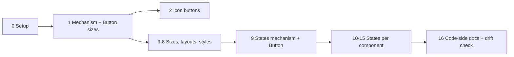

# Plan: Add the missing shadcn/ui component variations to the Figma push

## Context

The user noticed generated shadcn components "only come in one size." Investigation found:

- **Code is already complete.** `scaffold` runs `shadcn add --all` (`Tool/cli/src/scaffold/nextjs.ts:161`), which vendors the official, unmodified files. E.g. `Demo/sdsgt-demo-app/src/components/ui/button.tsx` already has 6 variants × 8 sizes. Nothing trims them.
- **Figma is the gap.** `Tool/cli/src/scaffold/figma-components-plan.ts` (3,447 lines) deliberately builds "one size each ('default'), rest states only" for its 29 components, and `Tool/.claude/skills/SDSGT-figma-push/SKILL.md` step 7 replays that plan with a single `Variant=` property.

Missing in Figma (verified against the vendored official source, 2026-10-08):

| Component | Missing |
|---|---|
| Button | sizes xs/sm/lg + icon-only sizes icon/icon-xs/icon-sm/icon-lg |
| Toggle | sizes sm/lg |
| Item | sizes sm/xs |
| Attachment | sizes sm/xs + orientation vertical |
| Avatar | sizes sm/lg (`data-[size=…]`, not cva) |
| Card, NativeSelect, Switch | size sm (`data-[size=…]`) |
| Tabs | style "line" (`tabsListVariants`) |
| Marker | variants separator/border |
| Separator | orientation vertical |
| Field | orientation horizontal (`responsive` = breakpoint behavior → skip + disclose) |
| 13+ interactive components | states Hover / Focus / Disabled / Invalid / Pressed |

**User decisions (2026-10-08):** build *all* of the above; off-scale sizes **snap to the nearest token** (not exact px); **small batches, 1–2 components each**, so a Claude Pro session never runs out mid-batch.

Intended outcome: every variation the official code has also exists as a real Figma variant property (`Variant=…, Size=…, State=…`), token-bound, with every fidelity gap disclosed.

## Rules for whoever executes this (Sonnet or Haiku)

1. **One batch per session.** Start each session by reading only: this plan's status table, the batch's section, and the specific functions named (use `grep -n` to find them — don't read all of `figma-components-plan.ts` or `SKILL.md`, they're 3.4k / 1.8k lines).
2. **This file (`figma-component-variations-plan.md`, project root) is the source of truth.** Tick its status table at the end of every batch, so the next session knows where to resume.
3. **Strictly additive.** Every new field is optional. A component that doesn't use the new fields must produce **byte-identical** plan JSON to the baseline (see Verification).
4. **Disclosure policy (project rule): every gap is disclosed twice**: (a) a line in the plan's `notes` (surfaced by SKILL.md step 6's report) and (b) the Figma component set's own `description`. Gaps include: sizes snapped to a token, sizes that end up visually identical after snapping, states that can't be represented, and dropped opacity.
5. **Never invent class values.** Read sizes and states from the real vendored source (reuse `parseCvaAxis(source, "size")`). If the source has an option the builder doesn't handle, record it in a `skipped…` list with a reason. Don't throw (it would break scaffold), and don't drop it silently.
6. Ask the user before deleting or replacing any existing component set in their Figma file.
7. At the end of each batch: update docs (see "Docs to keep in sync") and stop. Don't start the next batch in the same session.

## Mechanism (built once in Batch 1, reused by every later batch)

### A. Plan schema (`figma-components-plan.ts`), all optional

```ts
// Overrides applied on top of the component's own fields for one axis option.
export interface FigmaComponentLayoutOverrides {
  heightVariable?: string;          // NEW: fixed frame height bound to a spacing token (h-N / size-N)
  paddingHorizontalVariable?: string;
  paddingVerticalVariable?: string; // ignored when heightVariable is set (content is centered)
  fontSizeVariable?: string;
  radiusVariable?: string;
  fixedSizePx?: number;
  iconOnly?: FigmaComponentIconPlanItem; // NEW: replace the text label with an icon (Button icon sizes)
  line?: FigmaComponentLinePlanItem;     // Separator orientation
  sections?: FigmaComponentSectionPlanItem[]; sectionGapVariable?: string; // Field/Attachment orientation
  variantOverrides?: Record<string, Partial<FigmaComponentVariantPlanItem>>; // per-variant tweaks (Switch thumb dims, Tabs line style)
}
export interface FigmaComponentAxisPlanItem {
  propertyName: string;             // "Size" | "Orientation" | "Style"
  options: Array<{ name: string; overrides: FigmaComponentLayoutOverrides }>;
  skippedOptions: Array<{ name: string; reason: string }>;
}
// on FigmaComponentPlanItem:
extraAxes?: FigmaComponentAxisPlanItem[];
statePropertyName?: "State";        // added in Batch 9
// on FigmaComponentVariantPlanItem (Batch 9):
states?: FigmaComponentStatePlanItem[]; // Default is implicit = the variant's rest values
skippedStates?: Array<{ name: string; reason: string }>;
```

The **Default option of every new axis must reproduce the component's current values exactly** (regression guard). One intended exception: components that gain a Size axis also get `heightVariable` on every size, including Default. Button Default then becomes a fixed 32px (`h-8`), where today it hugs its content. That's a fix, so disclose it in the batch's docs entry.

### B. Shared helpers (`figma-components-plan.ts`)

- `tailwindClassPx(cls)`: `h-N | size-N | px-N | py-N | p-N | gap-N` → N×4 (N may be fractional, e.g. 2.5); `text-xs/sm/base/lg` → 12/14/16/18; `text-[0.8rem]` → 12.8. Returns `null` for anything else.
- Radius: `rounded-lg` → existing `exactRadiusMd()`. `rounded-[min(var(--radius-md),Npx)]` → min(radius.md, N) → `nearestToken`.
- **Snapping = existing `nearestToken()` unchanged** (ties resolve to the smaller token, deterministic). Known consequences, which must be disclosed: Button `sm` (28px) snaps to 24px and `lg` (36px) snaps to 32px, so Sm looks identical to Xs and Lg looks identical to Default in Figma. All of them are still created, so Figma property names match code `size=` values. Write a small helper that detects options with identical resolved overrides and adds the "renders identical to X" note.
- `parseDataSizeClasses(classString)` → `Record<sizeName, string[]>` from `data-[size=X]:` / `group-data-[size=X]/…:` prefixes (Avatar, Card, NativeSelect, Switch).
- Naming: `Size` option values use the existing `capitalize()` ("Xs", "Icon-sm"), same convention as variants.

### C. Replay (`SKILL.md` step 7)

- **Combinations:** for each variant × each combination of `extraAxes` options (× each state, from Batch 9 on), merge: `item = {...component, ...axisOverrides}` and `variantItem = {...variant, ...overrides.variantOverrides?.[variant.name], ...stateOverrides}`. Then run the **existing, unchanged** frame-building code on the merged objects. Name each component `Variant=Default, Size=Sm, State=Hover` (order: variant property, then `extraAxes` in order, then State).
- **Height:** when `heightVariable` is set: horizontal auto-layout, width hugs, `counterAxisSizingMode = "FIXED"`, then `frame.setBoundVariable("height", getVar(...))`. **Smoke-test this binding live first**, as earlier batches did for `rescale()`.
- **iconOnly:** square frame (height token used for both sides), centered icon via the existing `buildLucideIcon` helper, no text node. The `Label` property still exists on the set but those variants don't reference it.
- **Timeout chunking:** `figma_execute` / `use_figma` cap at ~30s. Build at most ~20 variant frames per call (measure on the first call and adjust), return the created node IDs, and do `combineAsVariants` + `componentSet.description` in a final call. On any error, follow step 7's existing orphan-cleanup rule.
- Set `componentSet.description` to the disclosure lines for that component (rule 4b).

## Batches

Model guide: **S** = use Sonnet (new mechanism or highest risk). **S/H** = Haiku is OK, because the pattern already exists by then.

| # | Scope | Model | Status |
|---|---|---|---|
| 0 | Capture baseline plan JSON, add `scripts/regen-components-plan.ts` (plan already saved to repo 2026-10-08) | S/H | ☑ |
| 1 | Mechanism A+B+C, plus **Button text sizes** (default/xs/sm/lg) | S | ☑ done (live-verified 2026-10-08) |
| 2 | **Button icon-only sizes** (icon/icon-xs/icon-sm/icon-lg) | S | ☑ done (live-verified 2026-10-08) |
| 3 | **Toggle** sizes + **Item** sizes | S/H | ☑ done (live-verified 2026-10-08) |
| 4 | **Avatar** + **Switch** sizes (first `data-[size]` consumers) | S | ☑ done (live-verified 2026-10-08) |
| 5 | **Card** + **NativeSelect** size sm | S/H | ☑ done (live-verified 2026-10-08) |
| 6 | **Attachment** sizes + orientation (first component with 2 extra axes) | S | ☑ done (live-verified 2026-10-08) |
| 7 | **Separator** + **Field** orientation | S/H | ☑ done (live-verified 2026-10-08) |
| 8 | **Tabs** "Line" style + **Marker** separator/border variants | S | ☑ done (live-verified 2026-10-08) |
| 9 | States mechanism, plus **Button** states | S | ☑ done (live-verified 2026-10-09) |
| 10 | **Toggle** + **Badge** states. Also fix Badge/Bubble Link-style variants that wrongly underline at rest (same gap as Button Link, fixed for Button only in Batch 9), if their real source has `hover:underline` and no bare `underline` | S/H | ☑ done (live-verified 2026-10-09). Badge Link fixed; Bubble has no link variant (its Destructive hover shares the Button/Badge gap, recorded in a plan note, not built) |
| 11 | **Input** + **Textarea** states | S/H | ☑ done (live-verified 2026-10-09). Focus/Invalid rings do not render (both fields are fill-less at rest), disclosed |
| 12 | **NativeSelect** + **Item** states | S/H | ☑ done (live-verified 2026-10-09). NativeSelect Hover is identical to Default (the real source has only `dark:hover:`); Item Hover is link-only and identical to rest on Muted; Focus/Invalid rings do not render on fill-less variants, disclosed |
| 13 | **Checkbox** + **RadioGroup** states | S/H | ☑ done (live-verified 2026-10-13). Unchecked Focus/Invalid rings do not render (fill-less), disclosed; Checked keeps its primary border. Ring/hover-fill/Disabled-field transparency lost on instances: **fixed 2026-10-13 with tokens, see the follow-ups under Batch 13** |
| 14 | **Switch** + **Tabs** states | S/H | ☑ done (live-verified 2026-10-13). Switch: Focus/Disabled/Invalid (rings render, the track has a fill); Tabs: Hover (identical to Default), Focus, Disabled. Tabs Line / Active / Focus replaces the bar with the focus border (disclosed). Open decision: Tabs Hover shows nothing because the rest 60% text is drawn at full strength |
| 15 | **Accordion** + **Label** states; triage the minor ones | S/H | ☑ done (live-verified 2026-10-13). Accordion: Hover (underline), Focus (border; its ring does not render, no fill), Disabled; Label: Disabled; Attachment (from the triage): Focus ring, Hover identical to rest (OPEN DECISION: translucent `bg-muted/50`, no token). Alert, Breadcrumb, Field, Marker, Bubble: skipped, disclosed (triage table in the Done entry) |
| 16 | Code side: Figma↔code naming rule in agent docs, plus a drift check | S/H | ☑ done 2026-10-13 (rule in the generated AGENTS.md for shadcn targets; drift check = QA case CLI-6, in `cli-cases.ts` not `checks.ts`) |



### Batch 0: Setup (no Figma)
- Add `Tool/cli/scripts/regen-components-plan.ts`. It calls `buildFigmaComponentsPushPlan(codeDir, uiDir)` and writes the JSON, so later batches can regenerate a plan without re-scaffolding. Default args: `codeDir = Demo/out/Code tokens (consumables)/sdsgt-demo`, `uiDir = Demo/sdsgt-demo-app/src/components/ui`, output path as a flag. Run with `node` (Node already runs `.ts` here, see `package.json` scripts).
- Save the baseline: `cp Demo/sdsgt-demo-app/figma-components-push-plan.json <scratchpad>/baseline-plan.json`. Commit it under `Tool/cli/qa-results/` so later sessions have it too.
- **Done.** Regenerate a plan: `cd Tool/cli && npm run regen:components-plan -- --out /tmp/new-plan.json` (or `node scripts/regen-components-plan.ts --out <path>`; optional `--code-dir` / `--ui-dir`; no `--out` prints to stdout). Baseline to diff against: `Tool/cli/qa-results/baseline-components-plan.json` (byte-identical to `Demo/sdsgt-demo-app/figma-components-push-plan.json` at capture time), e.g. `diff Tool/cli/qa-results/baseline-components-plan.json /tmp/new-plan.json`.

### Batch 1: Mechanism + Button text sizes
- Add schema A, helpers B, replay C.
- `buildButtonPlan` (`figma-components-plan.ts:817`): read `parseCvaAxis(buttonSource, "size")`. Build options for `default/xs/sm/lg` from each class string (h-N → `heightVariable`, px-N → padding, text-* → font size, rounded-* → radius). Put the `icon*` keys in `skippedOptions` with reason "added in Batch 2".
- Disclose: the 28→24 and 36→32 snaps, and Sm≡Xs / Lg≡Default in Figma.
- Live: push Button only (5 variants × 4 sizes = 20), screenshot, then `setProperties({Variant, Size, Label})` on a test instance, screenshot, delete the test instance.

- **Done 2026-10-08 (code, plan JSON, docs, and live Figma push).** Built: schema A (plus a `disclosures?: string[]` field on each axis, which SKILL.md writes into `componentSet.description`, and `heightVariable?` on the plan item), helpers B, `buildButtonSizeAxis` (called from `buildButtonPlan`), and SKILL.md step 2c. Verified: `npm run typecheck`; regenerated plan vs `qa-results/baseline-components-plan.json` differs only in Button's new `extraAxes` and the new `Button Size ...` `notes` lines; `npm run qa:matrix -- --group=cli` 5/5 pass. Button plan: Default `spacing/8`, Xs `spacing/6`, Sm `spacing/6` (28px snaps to 24), Lg `spacing/8` (36px snaps to 32); padding `spacing/2`; fonts 14/12/12/14; radius `radius/md` for all four. **Live push, same day ("SDSGT test file", Southleft Desktop Bridge):** all passed. (1) Height binding: `counterAxisSizingMode = "FIXED"` then `setBoundVariable("height", spacing/8)` binds and reads back exactly 32, so no fallback was needed; every built frame read back 32 (Default/Lg) or 24 (Xs/Sm). (2) Frames per call: 10 frames built and converted in ~450ms, then the other 10 plus `combineAsVariants` and layout in ~315ms, so all 20 fit in one call with huge headroom (~20-45ms per frame); no chunking needed at 20 variants, and the ~30s cap should allow hundreds of frames (untested; Batch 2's 40 and Batch 15's 200 should re-measure). (3) Built as a new set "Button (sizes test)" in a new sibling Section "Button sizes test" below "Components" (the existing Button set and Section were not touched or resized). Layout: wrapped grid, 5 columns x 4 rows, 716x184. Size property options came out Default/Xs/Sm/Lg; description with the 9 disclosure lines verified by read-back. (4) Visuals: fills, strokes, text colors, font sizes and radii all still variable-bound on all 20 (no invisible-text regression on Ghost/Destructive/Link). Sm renders identical to Xs (24px tall, 12px text) and Lg identical to Default (32px, 14px text), as disclosed; Size Default is now a fixed 32px rather than hugging. (5) Test instance with `{Variant: Destructive, Size: Lg, Label: "Delete account"}` worked (the tool maps `Label` to `Label#<id>` itself), screenshot correct, instance deleted; no orphans left. Surprises: none blocking. Outline variants are 2px wider than the others (1px stroke); the old Button set's own look is unchanged. **Next for the user:** swap "Button (sizes test)" in for the old Button set (move it into "Components" at the old Button's slot, delete the old set) when happy.
- Note: the user renamed `figma-remaining-components-plan.md` to `[Legacy] figma-remaining-components-plan.md`; several docs and code comments still use the old name.

### Batch 2: Button icon-only sizes
- Add a `plus` entry to `LUCIDE_ICONS` (`figma-components-plan.ts:537`). Extract the real path data from the project's installed `lucide-react` bundle, the same provenance method as the existing two entries. Don't type it from memory.
- Move `icon/icon-xs/icon-sm/icon-lg` out of `skippedOptions`. Each one: `iconOnly` + `heightVariable` (size-8 = 32, size-6 = 24, size-7 = 28→24, size-9 = 36→32; disclose). Icon px from the source's `[&_svg…]:size-N` (default 16, xs 12, sm 14). Icon color = the variant's text color.
- Size axis now has 8 options: 40 Button variants. This is the first real test of chunking.

- **Done 2026-10-08 (code, plan JSON, docs, and live Figma push).** Built: a `plus` entry in `LUCIDE_ICONS` (from the installed lucide-react v1.53.0's `plus.mjs`: two paths, `M5 12h14` and `M12 5v14`, joined into one path string with two sub-paths), the four `icon*` sizes in `buildButtonSizeAxis` (`iconOnly` + `heightVariable` + radius; icon colored per variant at replay time from the variant's own `textVariable`, the plan's `iconOnly.colorVariable` is only a fallback), SKILL.md step 2c's `iconOnly` branch and mixed-width manual grid, and a null guard in step 5. Verified: `npm run typecheck`; regenerated plan vs baseline differs only in Button (28 other components byte-identical); `qa:matrix --group=cli` 5/5. Button Size options: Default, Xs, Sm, Lg, Icon, Icon-xs, Icon-sm, Icon-lg, `skippedOptions` empty. Icon-only plan values: Icon `spacing/8` (32px exact, 16px icon), Icon-xs `spacing/6` (24px exact, 12px icon), Icon-sm `spacing/6` (size-7 = 28px snaps to 24; the source sets no icon size for it, so 16px), Icon-lg `spacing/8` (size-9 = 36px snaps to 32; 16px icon); radius `radius/md` for all (`min(var(--radius-md),Npx)` = 6px here). Disclosures: the two snaps, Icon-lg renders identical to Icon, and the plus icon is a placeholder. **Live push, same day ("SDSGT test file", Southleft Desktop Bridge): all passed.** (1) Built a NEW set "Button (icon sizes test)" (40 variants) in a NEW Section "Button icon sizes test" at y=1350; the existing "Components" and "Button sizes test" Sections were not touched. (2) Chunking: all 40 frames (20 with `createNodeFromSvg` icons) built and converted in ~760ms, whole call ~820ms, so one call is plenty (~19ms/frame); no chunking needed at 40. (3) `setBoundVariable("width", ...)` plus `"height"` on a FIXED/FIXED frame binds and reads back exactly (32/24/24/32). Every variant's fill, stroke, radius and icon stroke are variable-bound; icon strokes are each variant's text color (visible against every fill; no invisible-icon regression) and icons are centered (a 16px icon at 8,8 in 32px). (4) Label property: the set keeps one `Label` TEXT property bound on the 20 text variants; after adding the null guard, the 20 icon-only variants are skipped without error. `setProperties({Label: ...})` on an icon-only instance does not error and renders nothing; the value survives swapping Size icon->text and back. (5) Instances `{Variant: Outline, Size: Icon-sm}` and `{Variant: Destructive, Size: Lg, Label: "Delete account"}` rendered correctly, then were deleted; no orphans. (6) Surprise: with auto-layout wrap, narrow icon variants pack extra per row and break the 5-column grid, so the set uses a manual grid instead (SKILL.md step 2c), 716x392. Description with the 12 disclosure lines verified by read-back. **Next for the user:** when happy, swap "Button (icon sizes test)" in for the old Button set (it supersedes "Button (sizes test)", which has only the 4 text sizes).

### Batch 3: Toggle + Item sizes
- `buildTogglePlan` (:927) and `buildItemPlan` (:2315) via `parseCvaAxis(…, "size")`. Item uses `sections`, so per-size overrides touch padding/gap/font. Validate each size's sections render, not only Default.

- **Done 2026-10-08 (code, plan JSON, docs, and live Figma push).** Built: Button's size builder was extracted into the shared `buildCvaSizeAxis(componentName, ...)` (optional `describeUnmodeled` hook for per-size "not modeled" lines; Button output byte-identical to Batch 2), Toggle uses it, and a new `buildItemSizeAxis` handles Item (reads `size` cva `py-N`/`px-N`, ItemDescription's `group-data-[size=X]/item:text-*` via `parseDataSizeClasses`, which got its first consumer). SKILL.md: step 3's `sections` branch now reads `item.sections` / `item.sectionGapVariable`; step 2c got a "Sections + extraAxes" note. Verified: `npm run typecheck`; regenerated plan vs baseline differs only in Button (unchanged vs Batch 2 output), Toggle, Item (27 others byte-identical); `qa:matrix --group=cli` 5/5. Plan values: Toggle Default `spacing/8` h, pad `spacing/2`, font 14; Sm `spacing/6` (h-7 28px snaps to 24), font 12 (12.8 snaps); Lg `spacing/8` (36 snaps to 32, identical to Default); radius `radius/md` for all (`min(radius-md,12px)` = md). Not modeled, disclosed: `min-w-N`, icon-related padding/size classes. Item Default py `spacing/2` (py-2.5 snaps), px `spacing/3`, descriptions 14; Sm identical to Default; Xs py `spacing/2` (exact), px `spacing/2` (px-2.5 snaps), Description 12. Disclosed: flex `gap-N`, `in-data-[slot=dropdown-menu-content]:p-0`, `size-8`/`size-6`/`gap-0` on inner parts. **Live push, same day ("SDSGT test file"): all passed.** NEW sets "Toggle (sizes test)" (6 variants, 154x136) and "Item (sizes test)" (9 variants, 687x207) in a NEW Section "Toggle and Item sizes test" at y=1900 (nothing existing touched); 15 frames built in ~390ms in one call. Read-back: Toggle heights 32/24/32 bound to spacing tokens, padding 8, fonts 14/12/14; Item padding-top 8 bound, section padding 12 (Default/Sm) vs 8 (Xs), Description 14 vs 12, Title/Description non-empty and variable-bound in every size and variant. Test instances took `setProperties` for Variant, Size, Label/Title/Description (Toggle Sm 49x24; Item Xs 304x49 with a long description), then were deleted; no orphans. Descriptions: 13 lines (Toggle), 9 (Item), verified. Surprise: none blocking. **Next for the user:** swap the test sets in for the old Toggle/Item sets when happy.

### Batch 4: Avatar + Switch sizes
- Build `parseDataSizeClasses`. Avatar (:1536): `data-[size=sm]:size-6`, default size-8, `data-[size=lg]:size-10`. Fallback text uses `group-data-[size=sm]/avatar:text-xs`.
- Switch (:3141): track `h-[18.4px] w-[32px]` (default) vs `h-[14px] w-[24px]` (sm), thumb `size-4` vs `size-3`. These are literal px values already used by the `thumb` fields, not tokens, so use `variantOverrides` to give the Checked/Unchecked thumbs per-size dimensions and recompute `thumbOffsetXPx` with the existing formula.

- **Done 2026-10-08 (code, plan JSON, docs, and live Figma push).** Built: `buildAvatarSizeAxis` (Avatar) and a size axis inside `buildSwitchPlan`, both reading the real `data-[size=X]:` / `group-data-[size=X]/name:` classes through `parseDataSizeClasses` (its first uses outside Item); one new optional override, `square?: boolean` (with `heightVariable`: width AND height bound to the token, zero padding, label kept and centered); SKILL.md step 2c's thumb branch now reads the merged `variantItem.thumb`, plus a `square` bullet and a `square` branch in step 3's frame code. Verified: `npm run typecheck`; regenerated plan vs the Batch 3 output differs only in Avatar and Switch, vs baseline only in Button, Toggle, Item, Avatar, Switch (both Avatar and Switch are byte-identical to baseline once `extraAxes` is removed, so all pre-existing fields, including Switch's `thumb` content, are unchanged); `qa:matrix --group=cli` 5/5. Plan values: Avatar Default `spacing/8` (32px), Sm `spacing/6` (24px), Lg `spacing/10` (40px), all exact so nothing snapped; fallback text 14 / 12 (`group-data-[size=sm]/avatar:text-xs`) / 14 (no lg-specific text class, disclosed); radius stays `radius/full`. Intended exception, disclosed: Avatar Default is now a true fixed 32px circle instead of the hug-content box approximating it. Switch Default 32x18.4 track, 16px thumb, offsets 1 / 15; Sm 24x14 track, 12px thumb, offsets 1 / 11 (checked = trackWidth - thumbSize - 1, one shared formula); literal px, not tokens, so nothing is snapped (disclosed). `variantOverrides` carries a COMPLETE `thumb` object per size because the replay's merge is a shallow `Object.assign`. Not modeled, disclosed: AvatarImage, AvatarBadge and AvatarGroupCount per-size dimensions, `[&>svg]` rules. **Live push, same day ("SDSGT test file", Southleft Desktop Bridge): all passed.** NEW sets "Avatar (sizes test)" (3 variants, 144x40) and "Switch (sizes test)" (4 variants, 88x60.8) in a NEW Section "Avatar and Switch sizes test" at y=2270 (below "Toggle and Item sizes test", which ends at y=2187); all 7 frames built in one call in ~240ms; nothing existing touched. Read-back: Avatar frames 32/24/40, width, height, radius, fill, stroke, font size and text fill all variable-bound; Label property bound on all three; Switch thumbs at x=1 / 15 (Default) and 1 / 11 (Sm), thumb sizes 16 / 12, tracks 32x18.4 / 24x14, track and thumb fills bound. Screenshots: Avatar sizes visibly 24/32/40 with legible initials; Switch thumbs flush left (Unchecked, gray track) and flush right (Checked, red track) at both sizes. Test instances `{Variant, Size: Lg, Label: "AB"}` (Avatar, 40x40) and `{Variant: Checked, Size: Sm}` (Switch, 24x14, thumb at x=11) rendered correctly, then were deleted; no orphans. Descriptions verified by read-back (3 lines Avatar, 1 line Switch). Surprise: none blocking. **Next for the user:** swap the test sets in for the old Avatar and Switch sets when happy.

### Batch 5: Card + NativeSelect size sm
- Card (:1248): `data-[size=sm]:[--card-spacing:--spacing(3)]` → sm `sectionGapVariable` / section padding = 12px (`spacing/3`, exact). Title `group-data-[size=sm]/card:text-sm`.
- NativeSelect (:1429): `data-[size=sm]:h-7` (snaps to 24, disclose), `py-0.5`, smaller radius.

- **Done 2026-10-08 (code, plan JSON, docs, and live Figma push).** Built: `buildCardSizeAxis` (called from `buildCardPlan`; reads the real root `[--card-spacing:--spacing(N)]` per `data-[size=X]` plus the Title/Description size-specific text classes) and `buildNativeSelectSizeAxis` (called from `buildNativeSelectPlan`; reads the base `h-8` and the `data-[size=X]` classes). No SKILL.md replay code change was needed (the `sections` and `heightVariable` branches already covered both); only a note. Verified: `npm run typecheck`; regenerated plan vs the Batch 4 output differs only in Card and NativeSelect (vs baseline: Button, Toggle, Item, Avatar, Switch, Card, NativeSelect); with `extraAxes` stripped, Card and NativeSelect are byte-identical to the baseline; `qa:matrix --group=cli` 5/5. Plan values: Card Default `spacing/4` gap and section padding, Title 16 / Description 14 / Content 14 (same as before); Sm `spacing/3` (12px, exact, nothing snapped) for gap and section padding, Title 14 (`group-data-[size=sm]/card:text-sm`), Description and Content 14. NativeSelect Default `heightVariable` `spacing/8` (h-8, exact), Sm `spacing/6` (h-7 = 28px snaps to 24, disclosed), radius `radius/md` for both (`min(var(--radius-md),10px)` = 6px here, same as Default; disclosed). Intended exception, disclosed: NativeSelect Default is now a fixed 32px (the old set hugged to 28px). Not modeled, disclosed: Card's `has-data-[slot=card-footer]:pb-0` (no CardFooter in the Figma Card), NativeSelect's `py-0.5` as a separate value (fixed height, text centered) and its chevron icon. **Live push, same day ("SDSGT test file", Southleft Desktop Bridge): all passed.** NEW sets "Card (sizes test)" (2 variants, 502x106) and "NativeSelect (sizes test)" (2 variants, 286x32) in a NEW Section "Card and NativeSelect sizes test" at y=2500 (582x258); all 4 frames built in one call. Read-back: Card Default 243x106 (same as the existing Card set), Sm 235x92 with 12px padding, gap and section padding, all variable-bound; Title/Description/Content visible in both and bound to the three text properties; NativeSelect 32 / 24px high, bound. Screenshot: Card Sm visibly tighter, all three lines legible. Test instances took `setProperties` on Variant, Size and every text property, then were deleted; no orphans. Descriptions verified (2 and 5 lines). Surprise: none blocking. **Next for the user:** swap the test sets in for the old Card and NativeSelect sets when happy.

### Batch 6: Attachment sizes + orientation
- `attachmentVariants` has `size=[default, sm, xs]` and `orientation=[horizontal, vertical]`, so this is two `extraAxes` (3 × 2 = 6 combos). Orientation changes the `sections` direction. First component with two extra axes, so check the naming (`Variant=…, Size=…, Orientation=…`) live.

- **Done 2026-10-08 (code, plan JSON, docs, and live Figma push).** Built: `buildAttachmentAxes` (called from `buildAttachmentPlan`, which now builds its one Title + Description section through a shared `buildSections`), producing two `extraAxes`, plus two small additive schema pieces: `widthVariable` (a fixed token-bound frame width; sections stretch, text fills and truncates with an ellipsis like the real `truncate`) and `combinationOverrides` on an axis option (overrides applied only alongside one named option of another axis, key `"Size=Sm"`), because Vertical's extra content padding depends on BOTH axes. SKILL.md step 2c: the combination code now applies `combinationOverrides` after every axis's own overrides (the loop was already the full cartesian product), plus notes on two axes, `widthVariable`, and the grid for a one-variant, two-axis set (columns = Size, rows = Orientation); step 3's `sections` branch got the `widthVariable` code. Real classes read: size default/sm/xs = `has-data-[slot=attachment-content]:px-2.5 py-2` / `px-2 py-1.5` / `px-1.5 py-1`, bare `text-sm`/`text-xs`/`text-xs` (Title inherits it; Description keeps its own `text-xs`), xs `rounded-lg`; orientation horizontal = `min-w-40 items-center`, vertical = `w-24 flex-col has-data-[slot=attachment-content]:w-30`, plus AttachmentContent's `group-data-[orientation=vertical]/attachment:px-1`. Plan values: Default `spacing/2` padding both ways (px-2.5 snaps), Title 14, radius `radius/lg` (rounded-xl, as before); Sm padding top/bottom `spacing/1` (py-1.5 snaps), sides `spacing/2`, Title 12; Xs padding `spacing/1` all round (px-1.5 snaps), Title 12, radius `radius/md`. Vertical: width `spacing/24` (real 120px snaps to 96px, 24px off, disclosed), horizontal padding = size's px + 4px: Default `spacing/3` (14px snaps to 12), Sm `spacing/3` (12 exact), Xs `spacing/2` (10 snaps to 8). Default + Horizontal reproduces the old Attachment exactly (frame 93x51). Not modeled, disclosed: gap between parts, media-only padding, `min-w-40` (the horizontal Figma Attachment hugs its text as before), `flex-col` stacking (no Media), Media and Actions sizing/placement, the real `w-24` no-content width. No cross-axis combination renders identical (checked by a small helper). Verified: `npm run typecheck`; regenerated plan vs the Batch 5 output differs only in Attachment (vs baseline: Button, Toggle, Item, Avatar, Switch, Card, NativeSelect, Attachment; Attachment byte-identical to baseline once `extraAxes` is removed, apart from the plan-level `notes` line, which now says sizes and orientation are modeled); `qa:matrix --group=cli` 5/5. **Live push, same day ("SDSGT test file", Southleft Desktop Bridge): all passed.** NEW set "Attachment (sizes test)" (6 variants) in a NEW Section "Attachment sizes test" at y=2850 (below "Card and NativeSelect sizes test", which ends at y=2758); nothing existing touched. All 6 frames built and combined in one call (~475ms). Names read `Variant=Default, Size=Sm, Orientation=Vertical`; Figma reports three VARIANT properties (Variant, Size, Orientation) plus the Title and Description TEXT properties. Read-back: Default/Horizontal 93x51 (same as the old set), Sm/Horizontal 83x40, Xs/Horizontal 75x40, every Vertical 96 wide (51/40/40 high); padding, gap, radius, widths and font sizes all variable-bound and matching the plan; Vertical text nodes are FILL with ending truncation. Screenshot: all six visibly distinct and legible; Default/Vertical truncates "receipt.p..." at the 96px width (the snapped width, disclosed). Test instance took `setProperties` on all five properties (Size/Orientation round trips gave 139x40 for Xs/Horizontal and 169x51 for Default/Horizontal with a long title), then was deleted; no orphans. Description has 17 disclosure lines, verified by read-back. Surprises: `combineAsVariants` keeps creation order (Size outer, Orientation inner), so the grid must position children by parsing their names, not by index. **Next for the user:** swap "Attachment (sizes test)" in for the old Attachment set when happy.

### Batch 7: Separator + Field orientation
- Separator (:2137): `Orientation` axis. Vertical overrides `line` (swap thickness/length; source `data-vertical:w-px self-stretch`, so use the existing `representativeLengthPx` as the height).
- Field (:2047): `fieldVariants` orientation vertical/horizontal → `sections` direction. `responsive` → `skippedOptions`, reason "breakpoint-driven layout; Figma components have no viewport".

- **Done 2026-10-08 (code, plan JSON, docs, and live Figma push).** Built: `buildSeparatorAxes` (reads the real `data-horizontal:` / `data-vertical:` classes) and `buildFieldOrientationAxis` (reads the `fieldVariants` `orientation` cva axis), plus one small additive schema field, `line.orientation?: "vertical"`. SKILL.md: the `component.line` branch now reads the merged `item.line` (the only change needed for per-option `line` overrides) and builds a vertical rect as `resize(thickness, length)`; step 2c got a line + extraAxes bullet and a horizontal-sections bullet (Field Horizontal reuses step 3's existing Breadcrumb `textLineDirection: "horizontal"` branch unchanged). Plan values: Separator Horizontal = empty overrides (today's 1px x 200px line), Vertical = `line` with `orientation: "vertical"`, same `border.default` color; both lengths are the representative 200px stand-in (disclosed; the real classes are `w-full` / `self-stretch`). Field Vertical = empty overrides (today's plan), Horizontal = the same three sections with `textLineDirection: "horizontal"`; `responsive` is in `skippedOptions` ("breakpoint-driven layout (container query); Figma components have no viewport"); classes not modeled are listed verbatim in the disclosures. `FieldSeparator` was left alone (no orientation axis in the real source). Verified: `npm run typecheck`; regenerated plan vs the Batch 6 output differs only in Separator and Field (vs baseline: Button, Toggle, Item, Avatar, Switch, Card, NativeSelect, Attachment, Separator, Field; each of Separator/Field is byte-identical to baseline with `extraAxes` removed); `qa:matrix --group=cli` 5/5. Intended difference, disclosed: Field Horizontal has no top/bottom padding (the real root has none) while Vertical keeps the old 8px padding trade-off so it renders exactly as before. **Live push, same day ("SDSGT test file", Southleft Desktop Bridge): all passed.** NEW sets "Separator (orientation test)" (2 variants) and "Field (orientation test)" (2 variants) in a NEW Section "Separator and Field orientation test" at y=3150 (Attachment's section ends at y=3056); built in one call; nothing existing touched. Read-back: Separator 200x1 and 1x200, fills bound to `color/semantic/border/default`; Field Vertical 195x86 (identical to the old set), Horizontal 449x18 (gap `spacing/2`, no padding); all text sizes and fills variable-bound; Label/Description/Error properties bound in both orientations. Screenshot: both orientations visibly distinct and legible. Test instances took `setProperties` on Orientation and all three text properties (Separator Vertical 1x200; Field Horizontal 247x18 with short text, back to Vertical 97x86), then were deleted; no orphans. Descriptions: 4 lines (Separator), 5 (Field). Surprises: none; the Separator component wraps its rectangle, as the old set does. **Next for the user:** swap the test sets in for the old Separator and Field sets when happy.

### Batch 8: Tabs "Line" style + Marker variants
- Tabs (:2714): `Style` axis Default/Line. Read `tabsListVariants` and the trigger's `group-data-[variant=line]/tabs-list:` classes; use `variantOverrides` for the Active/Inactive look under Line.
- Marker (:2427): today it ignores its cva axis on purpose. Now build `Variant` = default/separator/border from the real classes (border adds a stroke; separator adds a line). **Read the real source first.** The 2026-09 survey found these options don't differ in color, so the difference is structural.

- **Done 2026-10-08 (code, plan JSON, docs, and live Figma push).** Built: `buildTabsStyleAxis` (Tabs `Style` axis Default/Line from the real `tabsListVariants` cva and the trigger's `group-data-[variant=line]/tabs-list:` classes) and `buildMarkerStyleVariants` (Marker's Separator and Border added to the existing `Variant` list, not a new axis, so `Variant=Default/Separator/Border` and Default stays byte-identical). New optional schema fields, all additive: variant-level `strokeSides: "bottom"`, `strokeWeightPx`, `paddingBottomVariable`, `flankLines`, and component-level `disclosures` (written into the set description, needed because Marker has no axis). In `variantOverrides`, an empty-string `fillVariable` means "remove the base fill". Decision on the Line underline: the real indicator is an `after:` bar (`bg-foreground`, `h-0.5`, `bottom-[-5px]`); adding per-side stroke weights was a small additive change, so Line's Active tab is a 2px bottom-edge stroke bound to text.primary (nearest look, not exact: real bar sits 3-5px below the tab, Figma stroke is flush, follows the rounded corners, adds 2px height; all disclosed). Marker: Separator = two 1px border.default lines (80px stand-ins, the real `flex-1` has no fixed width) with a 12px gap (`gap-2` + `mr-1`) bound to `spacing/3`; Border = bottom-only 1px border.default stroke + `pb-2` as bottom padding `spacing/2`; every Marker hugs its text (real one is `w-full`). Nothing was skipped. Verified: `npm run typecheck`; plan vs Batch 7 output differs only in Tabs and Marker (vs baseline: Button, Toggle, Item, Avatar, Switch, Card, NativeSelect, Attachment, Separator, Field, Tabs, Marker; Tabs byte-identical to baseline minus `extraAxes`; three Tabs/Marker `notes` lines reworded); `qa:matrix --group=cli` 5/5. **Live push, same day ("SDSGT test file"): all passed.** NEW sets "Tabs (style test)" (4 variants, 90x62) and "Marker (variants test)" (3 variants, 382x27) in a NEW Section "Tabs and Marker test" at y=3730; built in two calls (~90ms each). Read-back: Active/Line has no fill, stroke text.primary, weights [0,0,2,0], 33x20; other Tabs 33x18; Marker Default 50x18, Separator 234x18 with itemSpacing 12 bound, Border 50x27 with bottom padding 8 and weights [0,0,1,0]; every text node font size and fill variable-bound, Label bound. Screenshots: Default vs Line visibly distinct, Active distinguishable in both, Marker variants visibly distinct, all text legible. Test instances took `setProperties` on every property then were deleted; no orphans; descriptions verified (6 and 4 lines). **Next for the user:** swap the test sets in for the old Tabs and Marker sets when happy.

### Batch 9: States mechanism + Button states
- Extend `classToFigmaVariable` (:586) to also return `opacity` from a `/NN` modifier. This is a strict superset: existing callers ignore the new field.
- Add `extractStateClasses(classString, prefix)` for `hover:`, `focus-visible:`, `disabled:`, `aria-invalid:`, and `aria-pressed:`/`data-pressed:`/`aria-expanded:`. Ignore any `dark:`-combined class (dark mode = Figma variable modes).
- State mapping: Hover/Pressed → overridden fill/text/stroke (+ `fillOpacity` on the paint). Disabled → `nodeOpacity` from `disabled:opacity-50`. Focus → `strokeVariable = border.focus` plus `focusRing {colorVariable, widthPx from ring-N, opacity from ring-ring/NN}`, drawn as a DROP_SHADOW (spread = width, blur 0) with its color bound via `setBoundVariableForEffect`. **Smoke-test that binding live first**, including whether the effect keeps its own alpha. Invalid → stroke `status.error` plus a ring.
- **Consistency rule:** if a variant's rest fill already had its opacity dropped (existing simplification, e.g. `bg-destructive/10`), drop it in that variant's states too, and disclose. Don't change any existing rest state.
- Every variant gets the same set of State values. If one can't be represented, build it identical to Default and disclose.
- Button: 5 variants × 8 sizes × 5 states (Default/Hover/Focus/Disabled/Invalid) = 200 frames, so chunking is mandatory. If one session can't finish the live push, stop after the plan + typecheck are done and finish the live push next session. Record that in the status table.

- **Code done 2026-10-08; live push PENDING (the Southleft Desktop Bridge reported "no plugin connected" at the start of the session, so no Figma call was made).** Built: schema (`FigmaComponentStatePlanItem`, optional `statePropertyName`, variant `states`/`skippedStates`), `classToFigmaVariable` now also returns `opacity` (key absent when there is no `/NN`; kind/variable unchanged), `extractStateClasses(classString, prefix)` (plus a detailed form returning dropped arbitrary-value classes; `dark:` classes and bracket classes are never returned), `parseRingClass`, `buildStatesForVariants` (reads the cva base string plus the variant string, variant wins on a clash) called from `buildButtonPlan`, and SKILL.md step 2c (State loop, `State=` last in the name, a "States" bullet with the two smoke tests, chunking and the manual grid), step 3 (paint opacity, `frame.opacity`, drop-shadow ring, `strokesIncludedInLayout = false` for a state-added stroke, text colour/underline now read from `variantItem`). Verified: `npm run typecheck`; regenerated plan vs `check8.json` differs ONLY in Button, and with `states`/`skippedStates`/`statePropertyName`/`disclosures` removed Button is byte-identical to the Batch 8 output; `notes` only gained 10 Button lines; `qa:matrix --group=cli` 5/5. Plan values: Hover = Default fill action.primary at 0.8 opacity (`hover:bg-primary/80`); Outline and Ghost fill background.secondary (`hover:bg-muted`) and text text.primary; Focus = stroke border.focus plus ring {border.focus, 3px, 0.5}; Invalid = stroke status.error plus ring {status.error, 3px, 0.2}; Disabled = node opacity 0.5; Destructive Focus has a 0.4-opacity status.error stroke and a 0.2 status.error ring (its own `focus-visible:border-destructive/40 focus-visible:ring-destructive/20` win over the base). Decisions, all disclosed: (1) **consistency rule**: Destructive's rest fill already drops `/10` (solid status.error), so its Hover `/20` is dropped too and Destructive Hover renders IDENTICAL to Default (listed in `skippedStates`); (2) Link's rest already always draws the underline, so `hover:underline` makes Link Hover identical to Default (listed in `skippedStates`); (3) no Pressed state: the only `active:` class is the 1px `translate-y-px` nudge; (4) `aria-expanded:` classes (Outline/Ghost/Secondary) not built; (5) ring is a drop shadow with 0 blur, not a stroke; (6) `dark:` classes ignored; (7) no arbitrary-value hover class fires in the Demo project (Secondary is skipped as a variant: no secondary color in the seed), but the code would record `hover:bg-[color-mix(...)]` in `skippedStates` with the exact class. **Remaining for the live session:** smoke test 1 (does paint opacity survive `setBoundVariableForPaint`?) and smoke test 2 (does `setBoundVariableForEffect` bind and keep the alpha? fallback in SKILL.md step 2c), then build ONE new set "Button (states test)" (200 variants) in a NEW Section "Button states test" below "Tabs and Marker test" (the previous bottom edge is about y=3730 + its height: check), in ~50-frame chunks, measure timings, screenshot, read back, instance `setProperties` on Variant/Size/State/Label, delete the instance, verify the description, then flip this row to done.

- **Update 2026-10-09 (second session): two user decisions applied to Button's plan (code only; the bridge was STILL disconnected, so the live push is still pending).** (1) **Destructive Hover is now a real state** (it was skipped as "identical to Default"): fill `color/semantic/status/error-bg` (a pale red tint; in the Demo project `status.1.100`, #fbeaea) with text `color/semantic/status/error` (the saturated red); Destructive's rest stays a solid `status/error` fill with white `text/on-primary`. It deliberately uses these two existing tokens rather than a transparency modifier, so there is no `fillOpacity` on it. The real class is `hover:bg-destructive/20`, a 20% tint over a 10% tint rest; the Figma version is a token-based approximation (pale tint, not the exact browser colour, and a bigger jump from solid-red rest than the real subtle tint-to-tint step), disclosed in the plan `notes` and the Button description. Built through a new optional `stateOverrides` parameter of `buildStatesForVariants` (keyed `"Destructive/Hover"`, applied only when the source really has a `hover:bg-destructive/NN` class); its note goes into the disclosures only, not `skippedStates`. Destructive Focus/Invalid still make sense against the solid rest look (Disabled 50% opacity, Focus a 0.2 ring, Invalid a 0.2 ring), with one new disclosed gap found while checking: their red border is the same colour as the solid red fill, so it cannot be seen and only the 3px ring shows (a general check in `buildStatesForVariants` now flags any state whose border colour equals its fill, listed in that state's `skippedStates` reason). (2) **Link has no underline at rest** (the real string is `text-primary underline-offset-4 hover:underline`): the previous plan wrongly underlined Link at rest because the shared `buildVariantsFromCva` sets `underline: name === "link"`. Fixed for Button ONLY, after the shared builder runs, derived from the real class string (`hover:underline` present, no bare `underline` class): Link rest `underline: false`, Link Hover `underline: true` (no longer in `skippedStates`). This is an intended change to an existing rest value, disclosed in the plan `notes`, Button's `disclosures` (so the Figma description) and here. Badge and Bubble have the same shared-builder gap; their output is deliberately UNCHANGED here and is handled in Batch 10 (see the status table). Verified: `npm run typecheck`; regenerated plan vs `check9.json` differs ONLY in Button (Destructive: `states`/`skippedStates`; Link: `underline`/`skippedStates`; Button `disclosures`; four plan `notes` lines swapped), the other 28 components are byte-identical; `qa:matrix --group=cli` 5/5. **Still remaining for the live session (unchanged list, plus):** check the `status/error-bg` and `status/error` variables exist in the Figma file before building; verify Destructive Default vs Hover and Link Default vs Hover visibly differ in the screenshots; the three smoke tests (paint opacity, ring effect binding, and `strokesIncludedInLayout = false` stopping a Focus/Invalid stroke from widening a no-stroke frame).

- **Live push done 2026-10-09 ("SDSGT test file", Southleft Desktop Bridge connected): all passed. Batch 9 is complete.** *Smoke tests first (throwaway frames, deleted):* (1) **paint opacity**: `opacity: 0.8` set on the paint BEFORE assigning is silently dropped (reads back 1, binding kept); applying it as a second pass (read `frame.fills` back, clone, set `opacity`, reassign) gives 0.8 with the variable binding intact. (2) **ring effect**: `setBoundVariableForEffect` binds, but returns the effect with `spread` reset to 0, and the colour alpha reads back as the variable's own (1); a second pass (read back, clone, set `spread` and `color.a`, reassign) keeps the binding AND the alpha, and a screenshot showed the 0.5-alpha bound ring as a 50% band. So the literal-alpha fallback was NOT needed and the ring colour stays variable-bound (no extra disclosure). (3) **`strokesIncludedInLayout = false`** works: a 66x28 hugging frame went to 68x30 with a 1px stroke and stays 66x28 with the flag (either order). Two SKILL.md assumptions were therefore wrong (set opacity/spread/alpha in the first assignment) and were corrected in step 3 and step 2c. *Build:* NEW set "Button (states test)" (200 variants; Figma reports VARIANT properties Variant, Size, State plus the Label TEXT property) in a NEW Section "Button states test" at y=4060 (the previous bottom edge was 3959, "Tabs and Marker test"; the Section is 796x2376, the set 716x2296, widest variant 124px, 5 columns x 40 rows, placed by parsing names). Chunked as whole Size x State rows: 50 frames in 960ms, then 150 frames in 3135ms (~19-21ms per frame, same as earlier batches), then 834ms to combine, bind Label to the 100 text variants, write the description and lay out the grid. No existing node was touched. *Read-back:* Default Hover fill action.primary at opacity 0.8; Outline and Ghost Hover fill background.secondary with text.primary text; Destructive Hover fill status/error-bg + text status/error; Destructive Focus identical to its rest look (solid error fill, text on-primary, no stroke, no ring); Link rest NONE decoration, Link Hover UNDERLINE; Disabled frame opacity 0.5 on every variant; Focus stroke border.focus + DROP_SHADOW spread 3, alpha 0.5, colour bound to border.focus (Default/Outline/Ghost/Link); Invalid stroke status/error + ring alpha 0.2 bound to status/error; Focus/Invalid on a no-rest-stroke variant stay 122 wide (Outline 124); icon-only samples (Default/Icon/Focus 32x32, Destructive/Icon-xs/Hover 24x24 with the icon in status/error, Link/Icon-sm/Invalid) correct; every text fill, font size and icon stroke variable-bound. *Screenshots* (full set plus 2x crops): all five states visibly distinct per Variant at every size; Destructive Default (solid red, white text) vs Hover (pale pink, red text) clearly different; Link Default (plain red text) vs Hover (underlined); Destructive Focus looks the same as Default (by decision); Destructive Invalid shows only the pale ring (its stroke is invisible on the red fill, disclosed); icon-only plus glyphs legible down to Icon-xs; Disabled visibly faded. *Instance:* one test instance took `setProperties` on Variant (Destructive), Size (Lg), State (Hover) and Label (live key `Label#115:223`, "Delete account"), screenshot showed the pale-red Hover look, then deleted. No orphans (Section holds exactly the one set; the page has the 8 earlier test Sections plus Components and the new one). Description verified: 25 lines, exact match with the plan's `disclosures` + axis disclosures. **Next for the user:** swap the test set in for the old Button set when happy. Minor plan nit noticed, not changed: Destructive's Focus is disclosed in two description lines that overlap ("drawn exactly like the Destructive rest look..." and the `skippedStates` line "renders identical to Default by the user's decision").

- **Done 2026-10-09 (Batch 10: code, plan JSON, docs, live Figma push).** Built with the Batch 9 mechanism plus two small additive changes in `figma-components-plan.ts`: `buildStatesForVariants` got an optional `extraPrefixes` parameter (Badge's anchor-only `[a]:hover:`; the arbitrary-value bracket test now looks only at what follows the prefix) and `ring-[3px]` (Toggle/Badge's spelling of Button's `ring-3`) is read as a 3px ring width; a new `buildCommonStateDisclosures` writes the shared disclosure lines (Button keeps its own inline text, untouched). **Toggle** (`buildTogglePlan`): State = Default, Hover, Focus, Disabled, Invalid, Pressed; 2 variants x 3 sizes x 6 = 36. Real classes: base `hover:bg-muted hover:text-foreground` (Outline repeats `hover:bg-muted`), `focus-visible:border-ring focus-visible:ring-[3px] focus-visible:ring-ring/50`, `disabled:opacity-50`, `aria-invalid:border-destructive aria-invalid:ring-destructive/20`, `aria-pressed:bg-muted` (plus `data-[state=on]:bg-muted`, the same look under a second selector, disclosed, not read separately). Plan values: Hover = fill background.secondary + text text.primary; Pressed = fill background.secondary (renders identical to Hover, built anyway and disclosed per variant); Focus = stroke border.focus + ring {border.focus, 3px, 0.5}; Disabled = frame opacity 0.5; Invalid = stroke status.error only. **The real Invalid has only a ring COLOUR (`aria-invalid:ring-destructive/20`) and no ring width, so the real component draws no ring of its own for Invalid; no ring is drawn and this is disclosed** (a difference from Button, whose Invalid has `ring-3`). **Badge** (`buildBadgePlan`): State = Default, Hover, Focus, Invalid (no Disabled, no Pressed, disclosed); 5 variants (Secondary skipped, no secondary colour) x 4 = 20. Hover is `[a]:hover:...` (Default `/80`, Destructive `/20`, Outline `bg-muted` + `text-muted-foreground`) so it applies only when the Badge is rendered as a link; Ghost (`hover:bg-muted hover:text-muted-foreground`) and Link (`hover:underline`) hover always. Hover plan values: Default fill action.primary at 0.8; Outline and Ghost fill background.secondary + text text.secondary; Link underline; Focus/Invalid as for Toggle. **Badge-only decisions mirroring Button (user decisions 2026-10-09):** (a) Link rest has NO underline (the real string is `text-primary underline-offset-4 hover:underline`), underline on Hover only: the one intended change to an existing rest value, made after the shared `buildVariantsFromCva` so no other component changed; (b) Destructive Hover = fill `status/error-bg` + text `status/error` (the real `[a]:hover:bg-destructive/20` exists), disclosed as "same decision as Button" and as link-only; (c) Destructive Focus = identical to rest (no border change, no ring), disclosed; Destructive Invalid has the real `border-destructive` stroke but, because the real source has no Invalid ring width, it is invisible against the solid red fill and Invalid looks identical to Default (disclosed). **Bubble finding (nothing built):** Bubble has no `link` variant, so the Link underline gap does not apply; its Destructive variant (`bg-destructive/10`, hover `[&>[data-slot=bubble-content]:is(button,a):hover]:bg-destructive/20`) shares the Button/Badge Destructive Hover gap (a literal reading would render identical to a solid-red rest), recorded as one new line in the plan's `notes`; Bubble's other hover classes use a selector the state reader doesn't read. Verified: `npm run typecheck`; regenerated plan vs the Batch 9 output (`final9.json`) differs ONLY in Toggle and Badge (every other component, Bubble's included, is byte-identical; the one other difference is the single new Bubble line in the plan-level `notes`); with `states`/`skippedStates`/`statePropertyName`/`disclosures` removed Toggle is identical to Batch 9 and Badge differs only by Link's `underline: true -> false`; `qa:matrix --group=cli` 5/5. **Live push, same day ("SDSGT test file", Southleft Desktop Bridge): all passed.** NEW sets "Toggle (states test)" (36 variants, 160x1044; Figma reports Variant, Size, State as VARIANT properties plus the Label TEXT property) and "Badge (states test)" (20 variants, 327x164; Variant, State plus Label) in a NEW Section "Toggle and Badge states test" at y=6540 (previous bottom edge 6436), built in one call each (36 frames ~870ms, 20 frames ~490ms). Read-back matched the plan: fills/paint opacity (Badge Default Hover 0.8), strokes, ring effects (spread 3, alpha 0.5, bound to border/focus), Disabled opacity 0.5, Link rest NONE vs Hover UNDERLINE, Destructive Hover status/error-bg + status/error, Destructive Focus identical to rest, `strokesIncludedInLayout` false on state-added strokes (Focus/Invalid keep the rest width), all text fills and font sizes bound, Label bound on all 56. Descriptions verified (23 lines Toggle, 16 Badge, exact plan disclosures). Test instances took `setProperties` on every property (Toggle Outline/Lg/Pressed/"Bold"; Badge Destructive/Hover/"Delete" showed pale red with red text), then were deleted; no orphans (page = the 14 earlier nodes plus the one new Section). **Live finding (important, affects earlier work):** Figma draws a drop shadow only for a frame that has a fill, so the Focus ring does NOT show on fill-less variants: Toggle Default and Outline, Badge Outline, Ghost and Link (confirmed on throwaway frames, now deleted; a fill with any transparency draws the ring through the whole box, so no workaround). For those variants Focus shows as the focus-colored border only. Disclosed in the plan notes and both descriptions (new line from `buildCommonStateDisclosures`). **Button's already-pushed "Button (states test)" has the same limit on Ghost and Link Focus/Invalid rings and its disclosure doesn't mention it yet; not changed here (Button output must stay byte-identical this batch), flagged for the user.** **Next for the user:** swap the test sets in for the old Toggle and Badge sets when happy; decide whether to add the ring limit to Button's disclosure.

- **Done 2026-10-09 (Batch 11: code, plan JSON, docs, live Figma push).** Input and Textarea are plain `cn("...")` components (no `cva()`, one "Default" variant), so `buildStatesForVariants` got one more optional last parameter, `singleClassString`: when given, that string is read as the shared class string and the cva axis lookup is skipped (every other component passes nothing, so is unchanged). Other small additive changes in `figma-components-plan.ts`: `cursor-not-allowed` joins `pointer-events-none` in the non-visual class set; `buildCommonStateDisclosures` takes an optional `singleClassString` (also names the real non-visual disabled classes present and the real `dark:` classes, only for these two; Toggle/Badge text is byte-identical); a new `buildFormFieldStates` (called by `buildInputPlan`/`buildTextareaPlan`) writes the shared lines plus the form-field-specific ones. State = Default, Focus, Disabled, Invalid (4 variants each; no Hover or Pressed, the real source has none, disclosed). Plan values, from the real classes: Focus = stroke border.focus + ring {border.focus, 3px, 0.5}; Disabled = frame opacity 0.5 + fill `color/semantic/border/default` (what `bg-input` maps to) at paint opacity 0.5 (the real `disabled:bg-input/50`; the rest has no fill so the consistency rule does not drop it; it compounds with the frame's 50% opacity as in the browser, disclosed); Invalid = stroke status/error + ring {status/error, 3px, 0.2} (Input and Textarea do have the real `aria-invalid:ring-3`, unlike Toggle). Disclosed in plan notes and Figma descriptions (11 lines Input, 10 Textarea): no Hover/Pressed; the Focus AND Invalid rings are set but do not render (fill-less at rest, the Batch 10 limit), so those states show as a border colour change only; the Disabled fill and its multiplying opacities; `placeholder:text-muted-foreground` is identical in every state; Input's `file:` classes not modeled; `transition-colors` and `outline-none` not modeled; `pointer-events-none` / `cursor-not-allowed` have no Figma meaning; `dark:` classes ignored (Figma modes). Rest values unchanged (verified by stripping the new fields: Input/Textarea identical to Batch 10). Verified: typecheck; regenerated plan vs `check10.json` differs ONLY in Input and Textarea, with 21 new plan `notes` lines (11 + 10) and none removed; `qa:matrix --group=cli` 5/5. **Live push, same day ("SDSGT test file"):** NEW sets "Input (states test)" (117x216) and "Textarea (states test)" (117x248) in a NEW Section "Input and Textarea states test" at y=7770 (previous bottom edge 7664), one call each (4 frames ~150ms, ~120ms). Figma reports Variant and State as VARIANT properties plus the Label TEXT property. Read-back matched the plan (rest 111x30 / 111x38 same as the existing sets; fills, strokes, ring effects spread 3 alpha 0.5 / 0.2 bound to border/focus and status/error, Disabled opacity 0.5 + fill opacity 0.5, no widened frames, text fill/font size bound, Label bound on all 8; descriptions 11 and 10 lines with the disclosure lines present). Screenshots: Default grey border, Focus and Invalid red borders (Focus's border-focus red is close to Invalid's status/error red in this Demo project, a property of the seed colours, not a bug), Disabled faded with a grey fill; no rings visible, as disclosed. Instances took `setProperties` on Label, State and Variant (Disabled, then Invalid / Focus), screenshots correct, deleted; no orphans (page = the earlier nodes plus the one new Section). **Next for the user:** swap the test sets in for the old Input and Textarea sets when happy. Button's ring-limit disclosure decision is still open (untouched here).

- **Done 2026-10-09 (Batch 12: code, plan JSON, docs, live Figma push).** Same mechanism, no replay changes. **NativeSelect** (`buildNativeSelectPlan`, single `<select>` class string as in Batch 11): State = Default, Hover, Focus, Disabled, Invalid; Size Default/Sm x 5 = 10 variants. Focus = stroke border.focus + ring {border.focus, 3px, 0.5}; Invalid = stroke status/error + ring {status/error, 3px, 0.2}; Disabled = frame opacity 0.5, **read from the wrapper's real `has-[select:disabled]:opacity-50`** (it is on the outer wrapper `<div>`, not a `disabled:` class on the select, so it enters as a `stateOverrides` entry only when that class exists in the source; `buildCommonStateDisclosures` got an optional `wrapperDisabledClass` so the description names the real class). **Decision: Hover is built identical to Default**: the real source has no plain `hover:` class (only `dark:hover:bg-input/50`, ignored like every `dark:` class), but the table and the 10-variant target call for it, so every Variant/Size keeps the same State values; it is listed in `skippedStates` and a disclosure line names the dark-only class. The chevron is not modeled in any state (disclosed again). **Item** (`buildItemPlan`): State = Default, Hover, Focus (the real Item has no Disabled/Invalid/Pressed classes, disclosed); Variant x Size (9) x 3 = 27. Hover = fill background.secondary from the anchor-only `[a]:hover:bg-muted` (reuses Batch 10's `extraPrefixes`; disclosed as the look of a link-rendered Item); Focus = stroke border.focus + ring {border.focus, 3px, 0.5} (`ring-[3px]` already read as 3px). The state applies to the OUTER frame; Title/Description sections are untouched. **Muted Hover renders identical to rest** (its rest `bg-muted/50` is already drawn as a solid background.secondary; built anyway, in `skippedStates` plus an explicit disclosure line). Also disclosed: ItemDescription's `[&>a:hover]:text-primary` (a link inside the description) not modeled; `transition-colors` / `duration-100` / `outline-none` not modeled; `dark:` ignored; the Batch 10 ring limit (a ring does not render on a fill-less frame) for NativeSelect and Item Default/Outline (Muted has a fill so its ring renders). Rest values unchanged (verified by stripping `states`/`skippedStates`/`statePropertyName`/`disclosures`: both components identical to Batch 11). Verified: `npm run typecheck`; regenerated plan vs the Batch 11 output differs ONLY in NativeSelect and Item (28 other components byte-identical), plus 20 new plan `notes` lines and none removed; `qa:matrix --group=cli` 5/5. **Live push, same day ("SDSGT test file", Southleft Desktop Bridge): all passed.** NEW sets "NativeSelect (states test)" (10 variants, 137x556; Figma reports Variant, Size, State as VARIANT properties plus the Label TEXT property) and "Item (states test)" (27 variants, 693x723; Variant, Size, State plus Title and Description TEXT properties) in a NEW Section "NativeSelect and Item states test" at y=8200 (previous bottom edge 8098), built in one call each (10 frames 841ms, 27 frames 1883ms). Read-back matched the plan: NativeSelect 131x32 (Default) / 131x24 (Sm), Focus/Invalid strokes and rings with bound colours and alphas 0.5 / 0.2, Disabled opacity 0.5, Hover identical to Default; Item Hover fill on Default/Outline (Muted unchanged), Focus stroke border.focus with `strokesIncludedInLayout` false where there is no rest stroke (211x52 widths unchanged), ring on the outer frame, one section intact with Title and Description in every one of the 27, text fills/font sizes bound, Xs Description 12px; descriptions 16 and 19 lines with the disclosure lines present. Screenshots: Item Hover clearly distinct on Default and Outline and identical on Muted, as disclosed; Focus shows a border colour change on every Item with the ring visible only on Muted; NativeSelect Focus/Invalid red borders, Disabled faded, Hover same as rest; text legible. Test instances took `setProperties` on every property (NativeSelect Sm/Invalid/Label; Item Outline/Xs/Focus/Title/Description), screenshot correct, deleted; no orphans (page = the earlier nodes plus the one new Section holding exactly the two sets). **Next for the user:** swap the test sets in for the old NativeSelect and Item sets when happy. Button's ring-limit disclosure decision is still open (untouched).

- **Done 2026-10-13 (Batch 13: code, plan JSON, docs, live Figma push).** Built a shared `buildCheckableControlStates` (called from `buildCheckboxPlan` and `buildRadioGroupPlan`), which reads each component's one real class string through `buildStatesForVariants`' `singleClassString` (as for Input/Textarea) and adds one checked-specific rule. State = Default, Focus, Disabled, Invalid; Unchecked/Checked x 4 = 8 variants each; no Hover or Pressed (the real source has none, disclosed). **The checked-border rule (verified, not assumed):** a Checked control also has `data-checked:border-primary`. Compiling the real classes with the demo project's own Tailwind v4 (`@tailwindcss/node`'s `compile`) shows `.data-checked\:border-primary[data-checked]` after the `focus-visible:border-ring` and `aria-invalid:border-destructive` rules at the same CSS strength, so it wins; the explicit `aria-invalid:aria-checked:border-primary` agrees. So Checked's Focus and Invalid drop the stroke override and add only the ring (recorded in that variant's `skippedStates`); Unchecked reads the classes literally. Plan values: Focus = ring 3px border.focus at 0.5 (Unchecked also stroke border.focus); Disabled = frame opacity 0.5; Invalid = ring 3px status.error at 0.2 (Unchecked also stroke status.error). Disclosed (plan `notes` and the Figma description, 11 lines each): no Hover/Pressed; the checked-border rule; Unchecked is fill-less at rest so its Focus and Invalid rings are set but do not render (Batch 10 limit; Checked has a fill, so its ring does); the `group-has-[...]/field-label:` classes (and Checkbox's `group-has-disabled/field:opacity-50`) apply only inside a Field/label and are not modeled; `transition-colors` (Checkbox) and `outline-none` not modeled; `dark:` ignored; the check icon / center dot are identical in every state. Rest values unchanged (both components are byte-identical to the baseline with the new fields stripped). Verified: `npm run typecheck`; regenerated plan vs baseline differs only in Batches 1-13's components; `qa:matrix --group=cli` 5/5. **Live push, 2026-10-13 ("SDSGT test file", Southleft Desktop Bridge): all passed.** NEW sets "Checkbox (states test)" and "RadioGroup (states test)" (8 variants each, 62x160; Figma reports Variant and State as VARIANT properties; neither has a Label) in a NEW Section "Checkbox and RadioGroup states test" at y=9103 (previous bottom edge 9003), 284x240, built in ONE call (16 frames, 369ms). Read-back matched the plan on every variant: 16x16 frames, radius bound to radius/sm (Checkbox) and radius/full (RadioGroup); Unchecked rest stroke border/default, no fill; Checked fill and stroke action/primary with the 14px check icon (stroke bound to text/on-primary) or the 8px center dot; Unchecked Focus stroke border/focus + ring spread 3 alpha 0.5, Unchecked Invalid stroke status/error + ring alpha 0.2; Checked Focus and Invalid keep the action/primary stroke (NO state stroke) and add only the ring (alpha 0.5 / 0.2, colour bound to border/focus and status/error); Disabled frame opacity 0.5 on both variants; icon and dot present in every state; descriptions 11 lines each. Screenshot (4x): all eight states per component distinct and legible; Unchecked rings do not render, as disclosed; Checked rings render and the border stays primary. One cosmetic fix on the first screenshot: the component set clips its content, which cut the ring on the right-hand column, so the grid was shifted 3px right and each set widened 6px (the plan's +6 ring room existed only vertically). Instances took `setProperties({Variant, State})` (Checkbox Checked/Invalid, RadioGroup Unchecked/Focus), then were deleted; no orphans (page = the 17 earlier nodes plus the one new Section). **LIVE FINDING (affects Batches 9-13; FIXED the same day, see the follow-up below): a ring's alpha is lost on INSTANCES.** The main component's DROP_SHADOW has colour alpha 0.2 / 0.5 (bound to the variable), but an instance's copy of that effect reads back alpha 1 and renders as a full-strength ring (confirmed on both new sets AND on the Batch 9 Button set: main 0.5, instance 1), because a variable-bound effect colour takes the variable's own alpha when the instance resolves it. So the ring looks right on the component set (and in this plan's screenshots) but darker on instances placed in designs. Chosen fix: bake the alpha into ring colour tokens (see the follow-up below). **Next for the user:** swap the test sets in for the old Checkbox and RadioGroup sets when happy, and decide the ring-alpha question above.

- **Follow-up 2026-10-13: ring and hover-fill transparency fixed with tokens (code, plan, docs, live push); the Disabled field was decided in the second follow-up below.** Decision (user): put the fade inside a token so no transparency is left to lose on instances. **Three new tokens**, generated by `promote` (`Tool/cli/src/promote/index.ts`): `border.focus-ring` (brand.600 at 0.5, baked rgba, like `overlay.scrim`), `status.error-ring` (status.1.200 at 0.2, baked rgba), and `action.primary-hover-soft` (plain alias, a SOLID step per mode: brand.400 light, brand.700 dark; `action.secondary-hover-soft` too when a secondary color exists). Figma scope `EFFECT_COLOR` for the two ring tokens (Figma accepted it). **The Hover fill is a deliberate user-chosen approximation, not the exact 80% blend** (brand.400 white-text contrast about 3.1:1, below AA; disclosed). Plan side (`figma-components-plan.ts`): `FADE_FILL_TOKENS` / `FADE_RING_TOKENS` swap a state's (colour, opacity) pair for its token, **only when the project's own `css/light.css` / `dark.css` has the token** (older projects keep the old behaviour); the ring's own alpha in the plan stays equal to the token's alpha. Verified: typecheck; plan diff vs the Batch 13 output changes ONLY the nine ring-bearing components (Button, Badge, Toggle, Input, Textarea, NativeSelect, Item, Checkbox, RadioGroup; the other 20 byte-identical); `qa:matrix` core 16/16 (2528 checks) and cli 5/5. Demo regenerated into a scratch folder first (deterministic; diff = exactly the three tokens and their derived CSS), then only the derived token files were copied into `Demo/out` (its hand-written `design.md` was NOT touched). **Live ('SDSGT test file'):** the three variables were created in the Tokens collection (147 variables, was 144); 72 Button + 4 Badge + 6 Toggle + 2 Input + 2 Textarea + 4 NativeSelect + 9 Item + 4 Checkbox + 4 RadioGroup ring effects were re-bound in place (effect alpha 0.5/0.2 kept), the 8 Button and 1 Badge Default/Hover fills now bind `action/primary-hover-soft` with no paint opacity, and the nine descriptions got the new disclosure lines; no stale ring binding left. **Instances now match the set** (Checkbox Checked/Invalid main 0.2 / instance 0.2; RadioGroup Focus 0.5 / 0.5; Button Default/Focus 0.5 / 0.5), screenshot confirmed pale rings on instances; test instances deleted, page back to 18 nodes. The full rule and the "do not undo" warning live in `contracts-and-seeds.md`, "Figma instances lose a fill's or ring's transparency". **Disabled field fill:** left open at this point, then decided and applied in the second follow-up below (three solid tokens, no whole-control fade). No Figma pull snapshot refresh is needed (pull skips variables that are new since the last push).

- **Follow-up 2026-10-13 (second): the Disabled field of Input and Textarea decided and applied (code, plan, docs, live push).** User chose the compromise steps from the property-by-property comparison page (one step per property per mode): stroke `border.field-disabled` = light `neutral.300` / dark `neutral.900`; fill `background.field-disabled` = light `neutral.200` / dark `neutral.900`; placeholder `text.field-disabled` = light `neutral.500` / dark `neutral.600` (three plain aliases from `promote`; verified for both modes with a scratch both-modes seed). The real fill is `disabled:bg-input/50` in light mode but `dark:disabled:bg-input/80` in dark mode (the plan had only represented the 50%). **The Disabled state of Input and Textarea no longer fades the whole control to 50%** (the proposals were measured as solid colours at full strength); the other components keep their frame fade. `DISABLED_FIELD_TOKENS` + a `stateOverrides` entry in `buildFormFieldStates` swap the state only when the project has all three CSS variables (otherwise the old Disabled is kept); `buildCommonStateDisclosures` got an optional `disabledAsTokens` that replaces the 'Disabled is the real opacity-50' line. Verified: typecheck; plan diff vs the previous output changes ONLY Input and Textarea; `qa:matrix` core 16/16 (2528 checks) and cli 5/5; Demo token files regenerated via a scratch folder (diff = the three new aliases + derived CSS; `design.md` untouched). **Live:** three alias variables created (150 variables total, was 147; scopes FRAME_FILL+SHAPE_FILL / STROKE_COLOR / TEXT_FILL); the Input and Textarea `State=Disabled` variants re-bound in place (fill, stroke and the placeholder text bound to the new tokens, paint opacity none, frame opacity 1) and both descriptions updated; instances on the three light backgrounds read back the same bindings, screenshot as designed (grey fill, lighter stroke, muted placeholder; on `background.secondary` the fill equals the page colour so only the stroke shows); test frames deleted, page back to 18 nodes. Known, disclosed limits: approximation (not exact on every background), dark stroke = dark fill, no dimming of the whole control. **No transparency-on-bound-colour problem remains in the Figma push.**

- **Done 2026-10-13 (Batch 14: code, plan JSON, docs, live Figma push).** Real classes read first (`switch.tsx`, `tabs.tsx` in the Demo's `ui/`): **Switch** has Focus (`focus-visible:border-ring focus-visible:ring-3 focus-visible:ring-ring/50`), Disabled (`data-disabled:cursor-not-allowed data-disabled:opacity-50`, NOT the plain `disabled:`, so the new optional `disabledPrefixes` on `buildCommonStateDisclosures` and `extraPrefixes: {Disabled: ["data-disabled:"]}` carry it) and Invalid (`aria-invalid:border-destructive aria-invalid:ring-3 aria-invalid:ring-destructive/20`); no Hover or Pressed. **Tabs** has Hover (`hover:text-foreground`), Focus (`focus-visible:border-ring focus-visible:ring-[3px] focus-visible:ring-ring/50 focus-visible:outline-1 focus-visible:outline-ring`) and Disabled (`disabled:opacity-50` and the identical `aria-disabled:opacity-50`, the latter added as an extra prefix); no Invalid or Pressed. New in `figma-components-plan.ts` (additive only): `buildSwitchStates` (called from `buildSwitchPlan`), `buildTabsStates` (called from `buildTabsPlan`), optional `disabledPrefixes` option on `buildCommonStateDisclosures`, `!v.thumb` added to the "ring does not render on a fill-less frame" test (a Switch track IS the fill), `strokeSides` widened to `"bottom" | "all"` and `strokeSides`/`strokeWeightPx` added to `FigmaComponentStatePlanItem` (used only by Tabs Active / Focus). **Which wins (verified by compiling the real classes with the Demo's Tailwind v4, not assumed):** in the CSS, `border-transparent` and `text-foreground/60` come BEFORE `focus-visible:border-ring` / `aria-invalid:border-destructive` / `hover:text-foreground`, so the state classes win; Switch's `data-checked:bg-primary` and `data-unchecked:bg-input` set only the track fill, never a border (unlike Checkbox's `data-checked:border-primary`), so Focus and Invalid read the same on Checked and Unchecked and nothing is dropped; Tabs' `data-active:text-foreground` is the same colour as the hover colour. **Plan values:** Switch = Variant x Size (Default/Sm) x State (Default, Focus, Disabled, Invalid) = 16; Focus = stroke border.focus 1px + ring 3px `border.focus-ring` (0.5), Invalid = stroke status.error 1px + ring 3px `status.error-ring` (0.2), Disabled = frame opacity 0.5; the state is laid on the TRACK frame, the thumb is untouched. Tabs = Variant x Style x State (Default, Hover, Focus, Disabled) = 16; Hover = text.primary (identical to Default), Focus = stroke border.focus + ring 3px `border.focus-ring` (0.5), Disabled = frame opacity 0.5. **Decisions and disclosures:** (1) Tabs Hover renders identical to Default on every frame, because the rest look already draws the inactive tab's real `text-foreground/60` at full strength (the file-wide "no transparency on a bound colour" rule), so there is nothing left to brighten (in `skippedStates` and a description line, **OPEN DECISION for the user**: see below). (2) Tabs Line / Active / Focus: the Line style draws the underline bar as a bottom-edge stroke and a frame has one stroke colour, so Focus draws the real 1px `border.focus` border on all four sides INSTEAD of the bar (the Focus state carries `strokeSides: "all"`, `strokeWeightPx: 1`, merged after the Style override), 2px shorter than the rest frame; disclosed in `skippedStates` and the description (the real tab shows both). Judgement call by the executing agent; an alternative (keep the bar and drop the border, which leaves Focus invisible there) was rejected. (3) Tabs Focus ring renders only on Default-style Active (the only Tabs frame with a fill); every other Focus frame shows the border only (disclosed); Switch rings render everywhere. (4) `focus-visible:outline-1 focus-visible:outline-ring` (Tabs) not modeled, listed by exact class; `after:` hit area, `transition-all`, `outline-none`, the `group-has-[:focus-visible]/field-label:` classes (Switch) and the dark-only `dark:data-unchecked:bg-input/80` (a translucent track in dark mode; dark classes are always left to Figma modes) are disclosed by class name. (5) On a Checked Switch the Focus/Invalid borders are drawn over the `action.primary` track; in the Demo the focus and error colours are close to the primary brand colour, so there the ring carries the state (generic disclosure line added). No new transparency on a bound colour was needed anywhere: rings use the existing ring tokens, nothing else is translucent in light mode. Rest values unchanged (Switch and Tabs are byte-identical to the baseline with `states`/`skippedStates`/`statePropertyName`/`disclosures` stripped). **Replay (SKILL.md, two small additive notes):** the `variant.thumb` branch (Switch) skips step 3, so it now also applies the merged state stroke, frame opacity and ring to the track; and `strokesIncludedInLayout` is switched off when the MERGED REST look has no stroke or the state's `strokeSides === "all"` (instead of testing the base variant only, which would also have shrunk the Line Active rest frame, 33x20 by design). Verified: `npm run typecheck`; regenerated plan vs `/tmp/batch14-baseline.json` differs ONLY in Switch and Tabs (27 other components byte-identical), `notes` grew 274 -> 303 with none removed; `qa:matrix --group=cli` 5/5. **Live push, 2026-10-13 ("SDSGT test file", Southleft Desktop Bridge): all passed.** NEW sets "Switch (states test)" (16 variants, 182x123; Variant, Size, State are VARIANT properties) and "Tabs (states test)" (16 variants, 186x134; Variant, Style, State plus a Label TEXT property bound on all 16) in a NEW Section "Switch and Tabs states test" at y=9443 (previous bottom edge 9343), 266x377, one call each (~300ms, ~410ms). Read-back matched the plan on all 32 frames (track/thumb sizes 32x18.4 and 24x14, thumb x 1/15 and 1/11, fills, strokes, ring effects spread 3 alpha 0.5 / 0.2 bound to the ring tokens, opacity 0.5, no widened frames, Line Active 33x20 at rest and 33x18 on Focus, text/radius/padding bound); descriptions 15 and 21 lines. Screenshots (3-4x): all states distinct and legible; Switch rings render on all, Tabs rings render only on Default / Active, Hover looks like Default (disclosed). Instances took `setProperties` on every property, instance ring alpha equals the main component's (0.2 and 0.5), instances deleted, no orphans (19 top-level nodes). **Next for the user:** swap the test sets in for the old Switch and Tabs sets when happy. **OPEN DECISION (Tabs Hover):** to make Hover visible, the rest inactive text would need to become a muted colour (a solid token such as `text.secondary` in place of the dropped 60% text), which changes the existing rest look of Tabs; not done here because it is a rest-state change.

- **Done 2026-10-13 (Batch 15: code, plan JSON, docs, live Figma push).** Real classes read first (`accordion.tsx`, `label.tsx`, `alert.tsx`, `breadcrumb.tsx`, `field.tsx`, `marker.tsx`, `attachment.tsx`, `bubble.tsx` in the Demo's `ui/`). **Built:** (1) **Accordion**: `AccordionTrigger` has Hover (`hover:underline`), Focus (`focus-visible:border-ring focus-visible:ring-3 focus-visible:ring-ring/50`; `focus-visible:after:border-ring` is on an `after:` pseudo-element, not modeled, listed in that state's `skippedStates`) and Disabled (`aria-disabled:opacity-50` + `aria-disabled:pointer-events-none`, so `aria-disabled:` is passed as an extra prefix); no Invalid or Pressed (the open/closed look is the chevron swap on the icon children, `group-aria-expanded/accordion-trigger:hidden|inline`, and the chevron is not modeled). State = Default, Hover, Focus, Disabled = 4 frames; Hover = the label underlined, Focus = 1px `border.focus` stroke + 3px `border.focus-ring` ring (the ring does NOT render, the trigger has no fill: Batch 10 limit, disclosed by the shared helper), Disabled = frame opacity 0.5. (2) **Label**: Disabled only, `peer-disabled:cursor-not-allowed peer-disabled:opacity-50` and `group-data-[disabled=true]:pointer-events-none group-data-[disabled=true]:opacity-50` (both opacity-50, so one frame opacity 0.5; the cursor and pointer-events classes have no Figma meaning); the disclosure says Disabled is how the label looks next to a disabled control or inside a `data-disabled="true"` group. 2 frames. (3) **Attachment** (picked up from the triage, root-level classes): Focus = `focus-within:ring-1 focus-within:ring-ring/50` (a 1px ring while something inside has focus; the card has a fill, so the ring renders; uses the baked `border.focus-ring` token); Hover = `has-[>a,>button]:hover:bg-muted/50`, a 50% translucent tint over the card fill (and only when the Attachment has a direct link/button child, i.e. the AttachmentTrigger, which is not modeled). **Not built (rule: no transparency on a bound colour, no token):** Hover is still a State value but identical to Default, recorded in `skippedStates` with the exact class. Size x Orientation x State = 3 x 2 x 3 = 18 frames. `data-[state=error]:border-destructive/30` and `data-[state=idle]:border-dashed` are the Attachment's own upload status (idle/uploading/processing/error/done), not interaction states, named in the disclosures and not built. **Code (additive only):** new `buildAccordionStates`, `buildLabelStates`, `buildAttachmentStates` (called from their `build...Plan`), an optional `prefixLabels` option on `buildCommonStateDisclosures` (names `has-[>a,>button]:hover:` / `focus-within:` in the opening line), two small helpers (`skippedStatesDisclosure`, `classesInSource`); `buildStatesForVariants` and every other builder unchanged. No generator or token changes, no replay (SKILL.md) change.

  **Triage of the six minor components** (each disclosed twice: plan `notes` and the component's `disclosures`, which the replay writes to the set description; class names are read out of the real source, so only classes that really exist are named):

  | Component | Real hover/focus/other state classes found | Result |
  |---|---|---|
  | Alert | `[&_a]:hover:text-foreground` on AlertTitle and AlertDescription only (a link inside the text) | **Skipped.** The Figma Alert draws plain text lines with no link; the Alert itself has no state class |
  | Breadcrumb | `hover:text-foreground` (+ `transition-colors`) on BreadcrumbLink; BreadcrumbPage has `aria-disabled="true"`/`aria-current="page"` attributes but no state classes | **Skipped.** Hover belongs to ONE link; the Figma trail has two links and the current page, so a whole-component Hover would pick one arbitrarily |
  | Field | `data-[invalid=true]:text-destructive` (Field root: the label's inherited text turns destructive); `group-data-[disabled=true]/field:opacity-50` (FieldLabel and FieldTitle only: dims the label line alone); on FieldLabel as a selectable card wrapper: `has-[>[data-slot=field]]:not-has-[:disabled,[data-disabled]]:hover:bg-muted/50`, `has-[>[data-slot=field]]:has-[:focus-visible]:border-ring`, `...:ring-3`, `...:ring-ring/50`, `has-data-checked:border-primary/30`, `has-data-checked:bg-primary/5`; `[&>a:hover]:text-primary` (a link in the description) | **Skipped.** Invalid and Disabled each change ONE text line (the label), and the State mechanism colours or fades a whole frame; the card-label classes belong to a wrapper that is not modeled and are translucent; the link class needs a link. Possible future work: a per-text-line state colour in the replay (then Field Invalid becomes buildable) |
  | Marker | `[a]:hover:text-foreground` (only when the Marker itself is rendered as an `<a>`, which is also underlined at rest by `[a]:underline`) and `*:[a]:hover:text-foreground` (a link inside MarkerContent) | **Skipped.** The Figma Marker is plain text, not a link |
  | Attachment | `focus-within:ring-1 focus-within:ring-ring/50`; `has-[>a,>button]:hover:bg-muted/50`; `data-[state=error]:border-destructive/30`, `data-[state=idle]:border-dashed` (upload status, not interaction) | **Built** Focus; Hover identical to rest (open decision below); the status classes named, not built |
  | Bubble | On BubbleContent, only when rendered as `<button>`/`<a>` (`:is(button,a)`): hover `bg-primary/80`, `color-mix(...)` (secondary, muted), `oklch(from ...)` (tinted), `bg-muted` + `text-foreground` (outline, ghost), `bg-destructive/20` (destructive); focus `[button,a]:focus-visible:border-ring`, `ring-3`, `ring-ring/50` | **Skipped.** Every class applies only to an interactive (button or link) bubble, the Figma Bubble is the plain one; and only 3 of 7 variants are even drawable (default via `action.primary-hover-soft`, outline and ghost via a solid `bg-muted`), so a half-built Hover (3 change, 4 identical) was judged more confusing than useful |

  **Rest values unchanged:** all eight touched components are byte-identical to the baseline with `states` / `skippedStates` / `statePropertyName` / `disclosures` stripped (checked by script); the five skipped components differ ONLY by the new `disclosures` array (an optional field the replay writes to the set description) plus new plan `notes`. The other 21 components are byte-identical. Verified: `npm run typecheck`; regenerated plan vs `/tmp/batch15-baseline.json` differs ONLY in Alert, Label, Breadcrumb, Field, Marker, Bubble, Accordion and Attachment, `notes` grew 303 -> 337 with none removed; `qa:matrix --group=cli` 5/5. **Live push, 2026-10-13 ("SDSGT test file", Southleft Desktop Bridge): all passed.** NEW sets "Accordion (states test)" (4 variants, 116x235), "Label (states test)" (2 variants, 45x75) and "Attachment (states test)" (18 variants, 342x421; Variant, Size, Orientation, State are VARIANT properties plus Title and Description TEXT properties) in a NEW Section "Accordion, Label and Attachment states test" at y=9920 (previous bottom edge 9820), Accordion + Label in one call (~170ms), Attachment in one call (~590ms). Read-back matched the plan on all 24 frames (see the SKILL.md ledger for the details; Focus frames 110x34 like their Default frames thanks to `strokesIncludedInLayout = false`); screenshots: all states distinct and legible, Accordion Focus shows only the border (disclosed), Attachment Focus rings render. Instances took `setProperties` on every property; instance ring alpha equals the main component's (0.5 and 0.5); instances deleted, no orphans (20 top-level nodes). **Next for the user:** swap the test sets in for the old Accordion, Label and Attachment sets when happy.

  **OPEN DECISIONS for the user:** (1) **Attachment Hover**: the real hover is a 50% translucent `bg-muted` tint over the card fill, and only when the Attachment has a link/button child. It is not built (transparency on a bound colour is lost on instances); to build it, a solid hover token would be needed (like `action.primary-hover-soft` for Button), which is a generator change and was not done in this batch. (2) Optional, not blocking: Bubble Hover/Focus for an interactive bubble (3 of 7 variants drawable) and Field Invalid (needs a per-text-line state colour in the replay); both are skipped and disclosed, say so if you want either built. (3) Still open from Batch 14: Tabs Hover looks identical to Default.

- **Follow-up 2026-10-13 (third): Attachment Hover applied with a solid token (code, plan, docs, live push).** User approved the comparison page's proposals: new plain alias `background.surface-hover` = light `neutral.200`, dark `neutral.1000` (verified for both modes with the scratch both-modes seed). The real hover (`has-[>a,>button]:hover:bg-muted/50`) is background.secondary at 50% blended with the page behind the card, replacing the card's solid fill (not stacked); it only applies when the Attachment holds a link or button child. In `buildAttachmentStates`, `ATTACHMENT_HOVER_TOKEN` + a `stateOverrides` entry give the Hover state `fillVariable: color/semantic/background/surface-hover` when the project has the CSS variable and the real class exists; otherwise the old behaviour (Hover identical to Default, disclosed) stays. **Dark mode: the token equals the card at rest, so Hover shows no change in dark mode (disclosed).** Verified: typecheck; plan diff vs the Batch 15 output changes ONLY Attachment (notes count unchanged, 337); `qa:matrix` core 16/16 (2528 checks) and cli 5/5; Demo token files regenerated via a scratch folder (diff = the one alias + derived CSS; `design.md` untouched). **Live:** variable `color/semantic/background/surface-hover` created (151 variables, scopes FRAME_FILL+SHAPE_FILL); the 6 Attachment `State=Hover` variants re-bound in place (fill `background/surface-hover`, no paint opacity), description updated; instances over the three light backgrounds read back the new binding and show a clear grey hover (on `background.secondary` the fill equals the page colour, so only the border shows); test frames deleted, page back to 20 nodes. Also built the Tabs inactive-text comparison page (not applied yet, user to decide).

- **Follow-up 2026-10-13 (fourth): Tabs inactive text applied (the open Tabs Hover decision, resolved).** User approved the comparison page's best picks: new plain alias `text.tab-inactive` = light `neutral.700`, dark `neutral.200` (= text.secondary; verified for both modes with the scratch both-modes seed). Real: light `text-foreground/60` (text.primary at 60%, blended with the tab bar or the page), dark `dark:text-muted-foreground`. In `buildTabsPlan`, `TAB_INACTIVE_TOKEN` sets the Inactive variant's resting `textVariable` when the project has the CSS variable and the real class `text-foreground/60` is there (else the old behaviour: full text.primary, Hover identical to Default); Hover (`hover:text-foreground`) is then a real change (Inactive: tab-inactive to text.primary; Active: unchanged, identical). **This changes an existing rest value** (Inactive text was text.primary). The Line style inherits it. Verified: typecheck; plan diff vs the previous output changes ONLY Tabs (notes 337 to 336: one note reworded); `qa:matrix` core 16/16 and cli 5/5; Demo token files regenerated via a scratch folder (diff = the one alias + derived CSS). **Live:** variable `color/semantic/text/tab-inactive` created (152 variables, scope TEXT_FILL); in "Tabs (states test)" the six Inactive Default/Focus/Disabled variants (both styles) re-bound in place, Hover and Active unchanged, description updated (20 lines); instances read back the bindings and a screenshot shows a soft-grey inactive tab, a darker Hover and a dark Active tab in both styles; test frames deleted, page back to 20 nodes. The older Tabs sets in the test file (the Batch 8 style test and the original in Components) still use the old rest text. **The Tabs Hover question is closed.**

- **Follow-up 2026-10-13 (fifth): Field Invalid and Bubble Clickable built (code, plan, docs, live push); Field Disabled and Bubble Muted Hover are PENDING the user's pick.** **Field Invalid:** new optional state field `textLineOverrides` (`{ <labelPropertyName>: { textVariable } }`, recolours ONE named text line of a `sections` component); the real root class `data-[invalid=true]:text-destructive` recolours every text part with no colour class of its own (FieldLabel/FieldTitle inherit; the description has its own `text-muted-foreground`; the error line is already destructive), so Invalid = the Label line `color/semantic/status/error`. No new token, no transparency. Plan: `fieldStates` + `statePropertyName: "State"` in `buildFieldPlan` (the Invalid skip line is gone; Disabled and the card-label classes stay disclosed as not built). Replay: step 3's `sections` loop reads `variantItem.textLineOverrides` (one small additive change in SKILL.md). **Live:** NEW set "Field (states test)" (4 variants: Orientation Vertical/Horizontal x State Default/Invalid, 668x196) in a NEW Section "Field states test" at y=10521, cloned from the existing "Field (orientation test)" variants so the rest look is identical (source untouched), Invalid copies bind the Label text to `status/error`, the Label/Description/Error TEXT properties re-added and bound on every variant, description 11 lines; read-back matched; an instance took `setProperties` on Orientation, State, Label and Error. **Field Disabled (pending at this point, applied in the sixth follow-up below):** the real `group-data-[disabled=true]/field:opacity-50` dims ONLY the label (FieldLabel/FieldTitle), not the description; the user does not want transparency, so a comparison page was built (`field-disabled-label.html` in the session scratchpad): text.primary @50% over each background vs solid neutral steps; default best single step light `neutral.600` (distance 2 to 26), dark `neutral.500` (4 to 21). The user's pick will become a new text token and a Disabled state on Field's Label line. **Bubble Clickable:** new axis `Clickable` = Default / Clickable (a plain bubble vs one whose content is a button or link, i.e. BubbleContent rendered as `<button>`/`<a>`, which is when the real hover and focus classes apply; at rest the two look the same) plus a `State` property (Default, Hover, Focus) on the five built variants (Default, Muted, Outline, Ghost, Destructive; Secondary and Tinted remain not built: no secondary colour, oklch colours with no token). New optional axis-option field `ignoreStates` (Clickable=Default ignores Hover and Focus, so those frames are built identical to rest and every combination has the same State values; replay: step 2c's `stateFields`). `buildBubbleClickable` feeds the shared reader a SYNTHETIC cva source where the real `[&>[data-slot=bubble-content]:is(button,a):hover]:` and `[button,a]:focus-visible:` classes are rewritten as ordinary `hover:` / `focus-visible:`, so every existing rule applies: Default hover `bg-primary/80` becomes `action.primary-hover-soft` (fade-token swap), Outline and Ghost hover `bg-muted` + `text-foreground` use `background/secondary` + `text/primary`, Destructive hover reuses the Button/Badge decision (`status/error-bg` fill + `status/error` text), Focus = stroke `border/focus` + ring `border/focus-ring` 3px 0.5 (does not render on Ghost: no fill, disclosed). **Muted Hover is built identical to rest for now** (its real hover is the arbitrary `color-mix(in oklch, var(--muted), var(--foreground) 5%)`): a comparison page was built (`bubble-muted-hover.html`): real hover is only about 19 RGB units from rest in light mode and 15 in dark, and the closest solid step is the rest step itself (light `neutral.200`, dark `neutral.1000`), then `neutral.300` / `neutral.900`; the user's pick was pending at this point (decided in the sixth follow-up below). Verified: typecheck; plan diff vs the previous output changes ONLY Field and Bubble (Bubble rest values byte-identical with the new fields stripped; notes 336 to 344); `qa:matrix` core 16/16 and cli 5/5. **Live:** NEW set "Bubble (states test)" (30 variants: 5 Variants x Clickable x State, 1155x372, Variant/Clickable/State plus a Label TEXT property) in a NEW Section "Bubble states test" at y=10897, cloned from the existing Bubble variants (source untouched); read-back matched the plan (Hover fills, Focus stroke + ring bound to `border/focus-ring` alpha 0.5 spread 3, Clickable=Default Hover/Focus identical to rest on all five variants, sizes unchanged); an instance took `setProperties` on all four properties and its ring alpha equals the main component's (0.5); test frame deleted; page has 22 top-level nodes.

- **Follow-up 2026-10-13 (sixth): Field Disabled and Bubble Muted Hover decided and applied (code, plan, docs, live push); nothing pending from the fifth follow-up.** User approved the comparison pages' default proposals. **Field Disabled:** new plain alias `text.label-disabled` = light `neutral.600`, dark `neutral.500` (verified for both modes with the scratch both-modes seed). The real `group-data-[disabled=true]/field:opacity-50` dims ONLY the label (FieldLabel/FieldTitle), so Field's `Disabled` state is a `textLineOverrides` entry recolouring just the Label line to the new token (no opacity anywhere; the description and the error line are unchanged); built only when the project has the CSS variable (`FIELD_LABEL_DISABLED_TOKEN`). Field's State is now Default, Invalid, Disabled (6 variants). **Bubble Muted Hover:** the nearest solid token to the real `color-mix(in oklch, muted, foreground 5%)` is the rest step itself (light `neutral.200`, dark `neutral.1000`; the real hover is only about 19 and 15 RGB units from rest), so by the user's decision Muted / Hover stays drawn identical to rest; the plan text now records it as a decision instead of 'pending' (no new token, no visual change). Verified: typecheck; plan diff vs the previous output changes ONLY Field and Bubble (notes 344 to 343); `qa:matrix` core 16/16 (2528 checks) and cli 5/5; Demo token files regenerated via a scratch folder (diff = the one alias + derived CSS; `design.md` untouched). **Live:** variable `color/semantic/text/label-disabled` created (153 variables, scope TEXT_FILL); two `State=Disabled` variants added to "Field (states test)" by cloning the Default variants into the set (the first attempt cloned without appending and was rolled back cleanly; `fset.appendChild(clone)` is required), Label text bound to the new token, grid re-laid (668x306), description updated; the Bubble set's description updated; an instance took `setProperties` State=Disabled and its Label reads the new token; screenshot shows only the label greyed; test frame deleted, page back to 22 nodes.

- **Follow-up 2026-10-13 (seventh): Alert inline link + Hover built with Option A (code, plan, docs, live push).** User asked for a placeholder link INSIDE the Alert description (one text box; designers restyle it if they replace the text). Plan: `inlineLink: { text: "Learn more" }` with `defaultSecondaryLabel` ending in it, a `State` property (Default, Hover) and a per-state field `linkTextVariable` (Hover = `text/primary`; rest = the description colour `text/secondary`); the real classes are `[&_a]:underline [&_a]:underline-offset-3` (rest) and `[&_a]:hover:text-foreground` (hover) on AlertTitle and AlertDescription (only the description's link is drawn). Replay: SKILL step 3's secondary-text block styles the trailing range (underline + variable-bound fill). **Figma limit found live, and the decision it forced:** binding the description node to the `Description` TEXT component property FLATTENS the range styling and every INSTANCE then renders the property's single styled default whatever the variant (a fresh Default instance showed the Hover colour; editing the property flattens it too). **User decision: Option A, if the code component behaves the same way** (confirmed: the real `AlertDescription` is a plain `<div {...props}/>` container with free-form children and links written inline as `<a>`, with no 'description' prop): the Alert's description is NOT a TEXT property when `inlineLink` is present (`secondaryLabelPropertyName` is omitted; the Title keeps its `Label` property); designers edit the description by double-clicking its text in the instance and restyle the link in the same text box. This is an API change to the Alert's properties panel and an intended change to its placeholder text, both disclosed (3 description lines, plan notes). Verified: typecheck; plan diff vs the previous output changes ONLY Alert (notes 343 to 345); `qa:matrix` core 16/16 and cli 5/5. **Live:** NEW set "Alert (states test)" (4 variants: Variant Default/Destructive x State Default/Hover, 588x132; properties Variant, State and the Title's Label only) in a NEW Section "Alert states test" at y=11449, cloned from the existing Alert variants (source untouched). Read-back: main components and FRESH INSTANCES agree (Default link underlined in `text/secondary`, Hover link in `text/primary`, both variants), `setProperties` State/Variant swaps keep the right link colour; a designer's direct text edit in an instance gives plain text and re-underlining the new link keeps the description colour; a screenshot shows the underlined link and the darker Hover link; test frames deleted, page has 23 top-level nodes. The first attempt (with the Description property) was rolled back. **Breadcrumb and Marker remain skipped** (their link hover has no representable single state; unchanged).

### Batches 10–15: States per component
Same mechanism as Batch 9, no new code expected. Only build the states each component's real source has (scan from 2026-10-08):

| Component | Hover | Focus | Disabled | Invalid | Pressed |
|---|---|---|---|---|---|
| Toggle | ✓ | ✓ | ✓ | ✓ | ✓ |
| Badge | ✓ (`[a&]:hover:`, link-only) | ✓ | – | ✓ | – |
| Input, Textarea | – | ✓ | ✓ | ✓ | – |
| NativeSelect | ✓ | ✓ | ✓ | ✓ | – |
| Item | ✓ | ✓ | – | – | – |
| Checkbox, RadioGroup, Switch | – | ✓ | ✓ | ✓ | – |
| Tabs, Accordion | ✓ | ✓ | ✓ | – | – |
| Label | – | – | ✓ (via peer/group) | – | – |

Batch 15 also triages Alert, Breadcrumb, Field, Marker, Attachment and Bubble. They have 1–3 hover/focus classes, which are probably on child links. For each, either build the state or add a disclosed skip reason to the plan `notes`.

### Batch 16: Code side
- Code already ships every variation, so no component code changes. Add one agent rule in `Tool/cli/src/generate/project-docs.ts` (the shadcn/Tailwind section): Figma property values map to code props by lowercasing (`Variant=Outline, Size=Icon-sm` → `variant="outline" size="icon-sm"`). Note that a few Figma sizes are visually snapped, so agents should trust the code's classes, not measure the Figma file.
- Drift check: in `Tool/cli/scripts/qa-matrix/checks.ts` (cli group), assert that every cva `size`/`variant` key in the vendored source is either built or listed in a `skipped…` list in the generated plan. This catches a future shadcn release adding a size.

- **Done 2026-10-13 (Batch 16: code, docs, checks).** **(1) Agent rule.** `buildAgentsMd` in `Tool/cli/src/generate/project-docs.ts` now adds one always/never rule when the project targets shadcn/ui (`hasShadcn`): Figma property values map to code props by lowercasing (`Variant=Outline, Size=Icon-sm` = `variant="outline" size="icon-sm"`, `Orientation=Vertical` = `orientation="vertical"`), with the four exceptions found while building the batches (State is browser styling, with Disabled = `disabled`/`aria-disabled`/`data-disabled` and Invalid = `aria-invalid` or Field's `data-invalid`; Tabs `Style=Line` = `variant="line"` on `TabsList` and Active/Inactive = the selected tab; Checkbox/RadioGroup/Switch Checked/Unchecked = checked state; Bubble `Clickable=Clickable` = content rendered as `<button>`/`<a>`), plus the warning that a few Figma sizes are visually snapped (Button Sm and Icon-sm draw at 24px though the classes say 28px) so agents should trust the code's classes and not measure the Figma file. Every prop named was checked against the real vendored source (Switch/Card/Avatar/Item/NativeSelect `size`, Separator/Field `orientation`, `TabsList` `variant`, Bubble `render`). **(2) Drift check = QA case CLI-6** (in `Tool/cli/scripts/qa-matrix/cli-cases.ts`, the CLI group's file; the plan had said `checks.ts`): it builds the Figma components plan from a vendored shadcn/ui folder (default `Demo/sdsgt-demo-app/src/components/ui`; override with `SDSGT_VENDORED_UI_DIR`, e.g. a freshly scaffolded project to test a new shadcn release; SKIPs cleanly when there is none) and asserts, with its OWN small parser (independent of the plan builder), that every cva `variant`/`size`/`orientation` key in 10 mapped files (button, badge, toggle, alert, item, attachment, bubble, field, tabs, marker) is either built or listed as skipped in the plan (14 key checks), and that no mapped file has a cva axis outside variant/size/orientation (10 axis checks). Result on the Demo: 25/25 pass (24 checks plus the token-generation check). **Negative tests (scratch copies, nothing in the repo changed):** a fake new cva axis (`tone` in toggle.tsx) FAILS the check as intended; fake new KEYS in button size, marker, tabs, field, bubble, attachment and item all PASS, because the plan builders read every key from the source automatically (so a new key is simply built), which means in practice the check guards NEW AXES and any builder that stops reading keys. Verified: typecheck; `qa:matrix` core 16/16 (2528 checks) and cli 6/6 (36 checks). **This closes the component-variations plan (Batches 0 to 16).**

## Critical files
- `Tool/cli/src/scaffold/figma-components-plan.ts`: all plan logic (builders listed by line above; `COMPONENT_BUILDERS` at :3388)
- `Tool/.claude/skills/SDSGT-figma-push/SKILL.md`: step 7 replay (component-set naming at ~:1391, frame build at ~:1152)
- `Tool/cli/src/generate/project-docs.ts`, `Tool/cli/scripts/qa-matrix/cli-cases.ts` (the drift check, CLI-6; the plan said `checks.ts`, but the CLI group's cases live in `cli-cases.ts`): Batch 16
- Reuse: `parseCvaAxis`, `nearestToken`, `exactRadiusMd`, `readCssScale`, `capitalize`, `buildVariantsFromCva`, `LUCIDE_ICONS`/`buildLucideSvg`, SKILL's `buildLucideIcon`
- Edit real files under `Tool/` (root `cli` and `.claude/skills` are symlinks into it)

## Docs to keep in sync (every batch)
`figma-component-variations-plan.md` status table; the "proven live" ledger in the `figma-components-plan.ts` file header; the SKILL.md step 7 ledger; a dated entry in `docs/layer2-layer3-plan.md`; the scope wording in `contracts-and-seeds.md` and `Tool/.claude/skills/SDSGT-start/SKILL.md` (stop saying "one size each"); `pipeline-plan.md` if it mentions the one-size limitation.

## Verification (every batch)
1. `cd Tool/cli && npm run typecheck`
2. Regenerate the plan with `scripts/regen-components-plan.ts` and diff against the baseline. **Only the batch's own components may change.** Read the new JSON for those components by hand: check option names, bound variable names, skipped reasons and notes.
3. `npm run qa:matrix -- --group=cli` (add `--group=core` if anything outside `figma-components-plan.ts` changed).
4. Live Figma (Demo seed's "SDSGT test file", `figmaMcp: southleft`): push only the batch's components → `figma_capture_screenshot` → create one test instance and `setProperties()` every property (Variant, Size/Orientation/Style, State, Label) → screenshot → delete the instance → final page screenshot (no orphans). Check that the component description shows the disclosures.
5. Optional, for size batches: `next build` in `Demo/sdsgt-demo-app` plus a Playwright `getComputedStyle` on a real `<Button size="sm">` to confirm the source px values the plan used.
